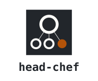
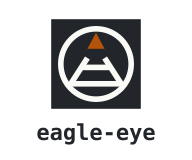
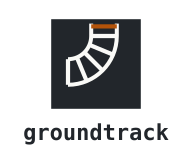
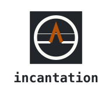

<p align="center">
  
</p>

<h1 align="center">G R I M O I R E</h1>

<p align="center"><strong>A spellbook of agent skills for AI. Cast wisely.</strong></p>

<p align="center">
  <a href="skills/contract"><picture><source media="(prefers-color-scheme: dark)" srcset="docs/brand/contract/contract-sigil-dark.svg"></picture></a>
  &nbsp;&nbsp;&nbsp;&nbsp;
  <a href="skills/head-chef"><picture><source media="(prefers-color-scheme: dark)" srcset="docs/brand/head-chef/head-chef-sigil-dark.svg"></picture></a>
  &nbsp;&nbsp;&nbsp;&nbsp;
  <a href="skills/eagle-eye"><picture><source media="(prefers-color-scheme: dark)" srcset="docs/brand/eagle-eye/eagle-eye-sigil-dark.svg"></picture></a>
  &nbsp;&nbsp;&nbsp;&nbsp;
  <a href="skills/groundtrack"><picture><source media="(prefers-color-scheme: dark)" srcset="docs/brand/groundtrack/groundtrack-sigil-dark.svg"></picture></a>
  &nbsp;&nbsp;&nbsp;&nbsp;
  <a href="plugins/incantation"><picture><source media="(prefers-color-scheme: dark)" srcset="docs/brand/incantation/incantation-sigil-dark.svg"></picture></a>
</p>

---

A **skill** is a folder of instructions your coding agent reads when the moment
calls for it — a reference book it knows when to open. Grimoire holds four.
contract helps you build a skill, an agent or a CLAUDE.md of your own.
head-chef lets one Claude Desktop session start and lead others, and comes
with a pane that shows them. eagle-eye and groundtrack do the same kind of work: they take something
you can only hold in your head and put it on a page you can look at. A plugin,
incantation, lets you talk with your session by voice.

**[See one before you install anything.][gallery]** The gallery holds every
page eagle-eye and groundtrack have drawn. Start with [a live decision grid][eagle-demo]
about whether to publish this repository. Click an option and
watch it recolour. eagle-eye wrote it, about itself.

## Install

Four skills today, more later. Works with any agent:

```bash
npx skills@latest add mephistopheles4/grimoire
```

That is [`skills`](https://github.com/vercel-labs/skills), which installs into
Claude Code, Cursor, Codex, Gemini CLI, Copilot, Windsurf, Zed, opencode, Amp
and around seventy more. It copies the whole skill directory, renderer
included.

**The Brigade pane needs grimoire installed as a Claude Code plugin.** The
command above copies skill folders only, so it gives you `head-chef` but not
`/brigade`. To get both, run:

```text
claude plugin marketplace add mephistopheles4/grimoire
claude plugin install grimoire@mephistopheles4
```

<details>
<summary><strong>Other ways to install</strong></summary>

**As a Claude Code plugin**, if you would rather the marketplace handled
updates:

```text
/plugin marketplace add mephistopheles4/grimoire
/plugin install grimoire@mephistopheles4
```

Plugin skills are namespaced, so that route invokes them as
`/grimoire:eagle-eye`, `/grimoire:groundtrack`, `/grimoire:contract` and
`/grimoire:head-chef`. The installer route keeps the plain `/eagle-eye`,
`/groundtrack`, `/contract` and `/head-chef`.

**By hand**, if you want neither installer:

```bash
git clone https://github.com/mephistopheles4/grimoire.git
cp -r grimoire/skills/eagle-eye ~/.claude/skills/
cp -r grimoire/skills/groundtrack ~/.claude/skills/
cp -r grimoire/skills/contract ~/.claude/skills/
cp -r grimoire/skills/head-chef ~/.claude/skills/
```

**Pinned to one commit**, if you want a copy that only changes when you
choose. Use the full 40-character commit SHA:

```bash
npx skills@latest add mephistopheles4/grimoire#<commit-sha>
```

No skill names a fixed path to its own scripts, so each runs from wherever it
lands. eagle-eye has been run from three directories: the author's
skills folder, the plugin install, and a copy made by `skills`.

</details>

Every route gives you all four skill directories, each with its `SKILL.md`
and the scripts that go with it. Only the plugin route also gives you the
Brigade pane. Each skill carries a README of its own, which is where it is
documented; contract, eagle-eye and head-chef also carry the `CONTRACT.md` their
`SKILL.md` is generated from. What follows is only enough to tell you which
one you want.

---

##  [contract](skills/contract)

**Agree the terms first. The prompt is build output.**

Reach for it when you want a skill, an agent or a CLAUDE.md of your own and
have never written one. contract interviews you through a template, one question
at a time, and writes your answers down as a contract. What you
build is a skill, an agent or a main agent file (a CLAUDE.md) that does one job
for you.

It then generates the file from the contract and validates it with
`claude plugin validate --strict`. When a skill or agent goes wrong, you amend
the contract and generate the file again. It never installs what it builds. Not
for a one-off prompt.

The questions, the levels and the marks:
[`skills/contract/references/template.md`](skills/contract/references/template.md).
The skill's own contract, which its `SKILL.md` is generated from:
[`skills/contract/references/CONTRACT.md`](skills/contract/references/CONTRACT.md).

##  [head-chef](skills/head-chef)

**Lead the sessions; let them do the work.**

Reach for it in Claude Desktop when you want work to run in another session,
or want to lead several at once. head-chef starts each session under the lead,
with the model and effort set, and points it to its issue, which holds the
brief. It takes the sessions' milestone reports, relays between them, and
cleans a session up on your yes in chat. It never counts a message from
another session as your yes.

A session cannot tell a forged sender from the lead, and the lead can act on
your own words in its chat: merge, close, edit or label an issue or a pull
request, file an issue, post a comment. A permission warning above the prompt
says so before its first launch in a lead. Read the skill's README before you
install. Not for work in the same session.

`/brigade` opens the Brigade pane, which comes with the plugin: one row per
session, the pull requests, and the decisions the lead took, with a slider
for how far it may go on its own.

What it does, what counts as your yes, and what cleanup names back:
[`skills/head-chef/README.md`](skills/head-chef). The pane's views, the
autonomy levels, the usage files and their known limits:
[`docs/brigade-pane.md`](docs/brigade-pane.md).

##  [eagle-eye](skills/eagle-eye)

**A decision is made once it has been seen against the whole system.**

Reach for it when three or more decisions are open and one choice changes what
is possible in another: picking the cheap database changes what the deployment
can be, which changes who can be on call. Asked one at a time, those questions
hide the thing you need to see.

eagle-eye draws a **morphological box** instead — one row per decision, one
cell per option, an edge wherever two options rule each other out or require
each other — then renders a page that reads any configuration back. Not for two
independent choices.

**Live: [the decision to publish this repository][eagle-demo].**

The seven findings, why every edge carries an evidence tier, and the renderer's
flags: [`skills/eagle-eye/README.md`](skills/eagle-eye).

##  [groundtrack](skills/groundtrack)

**A reader who did not write a change cannot see its shape.**

Reach for it when a plan is made or the work is done and someone else has to
understand it. A change arrives as a list of files. A plan arrives as a list of
tickets. Neither says what calls what, what each part hands back, where it can
break, or what it needs in order to work.

groundtrack writes one call graph with recorded traces through it, renders a
self-contained page you can step a cursor across, and prints the same graph as
an indented tree on request. Not for a conversation, because nothing durable
exists to check the graph against.

**Live: [a pull request, stepped through][track-demo].** For a complex sheet,
see [a larger pull request with 88 nodes][track-complex].
Every published page is in [the gallery][gallery].

The three channels, what a layer redraws, the page's controls, and the honesty
property's stated limit:
[`skills/groundtrack/README.md`](skills/groundtrack).

---

The marks, the cards and the tokens behind them are in
[`docs/brand/`](docs/brand).

<details>
<summary><strong>How the repository is put together</strong></summary>

The repository **is** the plugin. `.claude-plugin/plugin.json` names it
`grimoire`; `.claude-plugin/marketplace.json` is the shelf that lists it with
`"source": "./"`. Skills sit at `skills/<name>/`, which is the one level the
default scan reads and the layout the `skills` installer finds first.

The two manifests carry different names on purpose: the shelf is
`mephistopheles4`, the book is `grimoire`. The version lives in `plugin.json`
and nowhere else, because a second copy is a second place to forget.

This shape follows [mattpocock/skills](https://github.com/mattpocock/skills),
which ships a marketplace manifest and a plugin manifest side by side at the
root. The Claude Code docs describe each separately and never that pairing, so
the evidence it works is a repository that does it, plus
`claude plugin validate .` passing here.

</details>

##  [incantation](plugins/incantation)

**A familiar at your shoulder. Think out loud together.**

Reach for it when you would rather talk a problem through than type it: pair
with your session while your hands are on something else, and let it speak up
only when something needs you.

You talk with your session. It says a change back before it makes one and acts
on your yes. Voicebox, on your own machine, does the speaking and the
transcribing.

Setup and details: [`plugins/incantation/README.md`](plugins/incantation).

## Where it works, and what it runs

On claude.ai chat and in Cowork, only the four skills load. Brigade is a mod,
so it runs only in Claude Code: the terminal, the Desktop app's Code tab and
the VS Code extension. head-chef needs Claude Code in the Desktop app, git and
a signed-in `gh`.

Everything the plugin runs, sends or writes beyond reading and writing the
files you ask for:

- **eagle-eye's optional audit** (`audit.mjs`) sends the box's text to
  TypeSafe, or to OpenRouter, which passes it on to TypeSafe. It runs only
  when you set `TYPESAFE_API_KEY` or `OPENROUTER_API_KEY`, and the skill does
  a dry run and asks for your yes in chat first. `EAGLE_EYE_AUDIT_ENDPOINT`
  points it at another endpoint. Each request is charged to your key.
- **eagle-eye, groundtrack and contract** write their pages as local files.
  eagle-eye may open its page with your system's browser command, and keeps a
  usage log only after you say yes. contract's page keeps your answers in the
  browser's storage until you press Reset.
- **Brigade**, while its pane is open, runs `gh pr list` once a minute for the
  pull requests its rows carry (and `gh pr view <number> --web`, or `gh issue view <number> --web`, when you press a
  pull request pill or a to-do's link; a to-do's link to a comment or review on an issue
  or pull request is opened by the app or terminal itself, with no `gh` run), and once a minute for each other repository a
  row names, at most 6 runs a minute, the repositories taking turns past five,
  which uses your GitHub sign-in. Since 0.144.0 a quick-action button on
  Desktop reads your prompt box once, only to see whether it is blank, and then
  fills it with one checked line; it keeps neither the draft nor the engine's
  answer, and never submits. It reads Claude Code's own session files and
  the transcripts of the sessions the lead started. It writes a roster file and
  a usage summary file in the plugin's data folder; the summary file is written
  in every session, pane open or not. The roster file, unencrypted, holds each
  row's other repository by owner/name and each to-do's link, private ones included.
  Since 0.81.0 it also writes each lead's decision log, one entry per
  decision the lead logs, and a marks file of the Read, Flag, Unflag,
  Dismiss and, since 0.89.0, Mark all as read presses, and from 0.90.0 to 0.94.0 Mark these N read and from 0.91.0 to 0.94.0 Mark N relayed read presses, you make in its Decisions tab, both in plain text in the same folder, never removed by the
  mod, and since 0.83.0 each lead's hand-off, its working state, beside them.
  Since 0.84.0 the log also holds each move of the autonomy slider, each reset
  and, until 0.116.0, each alarm, with its time (not an alarm that repeated
  while an earlier one was unread, which the pane counted instead). The level is held in the mod's
  memory; a copy sits in the lead session's plugin state, with that session's id, which other plugins
  can read, never in a file; each answer of
  `read_autonomy`, `log_decision` and `set_lead_handoff` names it in the
  lead's transcript, and `read_autonomy`'s names a 3's press time, where they
  stay after the files go.
  Since head-chef 0.17.0 the hand-off's rules section holds a level-3 goal,
  naming work by repository and issue, and the log holds a waiting entry for
  each cleanup a level-3 lead leaves waiting under your user-level instructions file, by repository and session title only.
  Since 0.118.0 (issue 516) cleanup is your yes in chat, and the mod keeps no
  window, binding or cleaner of its own
  ([ADR 0016](docs/adr/0016-cleanup-is-the-owners-yes-in-chat.md)). At levels
  1 and 2, a message that names each session by its title and says to clean it
  up is the yes: the lead archives or stops those sessions at once and lists
  what it touched. Anything vaguer gets a list first, with each session's
  title and kind, folder and branch, and the cleaner your instructions name,
  and waits for your yes. At level 3 your user-level instructions file decides.
  The lead archives each Desktop session, or stops a background one with the
  mod's `stop_background_session`, which reads the session files at each call
  and stops only the session whose job id and name match the card. It runs a
  cleaner only if your own instructions state its program and how to run it,
  from its own shell and under the permission mode in force (a prompt in the default mode; in auto or bypass mode, or under an allow rule, it states the command in chat first); with none named
  it removes nothing and says what stays. **Naming a cleaner:** write its
  program and how to run it in your user-level instructions. What it keeps
  depends on how your instructions have it run, and whether a removal can be
  undone is the cleaner's own promise; Brigade no longer passes or checks
  anything. A cleaner path you set with 0.117.0's command is no longer read; it stays in the plugin's store, where other plugins can read it, until you remove the plugin's data.
  The cleaner's answer, folder and file names included, lands in the lead's
  conversation and transcript. A lead started, or a skill copied, before this
  update may still tell you to type a command: it now only opens the pane, so
  say the yes in chat. If an archive is refused with a message that names a
  window you open, the mod is older than 0.118.0: update it, or archive by
  hand. To undo a wrong card, recreate its worktree at
  `.claude/worktrees/<name>` with `git worktree add` from its remote branch or,
  if the cleaner printed one, the tip it printed, then unarchive the Desktop
  session or `claude attach` the stopped one. A stopped background session
  stays until you run `claude rm <id>` yourself, after its worktree has gone or
  you have saved what it holds: `claude rm` deletes the worktree with whatever
  is left in it.
  The files are named by session id, and the log and the hand-off hold a plain
  SHA-256 digest of the working folder's transcript-folder name, never the
  name, which links one working folder's sessions;
  while the pane is open it reads this session's decision log and marks file
  and, for the Lead hand-off card, this session's hand-off and the 20 newest
  others' ([ADR 0010](docs/adr/0010-the-mod-keeps-decision-text-in-plain-files.md)).
  Open in app asks the Desktop app to show a session, or opens a `claude://`
  link with your system's opener.
- **Ten calls skip the permission prompt:** the `set_roster` tool, which
  writes the roster file, the
  `log_decision` tool, which appends to the
  decision log, the `set_lead_handoff` and `read_lead_handoff` tools, which
  write and read the lead's hand-off, the `read_autonomy` tool, which reads
  the lead's autonomy level, the
  `start_background_session` tool (since 0.140.0), which starts one background
  session with a fixed command in a main checkout of the repository, the
  `stop_background_session` tool, which runs `claude stop` for a background
  session your words in the lead's chat named, the `read_context` tool, which reads each
  card's context figure from the meters the pane's last poll kept, the
  `show_permission_warning` tool, which shows a reminder,
  and Open in app's call to the Desktop app's
  `mcp__ccd_window__open_session_in`. A deny rule for each name stops it.

What each of Brigade's hooks does with what it sees:

| Hook | What it does |
| --- | --- |
| `session.start`, `classic.SessionStart` | Registers `/brigade`, notes the session's id and transcript path to find the plugin's data folder, and offers `show_permission_warning`, and `set_roster`, `log_decision`, `set_lead_handoff`, `read_lead_handoff`, `read_autonomy`, `start_background_session`, `stop_background_session` and `read_context` while the pane is open, again after a reload, a clear or a resume. Since 0.148.0 its `session.start` hook (not `classic.SessionStart`) also deletes an old `startFolders` key, only when one is present. A session start or reload that finds an autonomy level above 1 sets it back to 1 and logs it, pane open or not, and since 0.88.0 so does a start after a compaction; a clear or a resume forgets any other session's level. It changes nothing in the event and passes it on. |
| `session.compact` | Since 0.88.0, after a compaction of the lead's own conversation that went ahead, sets an autonomy level above 1 back to 1 and logs it. It reads only who is compacting, the compaction's trigger (a `precompute`, which the engine runs ahead of time and installs nothing, resets nothing) and whether it was skipped, never the conversation, the instructions or the summary, and returns the compaction unchanged. |
| `command.run` for `/brigade` | Opens the pane. It answers only `/brigade`. Since 0.99.0, `/brigade level 1`, `level 2` and `level 3 <goal>` set the autonomy level instead, only when you typed the command or sent it from your phone. Since 0.118.0, `/brigade done` and `/brigade cleaner` are gone and open the pane like any other arguments. Since 0.148.0, `/brigade folders` is gone, as are the list it kept and its `startFolders` key, and it opens the pane like any other arguments. To upgrade, open `claude` once in each main checkout and accept the trust prompt: the start tool relies on the harness's folder trust. |
| `skill.prompt` | Opens the pane when the head-chef skill loads from grimoire or your own skills folder, or finds it open, and adds one line to that skill's text saying whether `set_roster` is ready, or why not. Every other skill load passes on unchanged. |
| `tool.call` for `Skill`, and `command.run` for `/head-chef` and `/grimoire:head-chef` | Watch a head-chef load for the case where `skill.prompt` never reached the plugin (see below). Each reads the skill's or command's name and the load's answer, and returns that answer unchanged; where `skill.prompt` was skipped, a typed load also reads the session's local skill list once. Any other skill, and a subagent's load, passes on with no other work. |
| `tool.call` for `set_roster`, `log_decision`, `set_lead_handoff`, `read_lead_handoff`, `read_autonomy`, `start_background_session`, `stop_background_session`, `read_context` and `show_permission_warning` | Answers for the mod's own nine tools, which have no other code behind them. |
| `turn.start` | Only after a head-chef load whose pane was open but not shown, not yet listed, or opened without its reads: looks at the pane once a turn, and once it is shown and listed, starts the pane's reads, offers `set_roster` if it was not offered yet, and adds one note saying it is ready. At a level 3, and once after it ends, it also adds one fixed level-3 note. Otherwise, and on a subagent's turn, it passes on with no other work. It reads no text of the prompt. |
| `turn.step`, `turn.complete` | Counts each model call's token numbers for the usage summary file. It reads no text of the conversation and passes every step on unchanged. |
| `session.measure`, `session.receive` | While the pane is open, refreshes the usage numbers and keeps the first line of each report another session sends. |
| `ui.render`, `ui.press`, `ui.input`, `ui.close` | Draws the pane, the warning band and, since 0.88.0, the autonomy level's line above the warning, handles their buttons, and takes the Decisions tab's search text, which it keeps only to filter the tab, in plugin state, which other plugins can read until the pane next opens. |

Claude Code's bundled security default, on a machine with managed settings or
a Team or Enterprise account, keeps the plugins you install from seeing
`skill.prompt` and `classic.SessionStart`. What Brigade does with and without
it:

| | Without the security default | With it |
| --- | --- | --- |
| A typed `/head-chef` | `skill.prompt` opens the pane, with one line in the skill's text | after the load, the pane opens if the session's local skill list shows the loaded copy is grimoire's or yours and no other copy of that name is listed, with one note; otherwise a note asks for `/brigade` |
| The model loading head-chef itself | the same as typed | no pane: one note asks for `/brigade` |
| A pane opened but not shown, or not yet listed | its reads, and `set_roster` with one note if it was not offered yet, start at the first turn that finds it shown and listed | the same |
| A refused or failed load | nothing | nothing |
| `/brigade` | as before | as before |
| The session id, `set_roster` after a resume, `show_permission_warning` | as before | from `session.start` and the id read live |
| The transcript path | from `classic.SessionStart` | not known: the data folder comes from where the plugin is installed, and the pane says when it cannot find it |

What the pane draws, decision text included, reaches the Desktop and mobile
apps through Claude Code's own channel. Beyond that, nothing the mod reads
leaves the machine except the `gh` requests above and Open in app's
two routes: the call to the Desktop app carries the
session's id and the fixed target `split`, and the fallback hands a checked
`claude://` link to your system's opener.

The threat model,
[`docs/security/threat-model.md`](docs/security/threat-model.md), has the
detail and the accepted risks.

## Contributing

[`CONTRIBUTING.md`](CONTRIBUTING.md). The contract is one command:

```bash
node scripts/check.mjs
```

Security problems go through private reporting, not a public issue:
[`SECURITY.md`](SECURITY.md).

## Licence

[MIT](LICENSE). © 2026 Ayman Diab.

[eagle-demo]: https://mephistopheles4.github.io/grimoire/docs-decisions-publish-eagle-eye.html
[track-demo]: https://mephistopheles4.github.io/grimoire/skills-groundtrack-examples-pr-313.html
[track-complex]: https://mephistopheles4.github.io/grimoire/docs-examples-realtime-shadows.html
[gallery]: https://mephistopheles4.github.io/grimoire/
