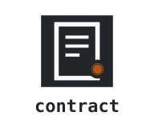
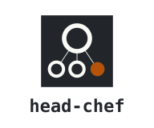
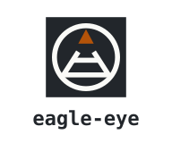
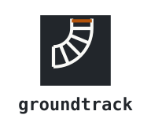

<p align="center">
  
</p>

<h1 align="center">G R I M O I R E</h1>

<p align="center"><strong>A spellbook of agent skills for AI. Cast wisely.</strong></p>

<p align="center">
  <a href="skills/contract"><picture><source media="(prefers-color-scheme: dark)" srcset="docs/brand/contract/contract-sigil-dark.svg"></picture></a>
  &nbsp;&nbsp;&nbsp;&nbsp;
  <a href="skills/head-chef"><picture><source media="(prefers-color-scheme: dark)" srcset="docs/brand/head-chef/head-chef-sigil-dark.svg"></picture></a>
  &nbsp;&nbsp;&nbsp;&nbsp;
  <a href="skills/eagle-eye"><picture><source media="(prefers-color-scheme: dark)" srcset="docs/brand/eagle-eye/eagle-eye-sigil-dark.svg"></picture></a>
  &nbsp;&nbsp;&nbsp;&nbsp;
  <a href="skills/groundtrack"><picture><source media="(prefers-color-scheme: dark)" srcset="docs/brand/groundtrack/groundtrack-sigil-dark.svg"></picture></a>
</p>

---

A **skill** is a folder of instructions your coding agent reads when the moment
calls for it — a reference book it knows when to open. Grimoire holds four.
contract helps you build a skill, an agent or a CLAUDE.md of your own.
head-chef lets one Claude Desktop session start and lead others, and comes
with a pane that shows them. eagle-eye and groundtrack do the same kind of work: they take something
you can only hold in your head and put it on a page you can look at.

**[See one before you install anything.][gallery]** The gallery holds every
page eagle-eye and groundtrack have drawn. Start with [a live decision grid][eagle-demo]
about whether to publish this repository. Click an option and
watch it recolour. eagle-eye wrote it, about itself.

## Install

Four skills today, more later. Works with any agent:

```bash
npx skills@latest add mephistopheles4/grimoire
```

That is [`skills`](https://github.com/vercel-labs/skills), which installs into
Claude Code, Cursor, Codex, Gemini CLI, Copilot, Windsurf, Zed, opencode, Amp
and around seventy more. It copies the whole skill directory, renderer
included.

**The Brigade pane needs grimoire installed as a Claude Code plugin.** The
command above copies skill folders only, so it gives you `head-chef` but not
`/brigade`. To get both, run:

```text
claude plugin marketplace add mephistopheles4/grimoire
claude plugin install grimoire@mephistopheles4
```

<details>
<summary><strong>Other ways to install</strong></summary>

**As a Claude Code plugin**, if you would rather the marketplace handled
updates:

```text
/plugin marketplace add mephistopheles4/grimoire
/plugin install grimoire@mephistopheles4
```

Plugin skills are namespaced, so that route invokes them as
`/grimoire:eagle-eye`, `/grimoire:groundtrack`, `/grimoire:contract` and
`/grimoire:head-chef`. The installer route keeps the plain `/eagle-eye`,
`/groundtrack`, `/contract` and `/head-chef`.

**By hand**, if you want neither installer:

```bash
git clone https://github.com/mephistopheles4/grimoire.git
cp -r grimoire/skills/eagle-eye ~/.claude/skills/
cp -r grimoire/skills/groundtrack ~/.claude/skills/
cp -r grimoire/skills/contract ~/.claude/skills/
cp -r grimoire/skills/head-chef ~/.claude/skills/
```

**Pinned to one commit**, if you want a copy that only changes when you
choose. Use the full 40-character commit SHA:

```bash
npx skills@latest add mephistopheles4/grimoire#<commit-sha>
```

No skill names a fixed path to its own scripts, so each runs from wherever it
lands. eagle-eye has been run from three directories: the author's
skills folder, the plugin install, and a copy made by `skills`.

</details>

Every route gives you all four skill directories, each with its `SKILL.md`
and the scripts that go with it. Only the plugin route also gives you the
Brigade pane. Each skill carries a README of its own, which is where it is
documented; contract, eagle-eye and head-chef also carry the `CONTRACT.md` their
`SKILL.md` is generated from. What follows is only enough to tell you which
one you want.

---

##  [contract](skills/contract)

**Agree the terms first. The prompt is build output.**

Reach for it when you want a skill, an agent or a CLAUDE.md of your own and
have never written one. contract interviews you through a template, one question
at a time, and writes your answers down as a contract. What you
build is a skill, an agent or a main agent file (a CLAUDE.md) that does one job
for you.

It then generates the file from the contract and validates it with
`claude plugin validate --strict`. When a skill or agent goes wrong, you amend
the contract and generate the file again. It never installs what it builds. Not
for a one-off prompt.

The questions, the levels and the marks:
[`skills/contract/references/template.md`](skills/contract/references/template.md).
The skill's own contract, which its `SKILL.md` is generated from:
[`skills/contract/references/CONTRACT.md`](skills/contract/references/CONTRACT.md).

##  [head-chef](skills/head-chef)

**Lead the sessions; let them do the work.**

Reach for it in Claude Desktop when you want work to run in another session,
or want to lead several at once. head-chef starts each session as a Desktop
session under the lead, one you can talk to directly, with the model and
effort set. Its start prompt points the session to its issue, which holds the
brief. It takes the session's milestone reports, relays between sessions, and
cleans a session up when you say it is done, after one name-back and one yes.
It takes the when and the why from your own process, and it never counts a
message from another session as your yes to start, archive or delete. On your
own words in its chat, it can also merge, close, edit, delete or label an
issue or a pull request, file an issue, or post a comment. The sessions it starts take a
message from the lead as a relayed decision, labelled so; a session cannot
tell a forged sender from the lead. Before its first launch in a lead, a
permission warning above the prompt says so. Read the skill's README before
you install. Not for work in the same session.

`/brigade` opens the Brigade pane, and so does loading the head-chef skill from the plugin or from your own skills folder: one compact row per session the lead
started. A switch at the top shows Sessions, Pull requests or Decisions, and
the pane opens on Sessions each time. Sessions keeps three foldable groups: Waiting
on you, Working, and Done · stopped, which starts folded and counts the reports
its sessions sent since you opened the pane. A row shows a checkbox, a status
dot, the title, the phase, the latest report's first line, the live busy or idle
state (a session that waits on you moves its row under Waiting on you, and a row
shows the session's own title) and how long the session has been in its status and phase. Model and
effort show as one character each, with the full settings in a tooltip. Open and
Dismiss appear when you point at a row; in the terminal they are always shown.
Tick several rows and a bar at the foot dismisses them together. A session that
waits on you has no Dismiss and is never hidden. Reopening the pane brings
dismissed rows back. The pane's section bars, hover and selection bar are drawn
for Desktop's dark theme, so in a light theme they look darker than the rest of
the app.

The lead can put each session's pull request on its row. A pill shows the
number in the state's colour. The Pull requests view lists those pull requests
grouped Open, Merged and Closed, with title, added and removed lines, repository
and age. While the pane is open and a row carries a pull request, the pane asks
`gh` for the details once a minute, and stops once every pull request it shows is merged. When
a session's pull request is in another repository than the lead's own, the lead
can name it on the row (`repo`, as `owner/name`): the pane then asks `gh` about
that repository too, at most 6 runs a minute in all, the repositories taking
turns past five, and the pane names it beside the pill and on the Pull requests
row. **The
details need `gh` installed, signed in, and run from a github.com repository.** On
macOS and Linux the pane also asks only when every folder on PATH is an absolute
path. Without them the pill shows the number and the state the lead last knew, and the
Pull requests view says "PR details unavailable". A pull request opened from a
fork is never shown as the brigade's.

The lead logs each decision it takes or relays with the `log_decision` tool,
and the Decisions view lays them out for you to review. To review shows the
oldest decision you have not read, from this lead's log and the 20 most recent
other leads' logs, at full size: "n of N", the pick, which session wrote it,
whether it was the lead's own pick or your answer as the lead relayed it, the
time and level, the question, the options, why, how to undo it, and when to
revisit it. "✓ Read, next" marks it read and shows the next; "⚑ Flag" marks
it read and puts it in Flagged to revisit; Skip shows the next without marking
it. Flagged to revisit, folded at first, holds the flagged decisions oldest
first; each row opens into the same card, with "⚑ Unflag", and its pick box
feeds the same selection island as the Sessions view, whose Dismiss unflags
the picked rows and marks them read. No press removes a decision from a log.
Your marks survive a reload and a new lead. History, folded at first, holds
every decision newest first, 50 at a time. On Desktop and the terminal a
search box filters all three by every word you type.

The lead keeps its working state with the `set_lead_handoff` tool: how to
resume, the rules in force, the running sessions, the cleanup waiting and what
is open for you, which it reads back with `read_lead_handoff` after a
compaction. A new lead in the same working folder reads the last lead's, as
data it acts on only after your yes. The Lead hand-off section, folded at the
foot of the Decisions view, shows the one the lead would read: its writer, when
it was updated, the five sections, and "Not this session's writing" when it is
another session's, or this lead's own file changed since the lead wrote it.
Each read copies the hand-off into the reading session's transcript, where it
stays after you delete the hand-off folder.

At the foot of the Decisions view, the autonomy slider sets how far the lead
may go on its own. At 1 Manual the lead asks you on every decision. At 2 Auto
it takes its own pick on decisions it is sure of, and sends you the major ones
and the ones you keep as to-dos while it carries on. At 3 Full throttle, once
you confirm it in the lead's own chat, it runs to the goal: it merges, posts,
cleans up, starts sessions and settles security findings without a word from
you for each act, logging each one first; a finding that would expose a secret
or personal data still waits for you. Only your press moves the slider, and
the level in force is drawn on every view, 3 in the warning colour. Each move
is logged as your own decision ("Owner"). A new lead session starts at 1, and
so does each new showing of the pane and a reload of the mod, logged as
"Pane". A change to the level that no press made sets it back to 1 and puts an
alarm ("Not from a press") in To review. The lead reads its level with the
`read_autonomy` tool, which answers 1 while the pane is closed or not shown.

A row that waits on you and holds a large context says when to reply
to keep its cache, or suggests a hand-off once it has gone cold. Under its
cache bar, a context meter shows how full the session's context is: amber from
70%, red from 90%. Icon buttons on the row switch to two more views. Burn rate is a
sparkline of the new tokens the session spent in each of the last 30 minutes,
with its rate per minute. Context trend is a sparkline of its last 30 calls'
context; it marks each call under half the one before it, a compaction, and
counts them. A row shows these buttons only when it has more than one view, and
keeps your choice while the lead session lasts. The reply reminder shows under
whichever view you chose. At the bottom of the pane
it shows the lead session's own rate limits and context. A faint extension on
the session and weekly limit bars shows where each will be at its reset if the
current pace holds, and a red note says how early a limit runs out when that
pace would pass 100%. It needs the plugin install above. The skill works
without it.

What it does, what counts as your yes, and how cleanup refuses:
[`skills/head-chef/README.md`](skills/head-chef). The skill's contract, which
its `SKILL.md` is generated from:
[`skills/head-chef/references/CONTRACT.md`](skills/head-chef/references/CONTRACT.md).

Since 0.60.0 every session with the plugin writes its own usage numbers to a
small summary file. Since 0.61.0 the pane draws a member's card from that file
whenever it passes its checks, so a member whose transcript is too large to
read keeps its cache line, context meter and views. A card that reads "summary
path refused" or "not a summary file" is drawn from its transcript instead:
the member's file failed the path check, or the same file failed its checks
two polls running. SECURITY.md says where the files are.
Since 0.62.0 a member keeps the Remote Control link the pane read while its
transcript was 4 MiB or less, once the transcript grows past that and after a
plugin reload. **Known limits:** a member first seen with a transcript already
over 4 MiB, or one that turned Remote Control on after it passed 4 MiB, shows
no link; and after a reload, a card whose name moved to another large session
can show the old session's link. If you notice a missing link, a read of just
the start of a large transcript, through a process, is the next step (issue
#308).
[`SECURITY.md`](SECURITY.md) says what the file holds and who can read it.
**Known limit:** a card the pane draws from that file counts its cache down from 1 hour after the last call, because the engine's
per-call usage does not say whether a call cached for 5 minutes or for 1 hour.
A session whose main conversation is not on the 1-hour cache can then show
warm for up to 55 minutes after its cache went cold, and its "reply within N
min" reminder comes up to 55 minutes late. This holds at every transcript
size, including members whose transcript the pane could read and whose window
it showed correctly before. Examples: a session in usage overage; a session on
an API key, or on Bedrock, Vertex or Foundry, without the 1-hour opt-in; a
session through the Claude apps gateway, or a gateway that drops the 1-hour
header; and a session where a setting or environment variable chooses 5
minutes.

##  [eagle-eye](skills/eagle-eye)

**A decision is made once it has been seen against the whole system.**

Reach for it when three or more decisions are open and one choice changes what
is possible in another: picking the cheap database changes what the deployment
can be, which changes who can be on call. Asked one at a time, those questions
hide the thing you need to see.

eagle-eye draws a **morphological box** instead — one row per decision, one
cell per option, an edge wherever two options rule each other out or require
each other — then renders a page that reads any configuration back. Not for two
independent choices.

**Live: [the decision to publish this repository][eagle-demo].**

The seven findings, why every edge carries an evidence tier, and the renderer's
flags: [`skills/eagle-eye/README.md`](skills/eagle-eye).

##  [groundtrack](skills/groundtrack)

**A reader who did not write a change cannot see its shape.**

Reach for it when a plan is made or the work is done and someone else has to
understand it. A change arrives as a list of files. A plan arrives as a list of
tickets. Neither says what calls what, what each part hands back, where it can
break, or what it needs in order to work.

groundtrack writes one call graph with recorded traces through it, renders a
self-contained page you can step a cursor across, and prints the same graph as
an indented tree on request. Not for a conversation, because nothing durable
exists to check the graph against.

**Live: [a pull request, stepped through][track-demo].** For a complex sheet,
see [a larger pull request with 88 nodes][track-complex].
Every published page is in [the gallery][gallery].

The three channels, what a layer redraws, the page's controls, and the honesty
property's stated limit:
[`skills/groundtrack/README.md`](skills/groundtrack).

---

The marks, the cards and the tokens behind them are in
[`docs/brand/`](docs/brand).

<details>
<summary><strong>How the repository is put together</strong></summary>

The repository **is** the plugin. `.claude-plugin/plugin.json` names it
`grimoire`; `.claude-plugin/marketplace.json` is the shelf that lists it with
`"source": "./"`. Skills sit at `skills/<name>/`, which is the one level the
default scan reads and the layout the `skills` installer finds first.

The two manifests carry different names on purpose: the shelf is
`mephistopheles4`, the book is `grimoire`. The version lives in `plugin.json`
and nowhere else, because a second copy is a second place to forget.

This shape follows [mattpocock/skills](https://github.com/mattpocock/skills),
which ships a marketplace manifest and a plugin manifest side by side at the
root. The Claude Code docs describe each separately and never that pairing, so
the evidence it works is a repository that does it, plus
`claude plugin validate .` passing here.

</details>

## Where it works, and what it runs

On claude.ai chat and in Cowork, only the four skills load. Brigade is a mod,
so it runs only in Claude Code: the terminal, the Desktop app's Code tab and
the VS Code extension. head-chef needs Claude Code in the Desktop app, git and
a signed-in `gh`.

Everything the plugin runs, sends or writes beyond reading and writing the
files you ask for:

- **eagle-eye's optional audit** (`audit.mjs`) sends the box's text to
  TypeSafe, or to OpenRouter, which passes it on to TypeSafe. It runs only
  when you set `TYPESAFE_API_KEY` or `OPENROUTER_API_KEY`, and the skill does
  a dry run and asks for your yes in chat first. `EAGLE_EYE_AUDIT_ENDPOINT`
  points it at another endpoint. Each request is charged to your key.
- **eagle-eye, groundtrack and contract** write their pages as local files.
  eagle-eye may open its page with your system's browser command, and keeps a
  usage log only after you say yes. contract's page keeps your answers in the
  browser's storage until you press Reset.
- **Brigade**, while its pane is open, runs `gh pr list` once a minute for the
  pull requests its rows carry, and once a minute for each other repository a
  row names, at most 6 runs a minute, the repositories taking turns past five,
  which uses your GitHub sign-in. It reads Claude Code's own session files and
  the transcripts of the sessions the lead started. It writes a roster file and
  a usage summary file in the plugin's data folder; the summary file is written
  in every session, pane open or not. The roster file, unencrypted, holds each
  row's other repository by owner/name, private ones included.
  Since 0.81.0 it also writes each lead's decision log, one entry per
  decision the lead logs, and a marks file of the Read, Flag, Unflag and
  Dismiss presses you make in its Decisions tab, both in plain text in the same folder, never removed by the
  mod, and since 0.83.0 each lead's hand-off, its working state, beside them.
  Since 0.84.0 the log also holds each move of the autonomy slider, each reset
  and each alarm, with its time. The level the mod reads is kept only in the
  lead session's plugin state, with that session's id, which other plugins
  can read, never in a file; each answer of
  `read_autonomy`, `log_decision` and `set_lead_handoff` names it in the
  lead's transcript, and `read_autonomy`'s names a 3's press time, where they
  stay after the files go.
  The files are named by session id, and the log and the hand-off hold a plain
  SHA-256 digest of the working folder's transcript-folder name, never the
  name, which links one working folder's sessions;
  while the pane is open it reads this session's files and the 20 newest
  other sessions' ([ADR 0010](docs/adr/0010-the-mod-keeps-decision-text-in-plain-files.md)).
  Open in app asks the Desktop app to show a session, or opens a `claude://`
  link with your system's opener.
- **Seven calls skip the permission prompt:** the `set_roster` tool, which
  writes the roster file, the `log_decision` tool, which appends to the
  decision log, the `set_lead_handoff` and `read_lead_handoff` tools, which
  write and read the lead's hand-off, the `read_autonomy` tool, which reads
  the lead's autonomy level, the `show_permission_warning` tool,
  which shows a reminder,
  and Open in app's call to the Desktop app's
  `mcp__ccd_window__open_session_in`. A deny rule for each name stops it.

What each of Brigade's hooks does with what it sees:

| Hook | What it does |
| --- | --- |
| `session.start`, `classic.SessionStart` | Registers `/brigade`, notes the session's id and transcript path to find the plugin's data folder, and offers `show_permission_warning`, and `set_roster`, `log_decision`, `set_lead_handoff`, `read_lead_handoff` and `read_autonomy` while the pane is open, again after a reload, a clear or a resume. A session start or reload that finds an autonomy level above 1 sets it back to 1 and logs it, pane open or not; a clear or a resume forgets any other session's level. It changes nothing in the event and passes it on. |
| `command.run` for `/brigade` | Opens the pane. It answers only `/brigade`. Since 0.84.0, opening a pane that was not shown sets an autonomy level above 1 back to 1 and logs it. |
| `skill.prompt` | Opens the pane when the head-chef skill loads from grimoire or your own skills folder, or finds it open, and adds one line to that skill's text saying whether `set_roster` is ready, or why not. Since 0.84.0, a load that opens a pane that was not shown sets an autonomy level above 1 back to 1 and logs it. Every other skill load passes on unchanged. |
| `tool.call` for `Skill`, and `command.run` for `/head-chef` and `/grimoire:head-chef` | Watch a head-chef load for the case where `skill.prompt` never reached the plugin (see below). Each reads the skill's or command's name and the load's answer, and returns that answer unchanged; where `skill.prompt` was skipped, a typed load also reads the session's local skill list once. Any other skill, and a subagent's load, passes on with no other work. |
| `tool.call` for `set_roster`, `log_decision`, `set_lead_handoff`, `read_lead_handoff`, `read_autonomy` and `show_permission_warning` | Answers for the mod's own six tools, which have no other code behind them. |
| `turn.start` | Only after a head-chef load whose pane was open but not shown, not yet listed, or opened without its reads: looks at the pane once a turn, and once it is shown and listed, starts the pane's reads, offers `set_roster` if it was not offered yet, and adds one note saying it is ready. Since 0.84.0, the turn that finds a pane the load found not shown now shown sets an autonomy level above 1 back to 1 and logs it, once. Otherwise, and on a subagent's turn, it passes on with no other work. It reads no text of the prompt. |
| `turn.step`, `turn.complete` | Counts each model call's token numbers for the usage summary file. It reads no text of the conversation and passes every step on unchanged. |
| `session.measure`, `session.receive` | While the pane is open, refreshes the usage numbers and keeps the first line of each report another session sends. |
| `ui.render`, `ui.press`, `ui.input`, `ui.close` | Draws the pane and the warning band, handles their buttons, and takes the Decisions tab's search text, which it keeps only to filter the tab, in plugin state, which other plugins can read until the pane next opens. |

Claude Code's bundled security default, on a machine with managed settings or
a Team or Enterprise account, keeps the plugins you install from seeing
`skill.prompt` and `classic.SessionStart`. What Brigade does with and without
it:

| | Without the security default | With it |
| --- | --- | --- |
| A typed `/head-chef` | `skill.prompt` opens the pane, with one line in the skill's text | after the load, the pane opens if the session's local skill list shows the loaded copy is grimoire's or yours and no other copy of that name is listed, with one note; otherwise a note asks for `/brigade` |
| The model loading head-chef itself | the same as typed | no pane: one note asks for `/brigade` |
| A pane opened but not shown, or not yet listed | its reads, and `set_roster` with one note if it was not offered yet, start at the first turn that finds it shown and listed | the same |
| A refused or failed load | nothing | nothing |
| `/brigade` | as before | as before |
| The session id, `set_roster` after a resume, `show_permission_warning` | as before | from `session.start` and the id read live |
| The transcript path | from `classic.SessionStart` | not known: the data folder comes from where the plugin is installed, and the pane says when it cannot find it |

What the pane draws, decision text included, reaches the Desktop and mobile
apps through Claude Code's own channel. Beyond that, nothing the mod reads
leaves the machine except the `gh pr list` request above and Open in app's
two routes: the call to the Desktop app carries the
session's id and the fixed target `split`, and the fallback hands a checked
`claude://` link to your system's opener.

The threat model,
[`docs/security/threat-model.md`](docs/security/threat-model.md), has the
detail and the accepted risks.

## Contributing

[`CONTRIBUTING.md`](CONTRIBUTING.md). The contract is one command:

```bash
node scripts/check.mjs
```

Security problems go through private reporting, not a public issue:
[`SECURITY.md`](SECURITY.md).

## Licence

[MIT](LICENSE). © 2026 Ayman Diab.

[eagle-demo]: https://mephistopheles4.github.io/grimoire/docs-decisions-publish-eagle-eye.html
[track-demo]: https://mephistopheles4.github.io/grimoire/skills-groundtrack-examples-pr-313.html
[track-complex]: https://mephistopheles4.github.io/grimoire/docs-examples-realtime-shadows.html
[gallery]: https://mephistopheles4.github.io/grimoire/
