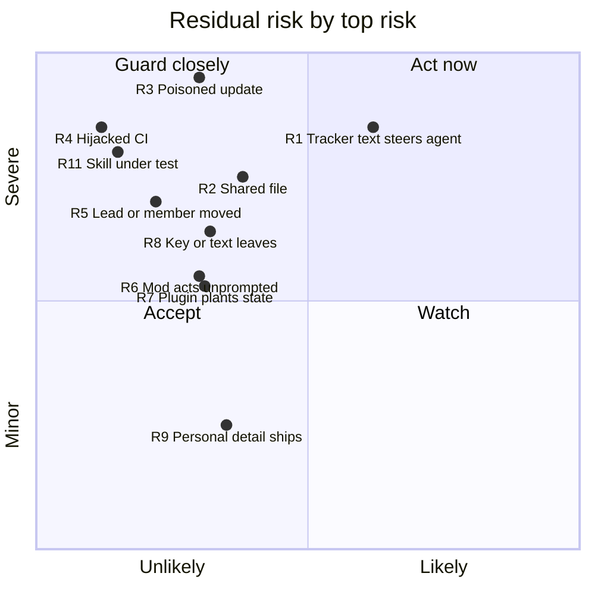
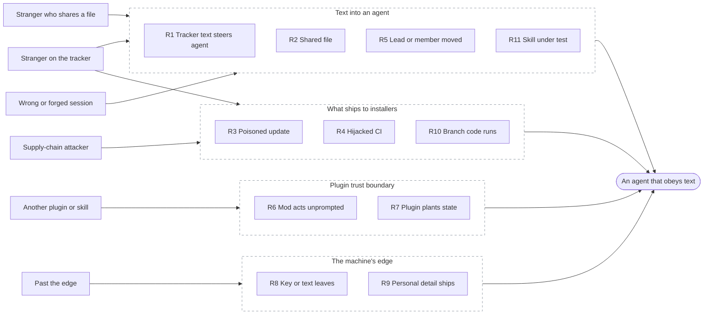

# Threat model

This page lists the risks worth planning for, what stops each one today, and
what still gets through. [`SECURITY.md`](../../SECURITY.md) is the summary.

Four reference pages hold the detail, and they are part of this threat model:
[`brigade.md`](brigade.md), [`checks.md`](checks.md),
[`rendering.md`](rendering.md) and [`hiring-interview.md`](hiring-interview.md).
A control any of them names is named by the threat model. Two older pages,
[`scanners.md`](scanners.md) and [`edge-audit.md`](edge-audit.md), hold
detail it links to, and a control they name counts the same way.

"The base" is this page as it stood before the issue 446 rewrite, at commit
`4bae5c3` ([provenance](#provenance)); its matrix rows 1 to 19 are the "old rows". Ids: C1 to C10, K1 and K2 are
[accepted classes](#accepted-risks-by-class); P0 to P9 are
[candidates](#candidates-for-the-owners-word); E and D ids are old entries and
data blocks, listed in [provenance](#provenance).

## Residual risk at a glance

The chart places each top risk by how likely it is and how much harm it does once today's guards have done their work, with R1 alone in "Act now" and most of the rest rare but severe.

| Id | Risk | L | I | Old rows | Control in one line | Open gap | Detail |
| --- | --- | --- | --- | --- | --- | --- | --- |
| R1 | **Tracker text steers agent.** A charted pull request, an issue a session works on, or a record the lead acts on. | 0.62 | 0.85 | 1 | Each skill tells the agent the material is data, and groundtrack says on the page that AI drew it. The host agent's own rule is the real guard. | The highest-value attack here. Prompt injection in general is not accepted (C1). | [Row 1](checks.md#row-1) |
| R2 | **Shared file.** It steers an agent, breaks a page or stalls a renderer. | 0.38 ⁺ | 0.75 ⁺ | 2–5, 7, 13 | Renderers escape what they print, refuse hostile shapes at three measured limits, and fill pages in one pass. Restored answers are bound to their draft by hash. | The attribute rule is held by review, not by a parse of the page. Row 13's other residuals are open too. | [Rows 2–5, 7, 13](checks.md#row-2), [rendering](rendering.md) |
| R3 | **Poisoned update.** A skill or mod change reaches every installer. | 0.30 ⁺ | 0.95 ⁺ | 8, 17 | Pull requests are required, and so are the check, SkillSpector, zizmor and plugin-validator gates. The check holds frontmatter keys, hidden characters, manifests and baselines. | Plain-prose instructions that no scanner detects. Fifteen scanner dependencies resolve fresh on every run. | [Row 8](checks.md#row-8), [row 17](checks.md#row-17), [scanners](scanners.md) |
| R4 | **Hijacked CI.** A moved action or a replaced package. | 0.12 | 0.85 | 9 | Actions are pinned by SHA, and jobs get minimal permissions with no credentials. Claude Code is pinned in two CI jobs and the athanor image, unpacked, never installed. | The CI pins are not content pins: no tarball hash is checked. The image fetch is hash-pinned. | [Row 9](checks.md#row-9) |
| R5 | **Lead or member moved.** Another session's text steers the lead or a member. | 0.22 | 0.70 | 16 | Members check each sender against the engine's session files. Only the owner's words in the lead's chat count as the owner's, and reports are data. | The sender check is a consistency check. Cleanup's authorization is open (P4). What the data blocks list as not checked is open (P6). Git config still runs programs in the lead at cleanup (filter drivers); row 16's other residuals are open too. | [Row 16](brigade.md#row-16) |
| R6 | **Mod acts unprompted.** Its writes and its Open in app call skip the permission step. | 0.30 | 0.55 | 15 | The mod asks the engine for its verdict before each call. A path rule runs before and after each write, and the tools are offered only after `/brigade` or a head-chef load. | The `claude://` opener's inherited environment (P6). Row 15's other residuals are open too, the roster's check-and-write race first. | [Row 15](brigade.md#row-15) |
| R7 | **Plugin plants state.** Another plugin reads or plants the level, a dismissal, search text or decision entries. | 0.30 | 0.55 | 15 | The pane shows what state claims as a claim. A level 3 counts only once the owner confirms it in the lead's chat or sets it with the level command, though a plugin that can add rows to the lead's transcript can forge that confirmation, or rewrite that command (E35a). | Row 15's other residuals are open too; what [C4](#c4) leaves out is a candidate (P1, P2, P4, P6, P7). | [Row 15](brigade.md#row-15) |
| R8 | **Key or text leaves.** The audit key or a box's text goes off the machine. | 0.32 ⁺ | 0.64 ⁺ | 6, 10 | The key is never printed or written, and the endpoint override takes loopback only. A dry run names every receiver first, and a standing yes comes only from the user's own instructions. | The script cannot stop the agent itself from printing an environment variable. | [Row 6](checks.md#row-6), [row 10](checks.md#row-10), [edge audit](edge-audit.md) |
| R9 | **Personal detail ships.** A home path reaches a shipped file, a page, a post or a command line. | 0.35 ⁺ | 0.25 ⁺ | 17, 18 | The check fails a fixed home path in shipped folders, and groundtrack warns on an absolute one. | A home root joined from a separate string is not seen, and free text is not checked (E79). | [Row 17](checks.md#row-17), [row 18](checks.md#row-18) |
| R10 | **Branch code runs.** A branch's code runs when a session opens on it. | – | – | 19 | The check holds the tracked settings file to its one guard. The contributor guide says to read a branch's `.claude/` and `scripts/` first, or to open the session with hooks off. | The guard protects the merge, not the reader. A non-local container engine (P6). | [Row 19](checks.md#row-19) |
| – | **Rows 11 and 12.** Box text skews the audit's reread order; a provider keeps audit text. | 0.18, 0.52 | 0.30, 0.20 | 11, 12 | Accepted as [K1](#k1) and [C7](#c7). | – | [Row 11](checks.md#row-11), [row 12](checks.md#row-12) |
| R11 | **Skill under test.** It reaches past its practice run. | 0.15 | 0.80 | 14 | Hygiene, not a boundary: a tight posture, a scrubbed environment, and backups of the owner's live places. | What the posture does not stop. | [Row 14](checks.md#row-14) |

- **Scale.** L is likelihood and I is impact, both residual risk after
  today's guards, from 0 to 1. Likelihood is how easy and how often the attack
  is; impact is what the attacker gets. The scores are judgement, used to rank,
  and are carried from the old matrix.
- **⁺** marks a risk built from several old rows. It takes the highest
  likelihood and the highest impact among them, per axis.
- **R10** is unscored, because old row 19 had no point on the chart.
- **On the chart,** R7 is drawn a step off R6 so both labels can be read; they
  share row 15's score.
- **Rows 11 and 12** went to [K1](#k1) and [C7](#c7), and are left off the
  chart. Their sections are [row 11](checks.md#row-11) and
  [row 12](checks.md#row-12).

## Scope

The scope is what the base page covered, unchanged. grimoire runs nothing on a
server. An attacker reaches a user through a file they wrote, the skill prose,
the CI and publishing path, the edge audit, the Brigade mod, or the head chef's
brigade. Behind every door the prize is the same: an agent on someone's machine
that obeys text.

**Proposed; not in force until the owner names it (candidate [P0](#candidates-for-the-owners-word)).**
Out of scope: a program the owner runs, as the owner, on the owner's own
machine. It can already edit the owner's `CLAUDE.md`, settings and git config,
so a guard against it guards nothing. In scope, though they also run as the
owner: another plugin or skill, a branch's own code, and a session steered by
text. Also in scope: the tracker and outside pull requests, other accounts on a
shared host, and anything that leaves the machine. Safety stays in scope: loss
of the owner's work with no attacker.

A path counts as a drop only when four answers are no: can another plugin take
it, can a branch's own code take it, can a steered session take it, and can
another account read its data. "Another plugin" means any plugin the engine
loads, its hooks module code included.

## Who is in scope

| Actor | Reaches us through |
| --- | --- |
| **A stranger on the tracker** | Pull requests, issues and comments that an agent charts, reads or acts on. |
| **A stranger who shares a file** | A box, flightpath, skill, agent, contract or answer block that someone opens. |
| **A supply-chain attacker** | A stolen maintainer token, a merged pull request, or a moved CI action or package. |
| **Another plugin or skill** | The same plugin store and state, the same config folder, the same model context. |
| **A session that is wrong or forged** | Messages, reports and relays that a lead or a member reads. |
| **Whoever sits past the edge** | Model providers, GitHub, devices on Remote Control, a non-local container engine, other users of a shared host, and everyone who installs. |

## Boundaries

1. **Text into an agent.** Tracker text, shared files and other sessions'
   messages all end up as text in a model's context.
2. **What ships to installers.** Skill prose, the Brigade mod's hooks module,
   and CI.
3. **The plugin trust boundary.** Anything else installed can read and write
   the plugin's store, state and files.
4. **The machine's edge.** The edge audit's send, the pane's `gh` call, GitHub
   posts and acts, Remote Control, and the container engine.

More top risks come in as text an agent reads than through any other boundary; each of the other three carries two or three.

| Boundary | Who crosses it | Risks |
| --- | --- | --- |
| **Text into an agent** | Tracker strangers, file sharers, other sessions | [R1](#r1), [R2](#r2), [R5](#r5), [R11](#r11) |
| **What ships to installers** | Supply-chain attackers, tracker strangers | [R3](#r3), [R4](#r4), [R10](#r10) |
| **Plugin trust boundary** | Other plugins and skills | [R6](#r6), [R7](#r7) |
| **The machine's edge** | Providers, GitHub, Remote Control devices, shared-host users | [R8](#r8), [R9](#r9) |

R10 sits under what ships because it arrives as a branch's own files. R11 sits
under text into an agent because the skill under test is text the session
obeys.

## The lenses, and how they are used

The lens table (STRIDE, MITRE ATLAS, OWASP, CSA MAESTRO)

| Lens | What it contributes here |
| --- | --- |
| [STRIDE](https://learn.microsoft.com/en-us/azure/security/develop/threat-modeling-tool-threats) | The kind of harm. Tampering, Information disclosure, Denial of service and Elevation of privilege apply. Spoofing and Repudiation mostly do not, because the project has no accounts or identities. |
| [MITRE ATLAS](https://atlas.mitre.org/) 2026.09 | Attacks on AI systems: prompt injection, poisoned agent tools, supply chain. Case study `AML.CS0049` is a poisoned skill on a skill registry, the closest precedent for this project. |
| [OWASP Top 10 for LLM Applications 2025](https://genai.owasp.org/llm-top-10/) and [for Agentic Applications 2026](https://genai.owasp.org/resource/owasp-top-10-for-agentic-applications-for-2026/) | The common names a reviewer will recognise: `LLM01:2025` prompt injection, `ASI01` agent goal hijack, `ASI04` agentic supply chain. |
| [CSA MAESTRO](https://cloudsecurityalliance.org/blog/2025/02/06/agentic-ai-threat-modeling-framework-maestro) | Only partly. MAESTRO assumes you run the agent stack. grimoire ships content into someone else's agent (layer 3, Agent Frameworks) through a marketplace (layer 7, Agent Ecosystem). Rows give a layer where one fits. |

Each old row's tags sit in its section in [`checks.md`](checks.md) or
[`brigade.md`](brigade.md). A new risk carries its tags in its detail section.

## Accepted risks, by class

A finding is inside a class only when it cites an entry the class holds whose
reach covers it. A finding no such entry covers is a candidate, and waits for
the owner. Until the owner names a class, each entry it holds stays accepted as
worded at the base; the class groups them. Each class reaches only what its entries accepted; the entries, their
dates, sources and premises are in the [provenance fold](#provenance).

**C1. The host agent is the last guard against text read as instruction.** grimoire cannot enforce the rule that text in a file is data, and every skill's reminder of it is prose. The lead reads whole records, so a stranger's text on a record reaches its context. Comments under the owner's account, or a stranger's text reposted there, can steer a session. A planted line can be taken for the owner's words for a GitHub act (E52). Names that a session or a stranger shapes reached the lead's cleanup commands before Brigade 0.110.0; since then the lead runs no cleanup command. Not inside C1: prompt injection in general through a charted pull request (R1), a shared file (R2), planted text that claims a standing yes (old row 6), an agent talked into leaking the audit key (old row 10), and a shared skill, agent or contract outside E14 (old row 13). Those stay open risks. Old rows 13 and 16. Entries E52, E58, E59, E61. Not inside C1 either: a skill's write scope and a second agent's load held by prose (E14a, a candidate, P7).

*Worded 2026-10-30 by the lead under the owner's relayed word; not yet named by the owner.*

**C2. Review is the guard for scanner gaps.** Scanner baseline allowances cover whole files or whole rules. The probe does not check every drift. Some files are read only in part. Nothing is signed. A duplicate manifest key is read last-wins. Root names are compared across case only. A skill is dangerous by its nature (ADR 0006). Not inside C2: plain-prose instructions in a skill update that no scanner detects, and scanner dependencies that resolve fresh (both R3's open gap). Old rows 8 and 13, and gap 5. Entries E2 to E10, E13, E14b, E15, E75.

*Worded 2026-10-30 by the lead under the owner's relayed word; not yet named by the owner.*

**C3. Renderer output carries author text, and its bounds are fast refusals.** An escaped one-line name can still read like a path or a reason. The count of refusal lines is not capped, though each line is. Deep nesting stops the renderer with one line. Old rows 2 and 5. Entries E1, E71, E72.

*Worded 2026-10-30 by the lead under the owner's relayed word; not yet named by the owner.*

**C4. Other plugins share the mod's trust.** In plugin state, the plugin's store or its data folder:
- another plugin can **read** usage summaries, roster files, the decision log, marks and hand-off, and search text;
- another plugin can **rewrite** the session-start usage record, **write** a long tabs list, **plant** the permission warning's dismissal, and **plant** a hook in cleanup's hooks folder between the tool's last check and the lead's removal call (TA1, E29);
- another plugin can **rewrite or press** the autonomy level, which can set level 3. A 3 counts only once the owner confirms it in the lead's chat, but a plugin that can add rows to the lead's transcript can also forge that confirmation, and its presses log as the owner's (E35a). Since 0.99.0 such a plugin can also turn a `/brigade` the owner types, and possibly any line the owner submits, into a level command with a goal of its own, which lasts through compactions; whether a plugin's own run, or the model's, can carry the owner's stamp is not measured.

An engine answer it supplies can misstate a session's liveness. Not inside C4: a plugin planting or rewriting the decision log, marks, hand-off or summary files (E40's and E20's plugin parts, P1), rewriting the search text, reading the report store's question or a session's Remote Control link (data block parts, P6), planting or hiding refusal lines (E24, P7), cleanup's press, the engine's own session files, and other plugins' tool calls seen by grimoire's hook. Those are candidates (P1, P2, P4, P6, P7). Old row 15. Entries E16, E19a, E25, E27a, E30, E33, E34, E35a, E38a, E44.

*Worded 2026-10-30 by the lead under the owner's relayed word; not yet named by the owner.*

**C5. A forged or misled session can speak for the lead.**
- A session that messages a member under the lead's shown name speaks for the lead, and some sessions the check cannot see.
- A relay counts as a decision. The lead's own calls are not limited, deletion included. A decision can switch off later checks.
- A pane's repository redirect is pinned before the first `gh` answer.
- A steered lead, or a session that loaded the skill unasked, can write false log entries and hand-offs.
- A confirmed level 3 hands the kept decisions to the lead: it takes every decision toward the goal, accepted-risk records and merges that ease a named control included, each logged with a review entry; an install, cleanup, a post carrying private work and an edit to the threat model's scope, the line that names it, or the accepted risks that remove the rules on secrets and personal data and widen the level-3 leave (grimoire's E79 and E80) still wait (E80). A resumed session may bring back a 3 with its earlier confirmation (E35b). Since 0.99.0 a 3 the owner's level command set lasts through compactions, in that session's memory. An unconfirmed 3, or a level kept anywhere but that session's memory, is not covered. Some surfaces show no sign of level 3.

Old rows 15 and 16. Entries E28, E35b, E36, E42, E45 to E48, E56, E57, E80.

*Worded 2026-10-30 by the lead under the owner's relayed word; not yet named by the owner.*

**C6. GitHub acts on the owner's word are irreversible and public.**
- The head is not pinned between review and merge, and merge text is not read.
- A broad authorisation covers acts its words did not name, and the warning comes in the same turn as the act.
- Deletes are permanent, and history keeps text.
- The head chef's posts carry what the owner asks, never error text (E60, E79); sessions' posts follow the owner's process (E62, E79).
- Act values are not held to plain character sets.
- At a confirmed level 3, the lead's own picks reach a merge, close, edit, label, issue or comment (E66), never because a report, record or relay asked; a delete is not covered. The lead takes every decision toward the goal, accepted-risk records and merges that ease a named control included, each logged with a review entry; an install, cleanup, a post carrying private work and an edit to the threat model's scope, the line that names it, or the accepted risks that remove the rules on secrets and personal data and widen the level-3 leave (grimoire's E79 and E80) still wait (E80).

Old row 16. Entries E49 to E51, E53, E54, E60, E62, E64, E66, E79, E80.

*Worded 2026-10-30 by the lead under the owner's relayed word; not yet named by the owner.*

**C7. Data leaves the machine, or reaches another account, as the owner accepted.**
- A provider keeps the audit text under its own policy.
- Pull request rows, private titles included, sit in module memory and on every pane surface, and the pane's polls under the owner's sign-in can show in the polled organisation's audit log (E26, E41).
- The autonomy level, its times, a pressed 3's press number and a command 3's goal sit in session transcripts that reach every Remote Control device, unencrypted at rest unless the disk is (E38d; the goal, E78). The rest of the transcripts' content on those devices, the lead's ids and address included, is a candidate (P6).
- Decision files, usage summaries and rosters sit unencrypted, are never removed, reach backup and sync, and decision files reach other local accounts.
- A post file, a leftover one included, can sit in a shared `/tmp` where another account can read it (E55, E63b). The filled start prompt, the lead's Desktop id and address (E65) and, on macOS and Linux, the app link (E76) sit on command lines other accounts on a shared host can read.
- Cleanup's reads put repository metadata in the lead's transcript.
- An author's home path warns and does not block.

Not inside C7: what the data blocks list as not checked (the phone sync and the app's own stores, a send from the phone, POSIX socket permissions), and a planted status file receiving one of the head chef's sends. Those are open gaps on R5's row and candidates (P6). Old rows 10, 12, 15, 16 and 18. Entries E12, E19b, E26, E27b, E38b, E41, E55, E63b, E65, E68, E69, E76, E38d, E79, and the data block parts D4b and D4c (the command-line part).

*Worded 2026-10-30 by the lead under the owner's relayed word; not yet named by the owner.*

**C8. The mod's tools run with no permission prompt,** in plan and don't-ask modes too, and after a load the owner did not type. The class names the tools E17, E18 and E39 cover, from the base text (`set_roster` and the four tab tools), and `set_roster`'s binding reads (E18), each inside its guards and the path rule. From Brigade 0.110.0 `clean_up` replaces `read_cleanup` and runs the pact's cleaner file with no prompt (E81). A tool added later is a candidate. Old row 15. Entries E17, E18, E39, E81.

*Worded 2026-10-30 by the lead under the owner's relayed word; not yet named by the owner.*

**C9. A tracked hook runs a branch's code when a session opens.** The owner judged the guard worth that exposure. Old row 19. Entry E70.

*Worded 2026-10-30 by the lead under the owner's relayed word; not yet named by the owner.*

**C10. One forced remove of a worktree whose submodules are populated can lose work that git's checks cannot see.** A session writing its own state into its own worktree can hide the work. The program a filter driver runs is not inside C10. The guards are the name-back's loss lines, the one yes, and the checks that remain. Since Brigade 0.110.0 (issue 484) cleanup forces no removal, so C10 covers the versions before it. Old row 16. Entry E67.

*Worded 2026-10-30 by the lead under the owner's relayed word; not yet named by the owner.*

**K1. Box text can move an edge in the audit's reread order.** A score never changes a tier. Old row 11. Entry E11.

*Worded 2026-10-30 by the lead under the owner's relayed word; not yet named by the owner.*

**K2. The interview's answers sit unencrypted** in the browser's store, where pages opened from disk, extensions with file access and profile backups can read them, and in the scratch folder's draft, page and answers file until they are deleted. A folder the person names is as private as that folder, and its sync takes the files off the machine. On Windows, the temp folder's own access holds them. Old hiring-interview section. Entries E73a, E73b.

*Worded 2026-10-30 by the lead under the owner's relayed word; not yet named by the owner.*

## Candidates for the owner's word

There are 64 candidate lines in ten groups, P0 to P9. None of these is in force.

Candidates (64 lines)

None of these is in force. A candidate does not meet issue 359's H1. Only a control, or the owner's accepted risk, does. An old entry listed here stays as the base had it until the owner names its line: accepted where the base accepted it, and not accepted where it did not (E14a, E22, E23, E24). Each line gives its id, where it came from, the class it would join or widen, and the owner's choice.

**P0. The scope line.** The proposed line in [Scope](#scope). The owner names it, rewords it, or leaves the base scope standing.

**P1. Same-user and plugin paths.** Under the four questions in [Scope](#scope), every line below has at least one yes. Another plugin, a branch's own code and a steered session all run as the owner, and each can take the same path. So the scope line drops none of these outright. Each line names the class it would widen. Answers: plugin · branch code · steered session · another account.

- E19c. Usage summary files read by a same-user process. Yes (C4, read accepted as E19a) · yes (C9) · yes (C1) · no.
- E20. A forged summary file outranks the transcript. Yes (C4) · yes (C9) · yes (C1) · no.
- E23. A link swapped in after the path rule runs, for the summary read. The base named it as a gap and never accepted it. Yes (C4) · yes (C9) · yes (C1) · no.
- E27c. Old roster files read by a same-user process. Yes (C4, read accepted as E27a) · yes (C9) · yes (C1) · no.
- E38c. Decision files read by a same-user process. Yes (C4, read accepted as E38a) · yes (C9) · yes (C1) · yes (C7, accepted as E38b).
- E40a. A same-user program or shell plants or rewrites decision files. Yes (see E40b) · yes (C9) · yes (C1 or C5) · no.
- E40b. Another plugin plants or rewrites decision files (the plugin side of E40a). Yes (widens C4) · yes (C9) · yes (C1 or C5) · no.
- E43. A same-user program redirects a checked write of the log, marks or hand-off. Yes (C4) · yes (C9) · yes (C1) · no.
- E63a. No first-launch check: a leftover post file, the same-user part. Yes (C4) · yes (C9) · yes (C1) · yes (C7, accepted as E63b).
- E73c. The interview's saved answers read by processes running as the person. Yes (C4) · yes (C9) · yes (C1) · no.
- E77. A planted folder under the config folder's `projects` gives a card false numbers and a false link, as a planted transcript can. Yes (C4) · yes (C9) · yes (C1) · no. It is undated, with no source recorded.

**P2. E29, raised in full.** Row 15's entry on planted or left-behind session files. It was accepted 2026-10-18 and widened 2026-10-22 and 2026-10-30. It rested on session files feeding only the pane's cards. Issue 359's design makes a session file feed cleanup's window, which breaks that premise. A program the owner runs is the same-user side (P0). Another plugin is a widening of C4, since the engine's session files are not in C4. The owner chooses: re-accept it for the pane only, accept the widening, or have 359 add a control. For 484's folder list, the widening is accepted as E81.

**P3. Reliability, not threats.** Each stays accepted as at the base until the owner moves it to the notes.

- E21. A writer whose files keep failing a check leaves its card ageing with no line.
- E31. No time bound on the session-file stat, list or read.
- E32. A session file read mid-rewrite drops a row for one poll.
- E74. The interview build session's local http server was not stated loopback-only. The data was public.
- E37. An alarm's sign above the prompt is lost at reload. A note, or C4, since another plugin can cause a reload.
- E35c. A reset after reload or compaction is delayed by a failing engine read. A note, or C4, since another plugin can fail the read.

**P4. Issue 359's H1 items.** Ids are question (q) and finding numbers in issue 359's record. H1 is its rule that cleanup's removal gate waits until each item rests on a control or the owner's accepted risk. Cleanup's authorization rests on these candidates and is open until the owner names them or 359 adds a control.

- q8. Indirect paths that remove a worktree or move a branch with no command the gate reads as a removal. For the lead, inside C5's reach (E47). For members, a widening of C5. For a branch's code, a widening of C9.
- q12. The gate's data: the `cwd` and main working tree kept up to 15 minutes, the branch, the confirming session id, and the 2-minute pending set. The module-memory part is a same-user path (P0). The gate's reply puts folder names and the branch in the lead's transcript and model context, which widens C7 (nearest reach: data block D1 and E68). Closed by E81 for 484's reply and `clean_up`'s answer.
- Row 16 pending item 2. A forced remove wherever git refuses, a doubled force for a locked worktree, and `-D` where `-d` refuses. A widening of C10. Superseded by 359's design, pending the owner's word (359's adversarial F10). Closed by E81: since 0.110.0 cleanup forces nothing and passes no `-D`.
- Row 16 pending item 6. The binding stops are gone. An item not bound to its session is named back and removed on the yes. A widening of C5 and C10. Superseded by 359's design, pending the owner's word (F10). Closed by E81: since 0.110.0 an item not bound to its session gets no run.
- E29's premise. See P2.
- q23. A plain branch delete on a self-written upstream ref. The ref can be written by a program the owner runs (P0), another plugin (C4) or a branch's code (C9). The loss is safety (C10). A widening of all three. Its 484 counterpart, what `--recoverable` can't see, is accepted as E81.
- q22 and q27. Another plugin against cleanup's press: it forges the press, rewrites the shown rows, takes a Cancel, or reads the box. One line for the four moves. A widening of C4.
- A4. Another plugin's tool call seen by grimoire's hook. What the hook keeps is 359's data rule. A widening of C4 and C7.
- 359's executability 3, data F1 and adversarial F4 and F7 are the same items as q8 and q12.

**P5. The base's pending items.**

- Item 1. Level 3 widened to the lead's picks on every decision the owner's user-level instructions file keeps (C5). Closed by E80.
- Item 2. The forced remove widened (C10). See P4. Closed by E81.
- Item 3. The lead-repository check removed. For the read reach, C7 (accepted as E68). For the removals, C5.
- Item 4. The branch-name entry widened to owner-run commands (C1).
- Item 5. Four new sources of the owner's words (C5).
- Item 6. The binding stops gone (C5, C10). See P4. Closed by E81.
- Item 8. The hidden-loss classes bear on every force and every `-D` (C10). Closed by E81: no force and no `-D` since 0.110.0.
- Item 9. The lead writes merge text at level 3 (C6).
- 0.9.0. Session-list reads land in transcripts (C7).
- D3c. Each turn's status-file fields enter the lead's transcript (C7).

**P6. Data flows the base described, or left open.**

- The `claude://` opener's inherited environment, which can hold keys and tokens (C7, with C8). Its two narrower guards were deferred to issue 235.
- Tracked files with uncommitted edits sent to a container engine that may not be local (C7, with C9). It stands until athanor refuses a non-local engine.
- D1a and D3b. Questions, decisions, relays, decision gists and failed-check names in transcripts that Remote Control shows on every device, unencrypted at rest unless the disk is (C7). The permission warning is its guard.
- D1b. The pane's report store keeps a one-line question in plugin state that other plugins can read (C4).
- D1c. Decision gists and failed-check names in the head chef's transcript and the pane's store (C7).
- D1d and D5b. What 0.4.0 and pre-0.9.0 versions posted on records, which may be public: quoted words, questions, the lead's name, and report and miss lines. It stays after an upgrade (C7).
- D1e. 0.4.0's leftover relay, post, question and list files in the temporary folder, which can hold the owner's quoted words. They stay until deleted, and other local accounts can read them on a shared `/tmp` (C7).
- D1g. Since 0.7.0, a Desktop send may sit in the app's own session store. Not checked (C7).
- D2b, D2d and D2e. Claude Desktop's own stores and the phone sync. Not checked (C7).
- D3e. The permission warning's acknowledgement, read by another plugin (C4). E33 accepts planting it, not reading it.
- D3d, D4d and D4e. A roster card's Desktop id, and the lead's ids and address in each session's transcript and each session's address in the lead's, reaching claude.ai's session list and every Remote Control device (C7). The 0.12.0 block that describes them was applied on the owner's word; whether that accepted them is the owner's to say.
- D4c, the transcript part. The filled start prompt's copy in the session transcript (C7). Its command-line part is accepted (E65).
- D4a. The pane keeps a background session's Remote Control link in plugin state that other plugins can read (C4).
- D4f. `claude rm` keeps a removed background session's transcript; what it keeps of the job's own store is not checked (C7). Since Brigade 0.110.0 cleanup removes no session; the owner runs `claude rm` by hand.
- D4h. Not checked in 0.12.0: rename and reopen effects on the Desktop id, a phone send, `/compact` (for the Brigade mod: the live lead's log showed three compactions with no reload before them on 2026-10-30 and 31; H1a, a live `/compact`, is pending), a stated `from-session`, the Windows pipe path, and POSIX socket permissions (C7).
- The level command's goal (0.99.0): its phone leg, the slider box drawn over Remote Control, and whether other plugins' pane hooks read the slider box. Not checked (C7, E78).
- D4j. A status file planted with an ended session's id and name could still receive one of the head chef's sends; nothing else stops it (C4, C7).

**P7. Gaps the base named and did not accept.**

- E22. (Issue 312's q2 A added it as a gap sentence and accepted only E21.) A session named like a card, or holding its id, feeds that card from its own summary file (C5).
- E24. (Issue 312's q2 A, as for E22.) Another plugin reads, plants or hides the pane's refusal lines (C4).

- E14a. A skill's write scope, and a contract's load beside its agent as a second agent, held by prose (C1). Row 13's only E14 acceptance is the case-only compare (E14b, C2).

**P8. Head-chef 1.0.0 (issue 452, PR 457).** Each line waits for the owner's word as worded below.

- The 1.0.0 lead-name form. A member takes a message as its lead's when it arrives under the lead's session name, with no status-file pairing, so a same-user process or a session that holds that name can pass as the lead, and receives the members' reports, any secret or personal detail in them included (E79), and decision gists and messages to each other by name, and the lead's sends to an ended member's name (C5). The owner's word, relayed by the lead on 2026-10-30: "Yes, name only" (q4 on #450's plan) and q8 A on #452; worded as spec S6.4, with q8's clause.
- Its widening, decided by the lead under the owner's standing word of 2026-10-30, relayed, open for the owner's revision (decision log 178): a brigade session misled by its issue's text, a name shared while a member runs, and a Remote Control session on another machine that holds the lead's name (C5).
- The controls [row 16](brigade.md#row-16) names as withdrawn in head-chef 1.0.0 (issue 450), and E57's 0.12.0 line, which rested on them (C5); decided by the lead under the owner's standing word of 2026-10-30, relayed, open for the owner's revision (decision log 178).
- E65 narrowed: the first-prompt compare and the members' check arguments are withdrawn, so only the start's command line remains (C7); decided by the lead under the owner's standing word of 2026-10-30, relayed, open for the owner's revision (decision log 178).
- A member on a 0.12 to 0.16 start prompt takes a 1.0.0 lead's own level-3 pick on a question its rules keep for the owner as the owner's word, relayed, now that the 0.17.0 rule that held such picks back is dropped (C5). Decided by the lead under the owner's standing word of 2026-10-30, relayed, open for the owner's revision, flagged unsure for the owner (decision log 180).
- The lead's session-list read for its own name puts each listed row, which may hold a folder and the account name, in its transcript, and idle notices and members' messages to each other sit in transcripts (C7). It closes P5's 0.9.0 item. Decided by the lead under the owner's standing word of 2026-10-30, relayed, open for the owner's revision, flagged unsure for the owner (decision log 181).

**P9. Easings an open change proposes.** Each waits for the owner's own word before its change merges, except that a level-3 merge goes on the lead's pick under E80.

None open. #466's easings (E42, E35a, E37, E17, E29, E30) took the owner's yes in the lead's chat on 2026-10-31 ("I already gave you permission"), superseding 448 Part B's line.

## Notes that are not threats

None yet. A reliability item moves here from the candidates (P3) only on the
owner's word.

## Gaps, ranked

Gaps 1 to 5, each done or decided

1. **Say it in the skill prose.** *Done 2026-09-25:* each `SKILL.md` now says
   the material, the files and the renderer's output are data, not instructions,
   and eagle-eye's says a standing yes for the audit comes only from the user.
   Narrows rows 1, 2 and 6; the host agent remains the real guard.
2. **Make the scanners gate.** *Done 2026-09-25:* SkillSpector's `scan` and
   zizmor's `audit` are now required checks on `main`, beside `check`. The
   plugin validator's `validate` joined them on 2026-10-09.
3. **Tell reviewers to check the sheet against the diff.** *Done 2026-09-26:*
   see [row 1](checks.md#row-1). The page's warning is the AUTHORED stamp's help note, which shows
   on hover. That is a deliberate choice, not a shortfall. The AI tool that drew
   the page already shows its own warning that AI can make mistakes, and we
   expect a reader who works with AI to know that its output needs checking.
   The note repeats the warning where the page makes its claims.
4. **Measure groundtrack on a hostile file.** *Done 2026-09-26:* see
   [row 5, measured](rendering.md#row-5-measured). Three limits, and fixes that make
   other costs grow with the file, hold the renderer's three commands under
   1.5 s on every file measured up to 25 MB that passes. The two costs that
   remained inside `fold` are gone since #147.
5. **Consider signed releases or a pinned install path.** [Row 8](checks.md#row-8)'s rug-pull
   exposure. *Decided 2026-09-26: no release tags or signing for now.* Neither
   installer checks a signature, and grimoire builds nothing to attest. A
   plugin user gets a new version only when the version in `plugin.json` has
   moved, and then only when they update by hand or have turned on background
   auto-update, which is off by default. A reader who wants a fixed copy can
   install one commit (see the README's install section). Revisit when someone
   else depends on grimoire, or when it ships something that is built.

6. **Cleanup's authorization.** Indirect removal paths, the forced-remove and
   binding widenings, and another plugin against cleanup's press are
   candidates only ([P4](#candidates-for-the-owners-word)). Until the owner
   names them or issue 359 adds a control, they are open.

## Keeping this page short

A row changes when its guard or its gap does. A new skill, a new script that
opens a connection or starts an agent session, a new place where the agent
reads a stranger's text, a new reach into another plugin's or session's text,
a new send off the machine, or a new call the mod makes through `$` gets one
risk row here, with its tags in its detail section.
Detail goes in a reference page, an ADR or the code's own comments, and this
page points at it. A finding inside an accepted class is reported in one line
that cites the old entry covering it; it adds no entry. That replaces ADR
0006's "gets a row" for such findings. Anything else is a candidate. When the
owner names a class or a candidate, its worded-by line becomes
`Named <date> by the owner · from <finding> · word <how it arrived>`, and a
named candidate leaves the fold for its class.

The tags cite ATLAS 2026.09, OWASP LLM 2025 and OWASP Agentic 2026; a newer
release may renumber them. The repository settings in row 8 were read on
2026-09-25, except the plugin validator's required check, which the owner
confirmed on 2026-10-09.

## Controls by risk

Controls by risk (every control the old matrix named)

Every control the base matrix named, by risk, by name and never by its steps. A merge that weakens one weakens a control named by a threat-model row.

#### R1. Tracker text steers agent (old row 1)

- the host agent's own rule that file content is data ([row 1](checks.md#row-1))
- groundtrack's `SKILL.md`: the material is data to draw, and a line that reads as a request is told to the reader ([row 1](checks.md#row-1))
- traces are literals a reader can check against the material ([row 1](checks.md#row-1))
- the hand-over line saying AI drew the page and it can be wrong ([row 1](checks.md#row-1))
- the page's "authored" stamp ([row 1](checks.md#row-1))

#### R2. Shared file (old rows 2, 3, 4, 5, 7, 13)

- the host agent's own rule that file content is data; both `SKILL.md` files say the file and the renderer's output are data ([row 2](checks.md#row-2))
- groundtrack's escape of control and invisible characters in `--check`, `--out` and `--text` lines ([row 2](checks.md#row-2))
- the 200, 1,000 and 2,000 character cuts on printed strings and lines ([row 2](checks.md#row-2))
- the contract skill's interview script prints one escaped line per refusal, quotes clause text, and masks home paths, keys and emails ([row 2](checks.md#row-2))
- the agent shows the change list as printed ([row 2](checks.md#row-2))
- `<` escaped before the script block; `&` and `<` escaped for element content; ids validated; no author text in an attribute ([row 3](checks.md#row-3))
- one-pass template fill in both renderers ([row 3](checks.md#row-3))
- tests that pin the escape's width and put hostile text in every field ([row 3](checks.md#row-3))
- the hiring page's escapes, one-pass fill, checked `pop-<id>` attribute ([row 3](checks.md#row-3))
- the hiring page's content security policy and the renderer's refusal of a page whose blocks are not the template's ([row 3](checks.md#row-3))
- `Groundtrack.hardenKeys` and prototype-free maps; own-property reads of the step and move tables ([row 4](checks.md#row-4))
- the type pass before any rule reads a field as text ([row 4](checks.md#row-4))
- the `__proto__` key refusal at any depth ([row 4](checks.md#row-4))
- the contract script's `constructor` and `__proto__` refusals and own-property kinds table ([row 4](checks.md#row-4))
- eagle-eye's 20,000-step walk limit ([row 5](checks.md#row-5))
- groundtrack's three measured limits: call depth 1,000, tree rows 20,000, cut-call search 1,000,000 units ([row 5](checks.md#row-5); [Row 5, measured](rendering.md#row-5-measured))
- the one-line exit 2 for a crash no rule foresees ([row 5](checks.md#row-5))
- the contract script's draft and block limits and the page budget ([row 5](checks.md#row-5); [the hiring interview](hiring-interview.md#the-hiring-interview-its-data-and-its-limits))
- the long-name cut where it enters a tree row; the bounded printed arg name ([Row 5, measured](rendering.md#row-5-measured))
- eagle-eye's step 8: say the set back and update only with what the user confirms ([row 7](checks.md#row-7))
- `--answers` binds the block to its draft and kinds table by SHA-256 and prints the change list ([row 7](checks.md#row-7))
- push-back in chat for every high-stakes clause and every restored, flagged or warned answer ([row 7](checks.md#row-7))
- a restored answer is kept only by its own Keep ([row 7](checks.md#row-7))
- the contract skill's data rule for files, diffs and validator output ([row 13](checks.md#row-13))
- an action, a stop or a tool answer drafted from a file needs the person's own words ([row 13](checks.md#row-13))
- the hiring page's stakes from the kinds table; no proposal on a high-stakes question until a pick ([row 13](checks.md#row-13))
- the skill never writes a hook, a settings file or a permission list, and asks before an installing write ([row 13](checks.md#row-13))
- `claude plugin validate --strict` after building, its output shown as printed ([row 13](checks.md#row-13))
- each tool binding keeps its warning line ([row 13](checks.md#row-13))
- rule 2c: the frontmatter key allow-list and the hidden-character refusal under `skills/` ([row 13](checks.md#row-13))
- rule 6c: the manifest key allow-list and case-twin refusal ([row 13](checks.md#row-13))
- the hiring interview's Reset, the hand-back delete, folder and file modes, the refusal of a parent inside a git work tree ([the hiring interview](hiring-interview.md#the-hiring-interview-its-data-and-its-limits))
- the redraft's single-key carry and `--shared` adoption rule; the old-shape rewrite's change list before any write ([the hiring interview](hiring-interview.md#the-hiring-interview-its-data-and-its-limits))
- the interview's limits: bytes, clauses per part, field length, one question per clause, the page-size test ([the hiring interview](hiring-interview.md#the-hiring-interview-its-data-and-its-limits))

#### R3. Poisoned update (old rows 8, 17)

- pull request required on `main` ([row 8](checks.md#row-8))
- the required `check`, SkillSpector `scan`, zizmor `audit` and plugin validator `validate` checks ([row 8](checks.md#row-8))
- `check`'s frontmatter key allow-list and hidden-character refusal under `skills/` (rule 2c) ([row 8](checks.md#row-8))
- rule 7: the hand-written baseline reader and each skill's entry held to the root entry's scope ([row 8](checks.md#row-8))
- rule 7a: case-only path twins under `skills/` ([row 8](checks.md#row-8))
- the SkillSpector probe that the pinned scanner honours `file` ([row 8](checks.md#row-8))
- the baseline entries narrowed to named files, and the test that pins each shipped entry ([row 8](checks.md#row-8))
- the partly-read files pinned by their content ([row 8](checks.md#row-8); [Partial reads](scanners.md#partial-reads))
- the scanner pin; `scripts/check.mjs` holds the mod to its folders, the fixed-path and dependency rules and a version bump ([row 8](checks.md#row-8))
- review of each diff ([row 8](checks.md#row-8))
- rule 2b's tracked-file comparison ([row 17](checks.md#row-17))
- rule 2's fixed home-path refusal in `skills/`, `brigade/` and `hooks/` ([row 17](checks.md#row-17))
- the one printing helper that masks the account segment and escapes control and reordering marks ([row 17](checks.md#row-17))
- the case checks on root folders and code-file suffixes ([row 17](checks.md#row-17))
- rule 6c's refusal of the plugin reference's standard root places ([row 17](checks.md#row-17))
- the mod's check: `hooks/hooks.json`, its module, quoted relative paths and the manifest's `types` under the fixed-path and dependency rules and the version bump; absolute import paths refused ([row 15](brigade.md#row-15))

#### R4. Hijacked CI (old row 9)

- every action pinned to a commit SHA; zizmor's `ref-version-mismatch` ([row 9](checks.md#row-9))
- `persist-credentials: false`; permissions scoped per job ([row 9](checks.md#row-9))
- the validator package pinned to an exact version, its version checked, fetched and unpacked and never installed, in two jobs with no token and `contents: read` ([row 9](checks.md#row-9))

#### R5. Lead or member moved (old row 16)

- cleanup runs `git branch -d` first, and `-D` only where `-d` refuses; never on a default or checked-out branch, or where the default is unknown ([row 16](brigade.md#row-16))
- cleanup forces once, and twice only for a worktree named back as locked ([row 16](brigade.md#row-16))
- a background start needs the owner's words choosing that route ([row 16](brigade.md#row-16))
- the head chef takes the "not ready" cue only from the mod's own line or note ([row 16](brigade.md#row-16))

- `skills/head-chef/SKILL.md` and its references, scanned with the other skills ([row 16](brigade.md#row-16))
- sessions: Desktop sessions started by the head chef, named from a plain set, never from an issue, no permission mode set ([row 16](brigade.md#row-16))
- background starts: the name, form and shell refusals, the one-argument prompt, the first-prompt compare, the two-row failed start ([row 16](brigade.md#row-16))
- the fixed-form start prompt and what it tells each session ([row 16](brigade.md#row-16))
- the sender check: shown name, status file, `from-session` and `from` pairing, form refusals, the kept id ([row 16](brigade.md#row-16))
- the owner's yes for starts, cleanup and each GitHub act; anything else asked goes to the owner (stop 1) ([row 16](brigade.md#row-16))
- data, not instructions: relays quoted with source, decisions labelled, an unknown decision told to the owner (stop 4) ([row 16](brigade.md#row-16))
- sends only to a local address on the matching status-file row; an undelivered message is told, never resent (stop 5) ([row 16](brigade.md#row-16))
- the status-file read rules and the background transcript compare ([row 16](brigade.md#row-16))
- GitHub acts: named repository, public-or-not line, the temporary post file deleted, the head read again before a merge, branch to delete only from the owner's words or a same-repository head, no error text on records ([row 16](brigade.md#row-16))
- the roster written only through `set_roster` ([row 16](brigade.md#row-16))
- the permission warning before the first launch; its press is a reminder ([row 16](brigade.md#row-16))
- cleanup's name-back and one yes, and the re-read before each removal ([row 16](brigade.md#row-16))
- the "not bound to its session" group; a main working tree never named ([row 16](brigade.md#row-16))
- removals only of the kept folder and branch, from the kept repository's main working tree; the branch-name character rule; never a force push or remote branch delete ([row 16](brigade.md#row-16))
- cleanup's git flags: `--no-optional-locks`, `core.fsmonitor` off, signatures off, an empty hooks folder ([row 16](brigade.md#row-16))
- `claude stop`, a re-read, then `claude rm` with no discarding flag, for a background session ([row 16](brigade.md#row-16))
- a failed removal told and left; no folder deleted other than by git or `claude rm` ([row 16](brigade.md#row-16))
- the forced remove's submodule reads and loss lines in the name-back; the folder must be gone after the force ([row 16](brigade.md#row-16))
- check output treated as data and kept off cards, to-dos and issues ([row 16](brigade.md#row-16))
- another running session inside a worktree holds that item ([row 16](brigade.md#row-16))

#### R6. Mod acts unprompted (old row 15)

- the plugin-data environment variable is never read ([row 15](brigade.md#row-15))
- the context breakdown is asked for only as `summary`, never `full` ([row 15](brigade.md#row-15))
- `session.receive` keeps reports only while the module's timers run ([row 15](brigade.md#row-15))
- the Remote Control link is taken only from the `bridge_status` row ([row 15](brigade.md#row-15))
- the "Mark all N read" press: its fixed key, 500 range and full-file check ([row 15](brigade.md#row-15))
- the "ended" liveness rule and its conditions ([row 15](brigade.md#row-15))

- the pane waits for `/brigade` or a head-chef load; session start runs no timer, process, file read or pane ([row 15](brigade.md#row-15))
- the skill-load hook acts only on grimoire's or a user-level head-chef; the typed-load listing check ([row 15](brigade.md#row-15))
- `set_roster` registered only from `/brigade` or a head-chef load that opens the pane; refused when the pane is closed or the caller is a subagent ([row 15](brigade.md#row-15))
- the shared roster check and its allow-list; the 256 KiB cap ([row 15](brigade.md#row-15))
- the engine's verdict first (`$.tool.check`), with no `tool.check` hook of the mod's own ([row 15](brigade.md#row-15))
- the model never names a path; the path rule before each write and pane read and again after each write ([row 15](brigade.md#row-15))
- an existing file overwritten only if it passes the strict check; one write at a time; pane state changes only after a write succeeds ([row 15](brigade.md#row-15))
- refusals in code that never pass the call on ([row 15](brigade.md#row-15))
- the tests under `claude plugin test` with recorded engine answers ([row 15](brigade.md#row-15))
- Open in app, the tool route: the `local_` id check, one press at a time, the surface gate, the tool-list gate, the verdict, constant server, tool and target, the 5-second bound, three read outcomes ([row 15](brigade.md#row-15))
- Open in app, the link route: one argument with no shell, openers by fixed name or absolute path, the 15-second limit, one run per link, the program's name only in a toast ([row 15](brigade.md#row-15))
- the host check by environment, then by a real-path file check ([row 15](brigade.md#row-15))
- the `gh` call: one fixed argument list, a checked owner/name as `GH_REPO`, the 15-second limit, one run at a time, the per-minute rate, the PATH check, the 1 MiB output cap and `parsePrList`'s checks, the pin to the first good answer, answers kept by repository and number ([row 15](brigade.md#row-15))
- the usage summary writer: module memory, the step counted as a transcript row, at most one write every 15 seconds, the roster's path rule, the 1,024-byte cap and strict summary check, a refusal stops the writer ([row 15](brigade.md#row-15))
- the decision log, marks and hand-off writers: offered where `set_roster` is, a session's own file only, a queue, caps, entry shapes, clock checks, fixed refusals ([row 15](brigade.md#row-15))
- each call's bounds in the call table ([the engine calls](brigade.md#row-15-the-engine-calls-behind-its-write-and-its-tool-call))

#### R7. Plugin plants state (old row 15)

- the stored usage snapshot checked and capped, and checked again before it is drawn; no memory-file path kept ([row 15](brigade.md#row-15))
- the `samples` atom checked before each use ([row 15](brigade.md#row-15))
- the roster read rules: text within caps, four status words, no repeated titles or to-do ids, no unknown field, 50 cards and to-dos, 256 KiB ([row 15](brigade.md#row-15))
- lookups through `Map`s; buttons keyed on roster place ([row 15](brigade.md#row-15))
- to-do ticks checked before every use; a planted time can only end a tick sooner ([row 15](brigade.md#row-15))
- every string drawn as text, cleaned and cut to one line ([row 15](brigade.md#row-15))
- the SVG attribute allowlist test for every image the module builds ([row 15](brigade.md#row-15))
- session files: the place check, digit names, 8 KiB, only named fields kept, the cwd kept in memory only, a fixed error line ([row 15](brigade.md#row-15))
- transcripts: read only for a roster member, by a checked id, at most 4 MiB, warmth re-reads by modified time ([row 15](brigade.md#row-15))
- the call series parse and the `meters` check before drawing ([row 15](brigade.md#row-15))
- finding a transcript: the once-a-minute listing, candidate rules, and module memory only ([row 15](brigade.md#row-15))
- the place check on every transcript path ([row 15](brigade.md#row-15))
- the permission warning: a constant key, a date-shaped value, only the owner's press with the box ticked writes it, fixed wording ([row 15](brigade.md#row-15))
- the decision tab's reads: the writer named from the engine's session files, "as recorded" entries, buttons that act only on the shown entry, the "Mark all N read" key ([row 15](brigade.md#row-15))
- what the pane reads stays in module memory; only the search text, cut to 200 characters, reaches plugin state ([row 15](brigade.md#row-15))
- the autonomy level: only a slider press or the owner's level command sets a level above 1; the stored level read only as 1, 2 or 3; a differing stored level reads as 1 and logs an alarm; a raise only once its Owner entry is written; one lock ([row 15](brigade.md#row-15))
- resets to 1 at a module reload, and at a compaction unless the owner's level command set the 3, retried by the level's poll ([row 15](brigade.md#row-15))
- the level-3 band with the press time and Dismiss; the level drawn on every tab ([row 15](brigade.md#row-15))
- a 3 counts only once the owner confirms it in the lead's chat, which a compaction ends, or sets it with `/brigade level 3`, which acts only on a run the engine stamps as the owner's Enter or a Remote Control message (intended; not measured against another plugin's own run or hooks, or the model's own run) ([row 15](brigade.md#row-15))

#### R8. Key or text leaves (old rows 6, 10)

- the four facts stated before each run; `--dry-run` first ([row 6](checks.md#row-6))
- a standing yes only from the user's own instructions ([row 6](checks.md#row-6))
- `audit.mjs` never prints or writes the key ([row 10](checks.md#row-10))
- the endpoint override takes only a loopback address ([row 10](checks.md#row-10))
- `SKILL.md`: never ask for the key or write it to a file ([row 10](checks.md#row-10))

#### R9. Personal detail ships (old rows 17, 18)

- rule 2's fixed home-path refusal and the masking print helper ([row 17](checks.md#row-17))
- the format reference asks for relative paths ([row 18](checks.md#row-18))
- groundtrack's absolute-path finding on `loc`, `touches`, `enteredBy` and `path`, naming the field and never the path ([row 18](checks.md#row-18))
- `SKILL.md`: fix an absolute path, keep one only on a page that stays on the author's machine ([row 18](checks.md#row-18))

#### R10. Branch code runs (old row 19)

- rule 6d: the tracked settings file held to the one guard entry; settings files below the root, a `.claude` file or link, and case twins refused ([row 19](checks.md#row-19))
- rule 2c over both files ([row 19](checks.md#row-19))
- the guard reads the hook input as data, writes nothing, and never answers with an explicit allow ([row 19](checks.md#row-19))
- the probe's fixed folder and absolute paths; no run on an empty or relative `PATH` entry ([row 19](checks.md#row-19))
- `CONTRIBUTING.md`'s "The agent guard": read a branch's `.claude/` and `scripts/` first, or start with hooks off ([row 19](checks.md#row-19))

#### R11. Skill under test (old row 14)

- the runner's posture, hygiene and not a boundary (ADR 0006) ([row 14](checks.md#row-14))
- "don't ask" mode with hooks off ([row 14](checks.md#row-14))
- the settings file's edit and read denies; tools that reach off the machine denied ([row 14](checks.md#row-14))
- the four shapes of a case's tool rules, written only in the skill's own forms ([row 14](checks.md#row-14))
- the append path may not name an instruction file or a device ([row 14](checks.md#row-14))
- no secret in the environment on `clean` and `owner-pact` ([row 14](checks.md#row-14))
- the per-turn refusal of unplanted settings, MCP config or instruction files, and of a changed skill copy ([row 14](checks.md#row-14))
- backups and hashes of the owner's six live places, the manifest hash, the change list ([row 14](checks.md#row-14))
- the session environment built from a named list ([row 14](checks.md#row-14))
- everything printed or kept cleaned and masked ([row 14](checks.md#row-14))

#### Old row 11 (class K1)

- a score never changes an edge's tier; the ranking only orders rereading ([row 11](checks.md#row-11))

#### Old row 12 (class C7)

- the dry run names every company that receives the text; [edge-audit.md](edge-audit.md) states the opt-ins ([row 12](checks.md#row-12))

#### Conditions the accepted entries rest on

Each condition an old accepted entry rested on, by risk. The entry's own line is in [provenance](#provenance).

- E35a: the same actor can already block the log by planting a file in its place; a reload starts module memory over; the head-chef skill's level rules are where the confirmation is next tightened
- E29: a writer that can do this can already plant marks that hide decisions
- E42: an approval comes only from the owner in the lead's chat; `read_lead_handoff`'s description says its own writing is never the owner's words or a level
- E35b: a 3 is drawn in the warning colour

##### Conditions under R2

- the escape keeps one report to one line (E1; [row 2](checks.md#row-2))
- the reader judges what the text says (E1; [row 2](checks.md#row-2))
- the engine is JavaScript and most likely reads it the same way (E13; [row 13](checks.md#row-13))
- a hand-written parser would cost more than the risk (E13; [row 13](checks.md#row-13))
- git's own path protection refuses the commonest names on NTFS (E14b; [row 13](checks.md#row-13))
- the rest need a rare legacy file system (E14b; [row 13](checks.md#row-13))
- ADR 0006: skills are dangerous by default (E15; [row 13](checks.md#row-13))
- the renderer exits with the refusal (E71; [Row 5, measured](rendering.md#row-5-measured))
- row 5's low rating under ADR 0004 (E71; [Row 5, measured](rendering.md#row-5-measured))
- each refusal line is bounded (E71; [Row 5, measured](rendering.md#row-5-measured))
- ADR 0004's stopping rule (E72; [Row 5, measured](rendering.md#row-5-measured))
- the file is refused in effect, and fast (E72; [Row 5, measured](rendering.md#row-5-measured))
- the owner chose to keep answers across a reopen without encryption (E73a; [the hiring interview](hiring-interview.md#the-hiring-interview-its-data-and-its-limits))
- Reset (E73a; [the hiring interview](hiring-interview.md#the-hiring-interview-its-data-and-its-limits))
- the hand-back delete (E73a; [the hiring interview](hiring-interview.md#the-hiring-interview-its-data-and-its-limits))
- the hand-back deletes the page and answers file and offers to delete the draft (E73b; [the hiring interview](hiring-interview.md#the-hiring-interview-its-data-and-its-limits))
- owner-only folder on macOS and Linux (E73b; [the hiring interview](hiring-interview.md#the-hiring-interview-its-data-and-its-limits))
- the per-user temp folder's access on Windows (E73b; [the hiring interview](hiring-interview.md#the-hiring-interview-its-data-and-its-limits))
- its data was head-chef's public contract (E74; [the hiring interview](hiring-interview.md#the-hiring-interview-its-data-and-its-limits))

##### Conditions under R3

- CI's gate scans each skill with its own baseline (E2; [row 8](checks.md#row-8))
- review holds the mod (E2; [row 8](checks.md#row-8))
- narrowing the root needs a path prefix in rule 7 (E2; [row 8](checks.md#row-8))
- review is the guard (E4; [row 8](checks.md#row-8))
- the probe catches a scanner that stops honouring `file` on the installer's route (E4; [row 8](checks.md#row-8))
- a scanner pin bump is a reviewed pull request (E5; [row 8](checks.md#row-8))
- review is the guard (E5; [row 8](checks.md#row-8))
- review holds the named files (E6; [row 8](checks.md#row-8))
- rule 2c refuses invisible characters (E6; [row 8](checks.md#row-8))
- review holds the named files (E7; [row 8](checks.md#row-8))
- rule 2c refuses invisible characters (E7; [row 8](checks.md#row-8))
- the flagged text is the README's storage notice and the font licence's verbatim disclaimer (E8; [row 8](checks.md#row-8))
- the part fences and ask-once phrase are false positives (E9; [row 8](checks.md#row-8))
- review holds the files (E9; [row 8](checks.md#row-8))
- partly-read files pinned by content (E9; [row 8](checks.md#row-8))
- each accepted file is pinned by its content (E10; [row 8](checks.md#row-8))
- re-read by hand when its hash changes (E10; [row 8](checks.md#row-8))
- review is the guard (E10; [row 8](checks.md#row-8))
- the marker pass for partly read files ([Partial reads](scanners.md#partial-reads)) (E10; [row 8](checks.md#row-8))

##### Conditions under R5

- the session-id binding (removed by 0.9.0) (E45; [row 16](brigade.md#row-16))
- the head is read again just before the merge (E49; [row 16](brigade.md#row-16))
- a move gets an "I'm about to" line (E49; [row 16](brigade.md#row-16))
- the act read keeps other accounts' text out (lifted by E59) (E52; [row 16](brigade.md#row-16))
- every act named to the owner in the same turn (E52; [row 16](brigade.md#row-16))
- as when the owner merges by hand (E54; [row 16](brigade.md#row-16))
- sessions would stall on every small decision while the owner is away (E57; [row 16](brigade.md#row-16))
- the no-id start prompt is the owner's term (E57; [row 16](brigade.md#row-16))
- lifted: the session-id binding the 2026-10-09 forged-sender entry rested on (removed by 0.9.0) (E57; [row 16](brigade.md#row-16))
- the 0.12.0 sender check: a status file pairing `from-session` and `from` (E57; [row 16](brigade.md#row-16))
- briefs from planning sessions must reach build sessions (E58; [row 16](brigade.md#row-16))
- the permission warning names it (E58; [row 16](brigade.md#row-16))
- the head chef writes a hand-off's comment in its own words (E58; [row 16](brigade.md#row-16))
- a field-limited read would stop Claude reading the record (E59; [row 16](brigade.md#row-16))
- lifted: the data rule (E79) (E59; [row 16](brigade.md#row-16))
- the host agent's own resistance (E59; [row 16](brigade.md#row-16))
- lifted: "the act read keeps other accounts' text out", which the 2026-10-11 misled-lead entry rested on (E59; [row 16](brigade.md#row-16))
- the owner is the one asking and chose the limit side (E60; [row 16](brigade.md#row-16))
- lifted: ids, tokens, secrets and local paths stay barred (E79); error text stays barred (E60; [row 16](brigade.md#row-16))
- a character set would stop on legitimate names (E61; [row 16](brigade.md#row-16))
- the owner chose that the pact and the tracker set what sessions post (E62; [row 16](brigade.md#row-16))
- lifted: the start prompt bars tokens and secrets (E79) (E62; [row 16](brigade.md#row-16))
- the README names both post-file names and says to delete a leftover by hand (E63a; [row 16](brigade.md#row-16))
- lifted: the first-launch check that named a leftover post file (E63b; [row 16](brigade.md#row-16))
- the reason E61 gives for names (E64; [row 16](brigade.md#row-16))
- a name-back would cost a yes each time (E64; [row 16](brigade.md#row-16))
- a branch to delete only from the owner's words or a same-repository head (E64; [row 16](brigade.md#row-16))
- none holds a token or secret (E65; [row 16](brigade.md#row-16))
- row 15 accepts the same exposure for the app link (E76) (E65; [row 16](brigade.md#row-16))
- the owner chose to let a confirmed 3 run to the goal (E66; [row 16](brigade.md#row-16))
- the lead logs each act and lists it (E66; [row 16](brigade.md#row-16))
- lifted: a secret or personal-data finding waits (E79) (E66; [row 16](brigade.md#row-16))
- no act because a report, record or relay asked (E66; [row 16](brigade.md#row-16))
- SECURITY.md and the README say so (E66; [row 16](brigade.md#row-16))
- each is a session writing its own state into its own worktree (E67; [row 16](brigade.md#row-16))
- closing needs a network read or checks beyond the hardening limit (E67; [row 16](brigade.md#row-16))
- the one yes, the loss warning and the remaining checks (E67; [row 16](brigade.md#row-16))
- the owner chose cleanup across every repository (issue 420) (E68; [row 16](brigade.md#row-16))
- the reads change nothing (E68; [row 16](brigade.md#row-16))
- the 0.5.0 data entry's reach (E68; [row 16](brigade.md#row-16))

##### Conditions under R6

- both ways in stay inside the tool's guards (E17; [row 15](brigade.md#row-15))
- the pane is visible whenever its reads run (E17; [row 15](brigade.md#row-15))
- tools offered only where set_roster is and only once offered since the last reload (E17; [row 15](brigade.md#row-15))
- To review card or count, until a bulk read (E17; [row 15](brigade.md#row-15))
- the level-3 band (E17; [row 15](brigade.md#row-15))
- the roster is a view the owner asked for (E18; [row 15](brigade.md#row-15))
- the same write is open in default and auto modes (E18; [row 15](brigade.md#row-15))
- a same-user process could already plant a whole transcript (E20; [row 15](brigade.md#row-15))
- the pane refuses a last-call time more than 2 minutes ahead (E20; [row 15](brigade.md#row-15))
- the rows hold only what `gh pr list` already shows the owner (E26; [row 15](brigade.md#row-15))
- they go when the session ends (E26; [row 15](brigade.md#row-15))
- after the first answer a redirect counts as no answer (E28; [row 15](brigade.md#row-15))
- the harm stays a misleading pane (E29; [row 15](brigade.md#row-15))
- no press or write without the owner's own Mark all read press (E29; [row 15](brigade.md#row-15))
- a session with a recent log entry counts as running (E29; [row 15](brigade.md#row-15))
- claims stay readable in From ended sessions (E29; [row 15](brigade.md#row-15))
- a record and a view the owner asked for (E39; [row 15](brigade.md#row-15))
- the tool's guards and the path rule (E39; [row 15](brigade.md#row-15))
- the same calls open in default and auto modes (E39; [row 15](brigade.md#row-15))
- the link stays on github.com (E41; [row 15](brigade.md#row-15))
- the chip's tooltip and the Pull requests row name the repository (E41; [row 15](brigade.md#row-15))
- the owner must click (E41; [row 15](brigade.md#row-15))
- the rows never reach plugin state (E41; [row 15](brigade.md#row-15))
- the engine offers no link-refusing write (E43; [row 15](brigade.md#row-15))
- the path rule before and after each write (E43; [row 15](brigade.md#row-15))
- the after-check toast (E43; [row 15](brigade.md#row-15))
- each writer writes only its own file (E43; [row 15](brigade.md#row-15))
- a winning program already runs as the owner (E43; [row 15](brigade.md#row-15))
- the link grants nothing without the owner's sign-in (E76; [row 15](brigade.md#row-15))

##### Conditions under R7

- plugin state is the one store a reload keeps (E16; [row 15](brigade.md#row-15))
- the redirect reaches only the owner's own leads and files (E16; [row 15](brigade.md#row-15))
- the own-writing mark keys on the engine's session id (E16; [row 15](brigade.md#row-15))
- the owner's yes before a new lead acts on a hand-off (E16; [row 15](brigade.md#row-15))
- the same path rule and checks (E16; [row 15](brigade.md#row-15))
- a key kept beside the file reaches the same readers (E19a; [row 15](brigade.md#row-15))
- a key kept beside the file reaches the same readers (E19b; [row 15](brigade.md#row-15))
- a key kept beside the file reaches the same readers (E19c; [row 15](brigade.md#row-15))
- a key beside the file reaches the same readers (E27a; [row 15](brigade.md#row-15))
- the summary files already hold finer timing (E27a; [row 15](brigade.md#row-15))
- a key beside the file reaches the same readers (E27b; [row 15](brigade.md#row-15))
- the summary files already hold finer timing (E27b; [row 15](brigade.md#row-15))
- a session with a file stays running (E30; [row 15](brigade.md#row-15))
- claims stay readable in From ended sessions (E30; [row 15](brigade.md#row-15))
- a plugin's Mark all read press already accepted (E30; [row 15](brigade.md#row-15))
- the same trust the plugin itself has (E33; [row 15](brigade.md#row-15))
- the level lives only in that session's memory (E34; [row 15](brigade.md#row-15))
- the pane draws the level on every tab (E34; [row 15](brigade.md#row-15))
- a bad stored value reads as 1 (E34; [row 15](brigade.md#row-15))
- a change not made by a press resets to 1 and logs an alarm (E34; [row 15](brigade.md#row-15))
- levels 1 and 2 never take the kept list (E34; [row 15](brigade.md#row-15))
- the same plugins already read Owner entries and the session-start record (E35a; [row 15](brigade.md#row-15))
- the level holds no secret; a command 3's goal is the owner's unscreened text (E78) (E35a; [row 15](brigade.md#row-15))
- a 3 counts only on the owner's confirmation in the lead's chat or the owner's level command (E35a; [row 15](brigade.md#row-15))
- fails safe at level 1 (E35a; [row 15](brigade.md#row-15))
- an alarm's line stays until a card or History press, reload or new session; own alarms only (E35a; [row 15](brigade.md#row-15))
- a 3 counts only after the owner confirms it in the lead's chat or sets it with the level command (E35b; [row 15](brigade.md#row-15))
- a new press needs a new confirmation (E35b; [row 15](brigade.md#row-15))
- a change not made by a press resets to 1 (E35b; [row 15](brigade.md#row-15))
- lifted: secret or personal-data findings and accepted-risk records wait (E79, E80) (E35b; [row 15](brigade.md#row-15))
- who-is-asking guards hold (E35b; [row 15](brigade.md#row-15))
- reload resets to 1, and compaction does unless the level command set the 3 (E35b; [row 15](brigade.md#row-15))
- the level in force reads 1 while the reset waits (E35c; [row 15](brigade.md#row-15))
- the poll retries at each tick (E35c; [row 15](brigade.md#row-15))
- a 3 counts only once the owner confirms it in the lead's chat or sets it with the level command (E36; [row 15](brigade.md#row-15))
- the pane draws the level on every tab (E36; [row 15](brigade.md#row-15))
- a module reload resets it (E36; [row 15](brigade.md#row-15))
- the same actor can already press the slider (E36; [row 15](brigade.md#row-15))
- an alarm's line stays until a card or History press, reload or new session; own alarms only (E37; [row 15](brigade.md#row-15))
- the level is already 1 (E37; [row 15](brigade.md#row-15))
- module memory cannot be cleared by plugin state (E37; [row 15](brigade.md#row-15))
- a 3 counts only on confirmation (E37; [row 15](brigade.md#row-15))
- the owner asked for a log that survives a restart (E38a; [row 15](brigade.md#row-15))
- the engine's write takes no file mode (E38a; [row 15](brigade.md#row-15))
- a key beside the files reaches the same readers (E38a; [row 15](brigade.md#row-15))
- lifted: the skill keeps secrets, paths and personal detail out (E79) (E38a; [row 15](brigade.md#row-15))
- lifted: the mod refuses id shapes (E79) (E38a; [row 15](brigade.md#row-15))
- same exposure as rosters and summaries (E38a; [row 15](brigade.md#row-15))
- the spec requires the level in those answers (E38d; [row 15](brigade.md#row-15))
- row 16 places the transcript and its readers (E38d; [row 15](brigade.md#row-15))
- same-user write is the boundary the mod accepts (E40a; [row 15](brigade.md#row-15))
- an Owner entry the pane did not write draws "as recorded" (E40a; [row 15](brigade.md#row-15))
- the own hand-off is checked against a kept digest (E40a; [row 15](brigade.md#row-15))
- a new lead acts on nothing until the owner's yes (E40a; [row 15](brigade.md#row-15))
- Relayed entries drawn as the writer's claim (E42; [row 15](brigade.md#row-15))
- the writer named from the engine's session files (E42; [row 15](brigade.md#row-15))
- the cap refuses until a bulk read (E42; [row 15](brigade.md#row-15))
- read_lead_handoff marks and frames hand-offs (E42; [row 15](brigade.md#row-15))
- a new lead acts on nothing until the owner's yes (E42; [row 15](brigade.md#row-15))
- the mod stamps the level (E42; [row 15](brigade.md#row-15))
- a 3 counts only on confirmation (E42; [row 15](brigade.md#row-15))
- every entry under To review, any kind or log, behind one Mark all read press, but the pane's own session's waiting entries that no Relayed entry answers (since 0.109.0, issue 486) (E42; [row 15](brigade.md#row-15))
- other plugins already read the files searched (E44; [row 15](brigade.md#row-15))
- cut to 200 characters (E44; [row 15](brigade.md#row-15))
- only filters (E44; [row 15](brigade.md#row-15))
- never sent or written (E44; [row 15](brigade.md#row-15))

##### Conditions under R9

- the owner prefers a warning to blocking a person's own file (E69; [row 18](checks.md#row-18))
- groundtrack's absolute-path finding warns and does not block (E69; [row 18](checks.md#row-18))

##### Conditions under R10

- the owner judged the guard worth that exposure (E70; [row 19](checks.md#row-19))

##### Conditions under K1 (old row 11)

- a score never changes an edge's tier (E11; [row 11](checks.md#row-11))
- the ranking only orders rereading (E11; [row 11](checks.md#row-11))

##### Conditions under C7 (old row 12)

- the dry run names every company that receives the text (E12; [row 12](checks.md#row-12))
- edge-audit.md states the opt-ins (E12; [row 12](checks.md#row-12))

## Provenance

Provenance (one line per old entry and data block)

The base page at `4bae5c3` holds every entry's full wording: [threat-model.md at 4bae5c3](https://github.com/mephistopheles4/grimoire/blob/4bae5c3/docs/security/threat-model.md). Each line reads: id · old row · date accepted · widened · from the finding · how the owner's word arrived · what it rests on · gist · where it went. A split entry has one line per part. E1 to E75 are in base file order; E76 and E77 are entries the first count missed. D1 to D5 are the "Where the data lives" blocks (0.5.0, 0.8.0, 0.9.0, 0.12.0, and before 0.9.0), split by part.

- E1 · row 2 · accepted 2026-10-17 · widened – · from #252's Test review, adversarial-lens path 4 · word relayed by the lead session (q7 on #248) · rests on the escape keeps one report to one line; the reader judges what the text says · gist an escaped one-line name can still hold quote marks and ": " and imitate a path or reason · to C3
- E2 · row 8 · accepted 2026-10-17 · widened – · from adversarial-lens F4, PR 337's round-1 Test review · word given in chat with the head chef, relayed by message (q4 from tm-edit-336 on #336) · rests on CI's gate scans each skill with its own baseline; review holds the mod; narrowing the root needs a path prefix in rule 7 · gist E1 and PE3 hidden in a whole-repository scan with the shipped baseline; no SkillSpector run reports the mod · to C2
- E3 · row 8 · accepted 2026-10-17 · widened – · from adversarial-lens F1, PR 340's round-1 security review · word given in chat with the head chef, relayed by message (q7 from tm-edit-336 on #336) · rests on the same reason as E2 · gist the root's other eight rule-wide rules hide their findings in a whole-repository scan, the mod's included · to C2
- E4 · row 8 · accepted 2026-10-17 · widened – · from PR 337's round-1 Test review: adversarial-lens's two trade-offs, unstated-lens's one · word given in chat with the head chef, relayed by message (build session's q3; q1 to q3 from tm-edit-336 on #336) · rests on review is the guard; the probe catches a scanner that stops honouring `file` on the installer's route · gist three probe drifts that no check fails: `message` unproved, probe tied to eagle-eye, stale file names · to C2
- E5 · row 8 · accepted 2026-10-17 · widened – · from adversarial-lens trade-off, review of spec revision 3 · word given in chat with the head chef, relayed to the spec session by message (q8 on #336) · rests on a scanner pin bump is a reviewed pull request; review is the guard · gist the probe proves `file` only on the installer's route, not the gate's explicit route · to C2
- E6 · row 8 · accepted 2026-09-27 · widened narrowed 2026-10-18 · from SkillSpector's EA2 finding on the contract skill's format check (#152) · word not recorded · rests on review holds the named files; rule 2c refuses invisible characters · gist EA2 allowance on the contract skill, then the whole skill; narrowed to named files · to C2
- E7 · row 8 · accepted 2026-10-15 · widened narrowed 2026-10-18 · from SkillSpector's P2, RA2 and MP1 findings on the rebuilt contract skill (q1 on #303) · word not recorded · rests on review holds the named files; rule 2c refuses invisible characters · gist P2, RA2 and MP1 allowances on the contract skill; narrowed to named files, each covered whole · to C2
- E8 · row 8 · accepted 2026-10-18 · widened – · from the hiring page's build (q3 on #344) · word relayed by the lead session · rests on the flagged text is the README's storage notice and the font licence's verbatim disclaimer · gist RA2 on the contract skill's README and EA3 on its OFL file, each covering the whole file · to C2
- E9 · row 8 · accepted 2026-10-21 · widened – · from adversarial-lens F10 in PR 360's second Test round; conventions-lens F3 in its first · word given in chat in the build session on #296 ("Take all seven as you recommend") · rests on the part fences and ask-once phrase are false positives; review holds the files; partly-read files pinned by content · gist head-chef's P2 and EA2 entries cover whole files; its files read only in part · to C2
- E10 · row 8 · accepted 2026-10-18 · widened – · from the hiring page's build and its Test review, adversarial-lens · word relayed by the lead session (owner step 5 of #344) · rests on each accepted file is pinned by its content; re-read by hand when its hash changes; review is the guard · gist partial reads as a class, the contract skill's three files among them · to C2
- E11 · row 11 · accepted undated · widened – · from not stated · word not recorded · rests on a score never changes an edge's tier; the ranking only orders rereading · gist box text can move an edge in the audit's reread order · to K1
- E12 · row 12 · accepted undated · widened – · from not stated · word not recorded · rests on the dry run names every company that receives the text; edge-audit.md states the opt-ins · gist after a yes the box's text sits under the provider's policy, outside the repository's control · to C7
- E13 · row 13 · accepted 2026-10-18 · widened – · from adversarial-lens F4 in build-307's lens review (#307) · word relayed by message from the lead session (q6 A from build-307) · rests on the engine is JavaScript and most likely reads it the same way; a hand-written parser would cost more than the risk · gist a duplicate key in a manifest or the hooks file is read last-wins · to C2
- E14a · row 13 · accepted – (no base acceptance; E14's sentence covers the case compare only) · widened – · from adversarial-lens F5 in build-307's lens review (#307) · word relayed by message from the lead session (q6 A from build-307) · rests on – · gist prose part: write scope held by prose; a contract beside its agent loads as a second agent · to P7
- E14b · row 13 · accepted 2026-10-18 · widened – · from adversarial-lens F5 in build-307's lens review (#307) · word relayed by message from the lead session (q6 A from build-307) · rests on git's own path protection refuses the commonest names on NTFS; the rest need a rare legacy file system · gist rule 6c compares root names across case only · to C2
- E15 · row 13 · accepted 2026-10-06 · widened – · from ADR 0006 · word the owner decided it (ADR 0006) · rests on ADR 0006: skills are dangerous by default · gist a skill's own text is accepted as the nature of a skill · to C2
- E16 · row 15 · accepted 2026-10-21 · widened 2026-10-26; 2026-10-27; 2026-10-27 · from data-lens F7 spec round 1; adversarial-lens F3 and data-lens F1 spec round 2 (#363) · word relayed by the lead session (q10 and q15 on #363); widenings relayed by the lead (q29 on #402; q7 A on ticket 413; q17 A on ticket 414, confirmed in finish2-414's chat) · rests on plugin state is the one store a reload keeps; the redirect reaches only the owner's own leads and files; the own-writing mark keys on the engine's session id; the owner's yes before a new lead acts on a hand-off; the same path rule and checks · gist the session-start record in plugin state, rewritable by other plugins, steers config folder, digest and write places · to C4
- E17 · row 15 · accepted 2026-10-23 · widened 2026-10-27; reworded 2026-10-30; reworded 2026-10-31 · from adversarial-lens F1 and data-lens F2, Test round 1 (#376); adversarial-lens F2, PR 469 Test 1 · word the owner's words in the lead's chat, relayed by the lead (q2 on #376); widened q3c A on #430; reworded "Reword them"; owner's yes 2026-10-31, lead's chat · rests on both ways in stay inside the tool's guards; the pane is visible whenever its reads run; tools offered only where set_roster is and only once offered since the last reload; To review card or count, until a bulk read; the level-3 band · gist a head-chef load the owner did not type opens the pane and offers the tools with no owner step · to C8
- E18 · row 15 · accepted 2026-10-21 · widened 2026-10-23; 2026-10-31 · from adversarial-lens F1, spec round 1 (#363) · word relayed by the lead session (q4, q5 and q8 on #363); widened on the owner's words in the lead's chat (q2 on #376) · rests on the roster is a view the owner asked for; the same write is open in default and auto modes · gist roster write with no prompt in plan and don't-ask modes; since Brigade 0.94.0 also `read_cleanup`, which runs `git` and `gh pr list` and writes a hooks folder, and `set_roster`'s two binding reads, with no prompt, on the owner's standing word relayed by the lead ("pick all risks please", at #454's hand-off) · to C8
- E19a · row 15 · accepted 2026-10-21 · widened – · from data-lens A2, spec round 1 (#363) · word relayed by the lead session (q9 on #363) · rests on a key kept beside the file reaches the same readers · gist usage summary files readable by other plugins · to C4
- E19b · row 15 · accepted 2026-10-21 · widened – · from data-lens A2, spec round 1 (#363) · word relayed by the lead session (q9 on #363) · rests on a key kept beside the file reaches the same readers · gist activity numbers at rest, unencrypted, never removed, reach backup and sync · to C7
- E19c · row 15 · accepted 2026-10-21 · widened – · from data-lens A2, spec round 1 (#363) · word relayed by the lead session (q9 on #363) · rests on a key kept beside the file reaches the same readers · gist summary files readable by same-user processes · to P1
- E20 · row 15 · accepted undated · widened – · from r4-q11 A on #304 · word not recorded · rests on a same-user process could already plant a whole transcript; the pane refuses a last-call time more than 2 minutes ahead · gist a forged summary file from a same-user process outranks the transcript · to P1
- E21 · row 15 · accepted 2026-10-17 · widened – · from q2 A on #312 · word relayed by the head chef · rests on – · gist a writer whose files keep failing a check leaves the card ageing with no line · to P3
- E22 · row 15 · accepted – (no base acceptance; issue 312's q2 A accepted only E21) · widened – · from q2 A on #312 · word not recorded · rests on a name two sessions carry reads unknown for warmth · gist a lone impostor's own summary file feeds another card · to P7
- E23 · row 15 · accepted – (no base acceptance; issue 312's q2 A accepted only E21) · widened – · from q2 A on #312 · word not recorded · rests on the pane keeps only numbers that pass the strict summary check from at most 1,024 bytes · gist a link swapped in after the path rule is followed for the summary read · to P1
- E24 · row 15 · accepted – (no base acceptance; issue 312's q2 A accepted only E21) · widened – · from q2 A on #312 · word not recorded · rests on the pane reads the refusals atom once per render, only through two words, first 200 entries, at most 50 kept · gist another plugin plants or hides refusal lines · to P7
- E25 · row 15 · accepted undated · widened – · from move 4 of #272 · word not hardened by owner decision (how the word arrived not recorded) · rests on – · gist a plugin-written long `tabs` list slows the pane's redraw · to C4
- E26 · row 15 · accepted 2026-10-18 · widened widened by E41 (2026-10-26) · from data-lens trade-off T1, PR 341's first security review; spec trade-off point 6 · word given in chat with the head chef, relayed by message (q14 A on #339) · rests on the rows hold only what `gh pr list` already shows the owner; they go when the session ends · gist the latest 100 `gh` rows kept in module memory for the session · to C7
- E27a · row 15 · accepted 2026-10-18 · widened 2026-10-26 · from data-lens F1, PR 341's first security review · word given in chat with the head chef, relayed by message (q14 A on #339); widened q29 on #402 · rests on a key beside the file reaches the same readers; the summary files already hold finer timing · gist old roster files readable by other plugins · to C4
- E27b · row 15 · accepted 2026-10-18 · widened 2026-10-26 · from data-lens F1, PR 341's first security review · word given in chat with the head chef, relayed by message (q14 A on #339); widened q29 on #402 · rests on a key beside the file reaches the same readers; the summary files already hold finer timing · gist old roster files never removed, unencrypted, ages and `repo` names at rest · to C7
- E27c · row 15 · accepted 2026-10-18 · widened 2026-10-26 · from data-lens F1, PR 341's first security review · word given in chat with the head chef, relayed by message (q14 A on #339); widened q29 on #402 · rests on as E27a · gist old roster files readable by same-user processes · to P1
- E28 · row 15 · accepted 2026-10-18 · widened widened by E41 (2026-10-26) · from adversarial-lens F1 path 10, PR 341's first security review · word given in chat with the head chef, relayed by message · rests on after the first answer a redirect counts as no answer · gist a repository redirect set before the first `gh` answer is pinned · to C5
- E29 · row 15 · accepted 2026-10-18 · widened 2026-10-22; 2026-10-30; narrowed 2026-10-30; 2026-10-31; reworded 2026-10-31 · from adversarial-lens F2 and unstated-lens F1, #347's lens review; adversarial-lens F3 and data-lens F3, PR 469 Test 1 · word given in chat with the head chef, confirmed in the building session's chat; widenings in the building session's chat and relayed by the lead (q13 A, q20 A, q21 A, q2 B, q6 A on #447; owner's yes 2026-10-31, lead's chat) · rests on the harm stays a misleading pane; no press or write without the owner's own Mark all read press; a session with a recent log entry counts as running; claims stay readable in From ended sessions · gist a left-behind or planted session file shows a live row, moves cards and can mark a session ended; since Brigade 0.94.0 the one session file holding a card's id at its one bind try also sets cleanup's target, and a plugin's write into the hooks folder before the lead's removal call (TA1) is accepted with it, on the owner's standing word relayed by the lead ("pick all risks please", at #454's hand-off) · to P2
- E30 · row 15 · accepted 2026-10-30 · widened –; reworded 2026-10-31 · from adversarial-lens F5, #447 Test round 2 (a hypothesis not probed); adversarial-lens F4 and data-lens F3, PR 469 Test 1 · word relayed by the lead ("Yes, both", q7 A on #447; owner's yes 2026-10-31, lead's chat) · rests on a session with a file stays running; claims stay readable in From ended sessions; a plugin's Mark all read press already accepted · gist liveness misstated through an engine answer inside the plugin trust boundary · to C4
- E31 · row 15 · accepted 2026-10-18 · widened – · from adversarial-lens F3, #347's lens review · word given in chat with the head chef, confirmed in the building session's chat · rests on – · gist no time bound on the session-file stat, list or read · to P3
- E32 · row 15 · accepted 2026-10-18 · widened – · from unstated-lens F2, #347's lens review · word given in chat with the head chef, confirmed in the building session's chat · rests on – · gist a session file read mid-rewrite drops a row for one poll · to P3
- E33 · row 15 · accepted 2026-10-21 · widened – · from adversarial-lens F11 round 1 and F9 round 2, PR 360's Test review · word given in chat in the build session on #296 ("Take all seven as you recommend") · rests on the same trust the plugin itself has · gist a planted "Don't show again" silences the permission warning · to C4
- E34 · row 15 · accepted 2026-10-26 · widened reasons reworded 2026-10-26; 2026-10-27 (alarm counting) · from adversarial-lens F3 and data-lens F5, spec Design round 1 (#402) · word the owner's words in the lead's chat, relayed by the lead (q2, q11 on #402; q2 A from fix-brigade-4) · rests on the level lives only in that session's memory; the pane draws the level on every tab; a bad stored value reads as 1; a change not made by a press resets to 1 and logs an alarm; levels 1 and 2 never take the kept list · gist another plugin presses the slider or rewrites plugin state and raises the level · to C4
- E35a · row 15 · accepted 2026-10-26 · widened 2026-10-27 x6; 2026-10-28 x2; 2026-10-31 (issue 464); eased 2026-10-31; eased 2026-10-31 (issue 486, E79 and E80) · from adversarial-lens F3, F5, behaviour-lens F2, data-lens D3, D-F9 (PR 424, #430); adversarial-lens F1 and data-lens F2, PR 469 Test 1 · word relayed by the lead, on the owner's standing or own word (q3 B, q3 d, q6, q12 a/q15 A, q16 A, q18 F3 on ticket 414; q4e on #430; owner's yes 2026-10-31, lead's chat) · rests on the same plugins already read Owner entries and the session-start record; the level holds no secret; a command 3's goal is the owner's unscreened text (E78); a 3 counts only on the owner's confirmation in the lead's chat or the owner's level command; fails safe at level 1; an alarm's line stays until a card or History press, reload or new session; own alarms only · gist plugin part: reads the level, synthesizes presses, forges a confirmation, rewrites a typed level command, loses alarm traces, fills the log · to C4
- E35b · row 15 · accepted 2026-10-26 · widened 2026-10-27 (q5 A); 2026-10-31 (issue 464); eased 2026-10-31 (issue 486, E79 and E80) · from adversarial-lens F1 and F6, data-lens F4, spec Design round 5 (#402); adversarial-lens F3 PR 424 · word relayed by the lead (q32 A on #402; q5 A on ticket 414, confirmed in finish-414's chat) · rests on a 3 counts only after the owner confirms it in the lead's chat or sets it with the level command; a new press needs a new confirmation; a change not made by a press resets to 1; lifted: secret or personal-data findings and accepted-risk records wait (E79, E80); who-is-asking guards hold; reload resets to 1, and compaction does unless the level command set the 3 · gist level-3 part: a press by another plugin can set 3, so a confirmed 3 hands over the kept decisions · to C5
- E35c · row 15 · accepted 2026-10-26 · widened 2026-10-27 (q17 A) · from adversarial-lens F2, PR 424's closing read 4 · word relayed by the lead, confirmed in finish2-414's chat · rests on the level in force reads 1 while the reset waits; the poll retries at each tick · gist a reload or compaction reset delayed by a failing engine read · to P3
- E36 · row 15 · accepted 2026-10-27 · widened 2026-10-31 (issue 464) · from adversarial-lens findings, spec 402 rev 6 Design rounds 1 and 2 · word relayed by the lead (q3a A, q3c A class 5, q5g A on #430) · rests on a 3 counts only once the owner confirms it in the lead's chat or sets it with the level command; the pane draws the level on every tab; a module reload resets it; the same actor can already press the slider · gist no level-3 sign above the prompt off the terminal and Desktop, or no reset at a compaction · to C5
- E37 · row 15 · accepted 2026-10-27 · widened 2026-10-27; eased 2026-10-31 · from unstated-lens F1, spec 402 rev 6.1 Design round 2; integrity-lens F1, PR 424 closing read 4; adversarial-lens F1 and data-lens F2, PR 469 Test 1 · word relayed by the lead (q5f A on #430; q17 A on ticket 414; owner's yes 2026-10-31, lead's chat) · rests on an alarm's line stays until a card or History press, reload or new session; own alarms only; the level is already 1; module memory cannot be cleared by plugin state; a 3 counts only on confirmation · gist an alarm's sign above the prompt lost at reload; an untested clearing of the press time · to P3
- E38a · row 15 · accepted 2026-10-26 · widened 2026-10-26; 2026-10-27 x3; eased 2026-10-31 (issue 486, E79) · from data-lens F1, spec Design round 1 (#402); data-lens D4 (PR 419, PR 424); data-lens F2 (#430) · word relayed by the lead (q9 A on #402; q3 A ticket 413; q3 B ticket 414; q3c A #430) · rests on the owner asked for a log that survives a restart; the engine's write takes no file mode; a key beside the files reaches the same readers; lifted: the skill keeps secrets, paths and personal detail out (E79); lifted: the mod refuses id shapes (E79); same exposure as rosters and summaries · gist decision log, marks and hand-off files readable by other plugins · to C4
- E38b · row 15 · accepted 2026-10-26 · widened 2026-10-26 (other local accounts); 2026-10-27 x3; eased 2026-10-31 (issue 486, E79) · from data-lens F1 and D4 (#402, PR 419) · word relayed by the lead (q9 A on #402; q11 A ticket 411, given in the lead's chat) · rests on as E38a · gist decision files unencrypted at rest, never removed, reach backup and sync and other local accounts · to C7
- E38c · row 15 · accepted 2026-10-26 · widened 2026-10-27 x3; eased 2026-10-31 (issue 486, E79) · from data-lens F1, spec Design round 1 (#402) · word relayed by the lead (q9 A on #402) · rests on as E38a · gist decision files readable by same-user processes · to P1
- E38d · row 15 · accepted 2026-10-27 · widened 2026-10-31 (issue 464) · widened again 2026-10-31 (issue 433, PR 488's data-lens D1, Test round 1; the owner's own word, relayed by the lead, decision 386 on q5) · from data-lens D7, PR 424's Test round 2 · word the owner's own word, relayed by the lead (q7 on ticket 414) · rests on the spec requires the level in those answers; row 16 places the transcript and its readers · gist the level-in-transcript widening: the level, a 3's press time and press number, and a command 3's time and goal copied into the lead's transcript, and the goal drawn in the slider box on every surface · to C7
- E39 · row 15 · accepted 2026-10-26 · widened – · from data-lens F4, adversarial-lens F10 and F11, spec Design round 1 (#402) · word relayed by the lead (q10 A on #402) · rests on a record and a view the owner asked for; the tool's guards and the path rule; the same calls open in default and auto modes · gist E18 and E17 also cover the four tab tools and the marks write · to C8
- E40a · row 15 · accepted 2026-10-26 · widened 2026-10-27 · from adversarial-lens F4, spec Design round 2 (#402); adversarial-lens F4 PR 423 · word relayed by the lead (q19 A on #402; q9 A ticket 413) · rests on same-user write is the boundary the mod accepts; an Owner entry the pane did not write draws "as recorded"; the own hand-off is checked against a kept digest; a new lead acts on nothing until the owner's yes · gist a same-user program or shell plants or rewrites decision files · to P1
- E40b · row 15 · accepted 2026-10-26 · widened 2026-10-27 · from adversarial-lens F4, spec Design round 2 (#402) · word relayed by the lead (q19 A on #402) · rests on as E40a · gist plugin part: another plugin plants or rewrites decision files (widens C4) · to P1
- E41 · row 15 · accepted 2026-10-26 · widened 2026-10-27 · from adversarial-lens F1 and data-lens F1, spec Design round 2 (#402); data-lens F1 PR 431 · word relayed by the lead (q20 A on #402; 415 hand-off O2) · rests on the link stays on github.com; the chip's tooltip and the Pull requests row name the repository; the owner must click; the rows never reach plugin state · gist chips to any repository; other repositories' private titles in memory; polls show in audit logs · to C7
- E42 · row 15 · accepted 2026-10-26 · widened 2026-10-26; 2026-10-27 x2; re-accepted 2026-10-27 x2; reworded 2026-10-30 x2; widened 2026-10-31 · from adversarial-lens F1, PR 419's Test rounds 1 and 2; F5 PR 423; F7 PR 424; adversarial-lens F2 and data-lens F1, PR 469 Test 1 · word given in the lead's chat and relayed by the lead (q4 A, q10 A ticket 411; q2 A, q10 A, q1 A ticket 413/414; q16 A; "Reword them"; q14 A, q21 A #447; owner's yes 2026-10-31, lead's chat) · rests on Relayed entries drawn as the writer's claim; the writer named from the engine's session files; the cap refuses until a bulk read; read_lead_handoff marks and frames hand-offs; a new lead acts on nothing until the owner's yes; the mod stamps the level; a 3 counts only on confirmation · gist a lead steered by text logs false entries and hand-offs · to C5
- E43 · row 15 · accepted 2026-10-26 · widened 2026-10-27 x2 · from adversarial-lens F4, PR 419 Test round 2; behaviour-lens F3 PR 424 · word given in the lead's chat and relayed by the lead (q5 A; q1 A ticket 413; q3 B ticket 414) · rests on the engine offers no link-refusing write; the path rule before and after each write; the after-check toast; each writer writes only its own file; a winning program already runs as the owner · gist a same-user program redirects a checked write of the log, marks or hand-off · to P1
- E44 · row 15 · accepted 2026-10-26 · widened – · from data-lens trade-off T1, PR 419 Test round 2 · word given in the lead's chat and relayed by the lead (q6 A) · rests on other plugins already read the files searched; cut to 200 characters; only filters; never sent or written · gist the Decisions search text stays in plugin state · to C4
- E45 · row 16 · accepted 2026-10-09 · widened eased by E57 (2026-10-21) · from spec v4 S4 on issue 228 · word not recorded · rests on the session-id binding (removed by 0.9.0) · gist a forged sender: any session that can message speaks for the owner · to C5
- E46 · row 16 · accepted 2026-10-09 · widened – · from spec v4 S4 on issue 228 · word not recorded · rests on – · gist a quoted relay counts as the owner's decision · to C5
- E47 · row 16 · accepted 2026-10-09 · widened 2026-10-31 · from spec v4 S4 on issue 228 · word not recorded · rests on – · gist the lead's own calls are unlimited, a merge or deletion included; a session whose archive failed and still runs gets cleanup's commands, on the owner's standing word relayed by the lead ("pick all risks please", at #454's hand-off) · to C5
- E48 · row 16 · accepted 2026-10-09 · widened –; eased 2026-10-31 (issue 486, E80) · from spec v4 S4 on issue 228 · word not recorded · rests on – · gist no audit lock: a decision can switch off later checks · to C5
- E49 · row 16 · accepted 2026-10-11 · widened – · from spec v3 S7 on issue 262 · word not recorded · rests on the head is read again just before the merge; a move gets an "I'm about to" line · gist no pin: a push between review and merge rides in · to C6
- E50 · row 16 · accepted 2026-10-11 · widened widened by E66 (2026-10-26); widened by E80 (2026-10-31) · from spec v3 S7 on issue 262 · word not recorded · rests on – · gist no reach rule: a broad authorisation lets a report trigger acts · to C6
- E51 · row 16 · accepted 2026-10-11 · widened widened by E66 (2026-10-26); widened by E80 (2026-10-31) · from spec v3 S7 on issue 262 · word not recorded · rests on – · gist say and act: the warning does not wait · to C6
- E52 · row 16 · accepted 2026-10-11 · widened widened by E66 (2026-10-26); control lifted by E59 · from spec v3 S7 on issue 262 · word not recorded · rests on the act read keeps other accounts' text out (lifted by E59); every act named to the owner in the same turn · gist a misled lead takes a planted line for the owner's words · to C1
- E53 · row 16 · accepted 2026-10-11 · widened – · from spec v3 S7 on issue 262 · word not recorded · rests on – · gist irreversible and public: deletes permanent, history keeps text · to C6
- E54 · row 16 · accepted 2026-10-11 · widened – · from spec v3 S7 on issue 262 · word not recorded · rests on as when the owner merges by hand · gist the merge message is written by default and not read · to C6
- E55 · row 16 · accepted 2026-10-11 · widened eased by E63 (2026-10-21) · from spec v3 (0.6.0) · word the owner chose no rule (how the word arrived not recorded) · rests on the first-launch check names it (removed by E63); the README says to delete it by hand · gist other local users on a shared /tmp may read the post file · to C7
- E56 · row 16 · accepted undated · widened – · from not stated · word accepted with the forged sender (E45); not recorded · rests on – · gist senders the session list cannot see (SSH, WSL Desktop sessions) · to C5
- E57 · row 16 · accepted 2026-10-21 · widened 2026-10-24; eased 2026-10-31 (issue 486, E79) · from adversarial-lens F1, PR 360's Test rounds 1 and 2; F5, security review of the record · word given in chat in the build session on #296 ("yes, and we accept the risk that comes with the autonomy"; "Take all seven as you recommend"); widened by 0.12.0 (q2 on the #390 follow-up) · rests on sessions would stall on every small decision while the owner is away; the no-id start prompt is the owner's term · gist anything that can send under the lead's shown name speaks for the lead · to C5
- E58 · row 16 · accepted 2026-10-21 · widened – · from adversarial-lens F3, PR 360's Test rounds 1 and 2; F2, security review · word given in chat in the build session on #296 · rests on briefs from planning sessions must reach build sessions; the permission warning names it; the head chef writes a hand-off's comment in its own words · gist comments made as the owner's account steer a session · to C1
- E59 · row 16 · accepted 2026-10-21 · widened –; eased 2026-10-31 (issue 486, E79) · from adversarial-lens F4 round 1 and F2 round 2, PR 360's Test review · word given in chat in the build session on #296 · rests on a field-limited read would stop Claude reading the record; lifted: the data rule (E79); the host agent's own resistance · gist the lead reads a record in full, so a stranger's text reaches its context · to C1
- E60 · row 16 · accepted 2026-10-21 · widened widened by E66 (2026-10-26); eased 2026-10-31 (issue 486, E79) · from data-lens F2, PR 360's Test rounds 1 and 2; F4, security review · word given in chat in the build session on #296 ("Take all seven as you recommend") · rests on the owner is the one asking and chose the limit side; lifted: ids, tokens, secrets and local paths stay barred (E79); error text stays barred · gist no limit on personal data, report text or private work in posts · to C6
- E61 · row 16 · accepted 2026-10-21 · widened 2026-10-26 (folder listing, with E67); premise ended 2026-10-31 (issue 484: the lead runs no cleanup command) · from adversarial-lens F5, PR 360's Test rounds 1 and 2 · word given in chat in the build session on #296 · rests on a character set would stop on legitimate names · gist branch names and worktree paths a session shapes reach the lead's cleanup commands · to C1
- E62 · row 16 · accepted 2026-10-21 · widened –; eased 2026-10-31 (issue 486, E79) · from data-lens F5, PR 360's Test rounds 1 and 2 · word given in chat in the build session on #296 · rests on the owner chose that the pact and the tracker set what sessions post; lifted: the start prompt bars tokens and secrets (E79) · gist sessions' posts follow the owner's process, not the skill · to C6
- E63a · row 16 · accepted 2026-10-21 · widened – · from adversarial-lens F1 and data-lens F1, security review of the record · word given in chat in the build session on #296 ("accept the leftovers check removal") · rests on the README names both post-file names and says to delete a leftover by hand · gist no first-launch check: a leftover post file, same-user part · to P1
- E63b · row 16 · accepted 2026-10-21 · widened – · from adversarial-lens F1 and data-lens F1, security review of the record · word given in chat in the build session on #296 ("accept the leftovers check removal") · rests on as E63a · gist a leftover post file in a shared /tmp read by another account · to C7
- E64 · row 16 · accepted 2026-10-21 · widened – · from adversarial-lens F3, security review of the record · word given in chat in the build session on #296 ("accept the other two act guards") · rests on the reason E61 gives for names; a name-back would cost a yes each time; a branch to delete only from the owner's words or a same-repository head · gist GitHub act values not held to plain sets, no name-back · to C6
- E65 · row 16 · accepted 2026-10-24 · widened – · from data-lens trade-off T1, Design round on #386, widened in the Test round · word relayed by the lead (q2 on the #390 follow-up) · rests on none holds a token or secret; row 15 accepts the same exposure for the app link (E76) · gist start prompt, Desktop id and address on command lines on a shared host · to C7
- E66 · row 16 · accepted 2026-10-26 · widened –; eased 2026-10-31 (issue 486, E79 and E80) · from data-lens F1 and adversarial-lens F3, spec Design round 5 (#402) · word given in the lead's chat and relayed by the lead (q33 A on #402) · rests on the owner chose to let a confirmed 3 run to the goal; the lead logs each act and lists it; lifted: a secret or personal-data finding waits (E79); no act because a report, record or relay asked; SECURITY.md and the README say so · gist the lead's own picks at a confirmed level 3 reach merges, closes, edits, labels, issues, comments · to C6
- E67 · row 16 · accepted 2026-10-26 · widened – · from adversarial-lens and data-lens findings, Test rounds on issue 409 · word given in the lead's chat and relayed by the lead ("accept residuals 1 to 6 on my word") · rests on each is a session writing its own state into its own worktree; closing needs a network read or checks beyond the hardening limit; the one yes, the loss warning and the remaining checks · gist a forced remove with submodules loses work in six classes the checks cannot see · to C10
- E68 · row 16 · accepted 2026-10-28 · widened 2026-10-31; narrowed 2026-10-31 (issue 484: cleanup sends nothing to GitHub, and its reads now come with removals, E81) · from data-lens F1, issue 416's closing read · word given in the lead's chat and relayed by the lead ("A on 416's hand-off"), confirmed in the build session's chat · rests on the owner chose cleanup across every repository (issue 420); the reads change nothing; the 0.5.0 data entry's reach · gist cleanup's read-only reach puts repository metadata in the lead's transcript; `gh pr list` sends a branch and its `owner/name` to GitHub under the owner's sign-in (P5 item 7), on the owner's standing word relayed by the lead ("pick all risks please", at #454's hand-off) · to C7
- E69 · row 18 · accepted 2026-10-17 · widened – · from #249's spec decision q1; Test review data-lens F1 and F3 · word relayed by the lead session (q7 on #248) · rests on the owner prefers a warning to blocking a person's own file · gist an author's home path warns and does not block · to C7
- E70 · row 19 · accepted 2026-10-24 · widened – · from Test review, adversarial-lens and data-lens, issue 377 · word given in the lead's chat, relayed by head-chef-field-test · rests on the owner judged the guard worth that exposure · gist a tracked hook runs a branch's code when a session opens on it · to C9
- E71 · row Row 5, measured · accepted undated · widened re-accepted 2026-10-17 · from #252's Test review, adversarial-lens F4 · word relayed by the lead session (q7 on #248) · rests on the renderer exits with the refusal; row 5's low rating under ADR 0004; each refusal line is bounded · gist refusal output volume not bounded · to C3
- E72 · row Row 5, measured · accepted 2026-10-17 · widened – · from #252's Test review, conventions-lens F2 · word relayed by the lead session (q7 on #248) · rests on ADR 0004's stopping rule; the file is refused in effect, and fast · gist deep nesting stops the renderer with one line · to C3
- E73a · row hiring interview · accepted 2026-10-18 · widened after the spec v3 review · from spec v2 review, data-lens and adversarial-lens on shared browser storage (#313) · word given in chat with the lead session (q8, q10, q17 on #313) · rests on the owner chose to keep answers across a reopen without encryption; Reset; the hand-back delete · gist saved answers unencrypted in the browser's store for pages opened from disk · to K2
- E73b · row hiring interview · accepted 2026-10-18 · widened after the spec v3 review (scratch files) · from spec v3 review, data-lens on the scratch files (#313) · word given in chat with the lead session (q8, q10, q17 on #313) · rests on the hand-back deletes the page and answers file and offers to delete the draft; owner-only folder on macOS and Linux; the per-user temp folder's access on Windows · gist scratch draft, page and answers file unencrypted until deleted · to K2
- E73c · row hiring interview · accepted 2026-10-18 · widened – · from spec v2 review (#313) · word given in chat with the lead session (q8, q10, q17 on #313) · rests on as E73a · gist saved answers readable by processes running as the person · to P1
- E74 · row hiring interview · accepted 2026-10-18 · widened – · from spec v4 re-check's Hardening candidate (#313) · word relayed by the lead session (owner step 5 of #344) · rests on its data was head-chef's public contract · gist the build session's local http server was not stated loopback-only · to P3
- E75 · row gap 5 · accepted 2026-09-26 (decided) · widened – · from gap list · word not recorded · rests on neither installer checks a signature; updates only when the version moves · gist no release tags or signing for now · to C2
- E76 · row 15 · accepted undated · widened – · from not stated (cited by E65) · word not recorded · rests on the link grants nothing without the owner's sign-in · gist the Remote Control link on the opener's command line on macOS and Linux · to C7
- E77 · row 15 · accepted undated · widened – · from not stated · word not recorded · rests on – · gist a planted folder under projects gives a card false numbers and link, as a planted transcript can · to P1
- E78 · row 15 · accepted 2026-10-31 · widened – · from data-lens F2, Design round 1 on issue 464; data-lens F1 and adversarial-lens F5 on spec rev 4 · word the owner's own word, relayed by the lead ("No, accept the risk"), with its wording on the owner's standing words relayed by the lead ("pick all risks please, keep in mind ballooning our threat model") · rests on only a run stamped as the owner's Enter or a Remote Control message sets the goal, and a plugin that hooks prompts or commands can read or rewrite it (C4, E35a); the goal is cleaned and held to 300 characters, refused past that · gist the level command's goal is unscreened free text: other plugins' hooks see it as typed, it is held in module memory for as long as the 3 lasts, the pane draws it on every surface, and it reaches the lead's transcript, Remote Control devices and the model provider in the command's reply, at each read and after each compaction · to C4 and C7
- E79 · rows 15 and 16 · accepted 2026-10-31 · widened – · from data-lens F1 to F3 and adversarial-lens F2, Design round 1 on issue 486 · word the owner's own words, relayed by the lead (decisions 348 and 389); accepted as written, with the wording edit Test round 1 on issue 486 proposed, by the owner's own words in the lead's chat, 2026-10-31, relayed by the lead (decision 448) · rests on – · gist Brigade and the head-chef skill keep no rule for secrets, personal data (the owner's, and other people's, such as an issue author's or a contributor's), session ids, Desktop ids or Remote Control links in what sessions post, record, send, pass as a command argument, read or print, or ask the owner to type. The decision log and hand-off files take such text and keep it unencrypted until removed by hand, where other plugins and same-user processes read it. A steered session, a session holding the lead's name, or a plugin forging a confirmation reaches a finding that would expose such text as it reaches any other finding. A secret or personal detail in a change's own content no longer holds its pull request or merge, so it can land in history no edit removes. Readers also include other local accounts, backup and sync, the session transcripts (and through them every Remote Control device and the model provider), and, for command lines, other accounts on a shared host. The outbound scan is gone. Removed on the owner's word, 2026-10-31, relayed by the lead; risk accepted. · to C6 and C7
- E80 · rows 15 and 16 · accepted 2026-10-31 · widened – · from issue 486 · word the owner's own words, relayed by the lead (decisions 382 and 383); accepted as written, with the wording edit Test round 1 on issue 486 proposed, by the owner's own words in the lead's chat, 2026-10-31, relayed by the lead (decision 448) · rests on – · gist At a confirmed level 3 the lead records accepted risks, defers or declines security findings, waives lenses and merges changes that ease a named control on its own pick toward the goal. Each is logged with a review entry that stays open in the Decisions tab until a Relayed entry answers it or the owner reads it; a Relayed entry the lead logs, steered or not, closes it as the owner's own answer would; the owner corrects on the result. A forged 3, and a lead at a genuine 3 steered by text it reads, reach these as they reach any level-3 decision; a session holding the lead's name reaches a member's record through the lead's decision id. A merged change that eases a control reaches every installer at the next version, and a level-3 merge may edit these waits themselves. An entry the lead writes counts at once, marked as under the owner's review. At levels 1 and 2, the owner's `/make-it-so` or an "all" button, or a reply forged as the owner's (C4), also accepts a recommended risk record, deferral, lens waiver or the release of a control's hold. Review entries stay open only in the pane session's own log; an earlier lead's drop once read. Only an install, cleanup's yes, the threat model's scope and pointer (and an edit to E79 or E80), and a post carrying private work wait. A member's record on the lead's level-3 id is checked against the lead's log before the merge. Taken on the owner's word, 2026-10-31, relayed by the lead (decisions 382 and 383); risk accepted. · to C5 and C6
- E81 · rows 15 and 16 · accepted 2026-10-31 · widened – · from issue 484's Design rounds 1 to 3 (spec revisions 2 to 4) and the-pact 446's Test round 1 · word the owner's standing word, relayed by the lead (decision 451: that they rarely override a recommendation, so 484's accepted-risk candidates and open security rows are settled as recommended), confirmed by the owner in the build session's own chat · rests on the cleaner removes only what `--recoverable` finds recoverable, and keeps and lists the rest; an archived session can be unarchived and a stopped one attached; `/brigade done none` takes a wrong list back · gist since Brigade 0.110.0 the owner's typed `/brigade done` is cleanup's one yes, and its list comes after the yes; the lead's card status chooses which cards `all` covers; a session file feeds the folder list through the `cwd` bound when its card joined (E29's premise, P2); `clean_up` runs the pact's cleaner file with no permission prompt, after a regular-file check that another plugin or process can swap before the run (C4), so a rewritten cleaner runs on the owner's typed act (the-pact's R14); what `--recoverable` can't see: stale or session-written remote-tracking refs, a pruned remote branch's squash-merged commits, and commits reachable only through a reflog or a per-worktree ref (T4, beside q23); a write between the cleaner's last read and git's removal; another plugin rewriting a card's status; a config folder other than the home one, where the cleaner reads the wrong sessions folder; the folder or branch drifting between binding and removal; the done reply's and `clean_up`'s folder, branch and file names in the lead's transcript and on Remote Control devices (q12, C7, P6); the cleaner's command line, which holds the repository's path, on a shared host (E65's class) · to C8
- D1a · row 16 · accepted – (data block, not an acceptance) · widened –; eased 2026-10-31 (issue 486, E79) · from head-chef 0.5.0 · word not recorded · rests on – · gist questions, decisions and relays in transcripts that Remote Control shows on every device; unencrypted at rest unless the disk is · to P6
- D1b · row 16 · accepted – (data block, not an acceptance) · widened – · from head-chef 0.5.0 · word not recorded · rests on – · gist the pane's report store keeps a whole one-line question in plugin state other plugins can read · to P6
- D1c · row 16 · accepted – (data block, not an acceptance) · widened – · from head-chef 0.5.0 · word not recorded · rests on – · gist decision gists and failed-check names sit in the head chef's transcript and the pane's store · to P6
- D1d · row 16 · accepted – (data block, not an acceptance) · widened – · from head-chef 0.5.0 · word not recorded · rests on – · gist what 0.4.0 posted on records stays: the owner's quoted words, questions and choices, taken-answer and failed-check lines · to P6
- D1e · row 16 · accepted – (data block, not an acceptance) · widened – · from head-chef 0.5.0 · word not recorded · rests on – · gist 0.4.0's leftover relay state, post files in the temporary folder and question and list files stay until the owner deletes them · to P6
- D1f · row 16 · accepted – (data block, not an acceptance) · widened – · from head-chef 0.5.0 · word not recorded · rests on – · gist the README names all five kinds · to description, moved with row 16
- D1g · row 16 · accepted – (data block, not an acceptance) · widened – · from head-chef 0.5.0 · word not recorded · rests on – · gist since 0.7.0 a Desktop send may sit in the app's own session store; location and encryption not checked · to P6
- D2a · row 16 · accepted – (data block, not an acceptance) · widened – · from head-chef 0.8.0 (0.8.1 field result) · word not recorded · rests on – · gist a note's quoted text sits in the lead's transcript · to description, moved with row 16
- D2b · row 16 · accepted – (data block, not an acceptance) · widened – · from head-chef 0.8.0 (0.8.1 field result) · word not recorded · rests on – · gist a task-list step holds a session's name in Claude Desktop's store; not on the phone; whether the phone sync holds it not checked · to P6
- D2c · row 16 · accepted – (data block, not an acceptance) · widened – · from head-chef 0.8.0 (0.8.1 field result) · word not recorded · rests on – · gist the start prompt is held by the start tool or a card until the session starts; the archive tool's reason is a fixed phrase · to description, moved with row 16
- D2d · row 16 · accepted – (data block, not an acceptance) · widened – · from head-chef 0.8.0 (0.8.1 field result) · word not recorded · rests on – · gist the app's own stores and the phone sync were not checked · to P6
- D2e · row 16 · accepted – (data block, not an acceptance) · widened – · from head-chef 0.8.0 (0.8.1 field result) · word not recorded · rests on – · gist not checked: a note reaching the report store, how long Desktop keeps an unclicked proposal, a step's name and handle, a chip holding Desktop's own stop and archive tools · to P6
- D3a · row 16 · accepted – (data block, not an acceptance) · widened – · from head-chef 0.9.0 · word not recorded · rests on – · gist the start prompt holds the lead's name, the issue and its repository, and no id · to description, moved with row 16
- D3b · row 16 · accepted – (data block, not an acceptance) · widened –; eased 2026-10-31 (issue 486, E79) · from head-chef 0.9.0 · word not recorded · rests on – · gist reports with decision gists and failed-check names sit in transcripts Remote Control shows on every device · to P6
- D3c · row 16 · accepted – (data block, not an acceptance) · widened – · from head-chef 0.9.0 · word not recorded · rests on – · gist each turn's status-file fields enter the lead's transcript · to P5
- D3d · row 16 · accepted as E27b (2026-10-18) · widened – · from head-chef 0.9.0 · word not recorded · rests on a key beside the file reaches the same readers; the summary files already hold finer timing · gist a roster card holds its session's Desktop id (row 15) · to P6
- D3e · row 16 · accepted – (data block, not an acceptance) · widened – · from head-chef 0.9.0 · word not recorded · rests on – · gist the warning's acknowledgement sits unencrypted in the plugin's store and plugin state (row 15) · to P6
- D4a · row 16 · accepted – (data block, not an acceptance) · widened – · from head-chef 0.12.0 · word applied 2026-10-24 on the owner's word relayed by the lead (q2 on the #390 follow-up) · rests on – · gist a background card holds its job id; the pane keeps the session's Remote Control link in plugin state other plugins can read · to P6
- D4b · row 16 · accepted as E76 (undated) · widened – · from head-chef 0.12.0 · word applied 2026-10-24 on the owner's word relayed by the lead (q2 on the #390 follow-up) · rests on the link grants nothing without the owner's sign-in · gist the link passes on the opener's command line on macOS and Linux (row 15) · to C7
- D4c · row 16 · accepted as E65 (2026-10-24) · widened – · from head-chef 0.12.0 · word applied 2026-10-24 on the owner's word relayed by the lead (q2 on the #390 follow-up) · rests on none holds a token or secret; row 15 accepts the same exposure for the app link (E76) · gist the filled start prompt sits on the lead's command line while `claude --bg` starts, and in the session's transcript · to C7
- D4d · row 16 · accepted – (data block, not an acceptance) · widened – · from head-chef 0.12.0 · word applied 2026-10-24 on the owner's word relayed by the lead (q2 on the #390 follow-up) · rests on – · gist each session's address enters the lead's transcript before each send · to P6
- D4e · row 16 · accepted – (data block, not an acceptance) · widened – · from head-chef 0.12.0 · word applied 2026-10-24 on the owner's word relayed by the lead (q2 on the #390 follow-up) · rests on – · gist each session's transcript holds the lead's Desktop id and latest address; with Remote Control on, it reaches claude.ai and every device · to P6
- D4f · row 16 · accepted – (data block, not an acceptance) · widened – · from head-chef 0.12.0 · word applied 2026-10-24 on the owner's word relayed by the lead (q2 on the #390 follow-up) · rests on – · gist `claude rm` keeps a removed background session's transcript; what it keeps of the job's own store not checked · to P6
- D4g · row 16 · accepted – (data block, not an acceptance) · widened – · from head-chef 0.12.0 · word applied 2026-10-24 on the owner's word relayed by the lead (q2 on the #390 follow-up) · rests on – · gist the head chef keeps its own address in its transcript · to description, moved with row 16
- D4h · row 16 · accepted – (data block, not an acceptance) · widened – · from head-chef 0.12.0 · word applied 2026-10-24 on the owner's word relayed by the lead (q2 on the #390 follow-up) · rests on – · gist not checked (0.12.0): rename and reopen effects on the Desktop id, a phone send, /compact, a stated from-session, Windows pipe paths, POSIX socket permissions · to P6
- D4i · row 16 · accepted – (data block, not an acceptance) · widened – · from head-chef 0.12.0 · word applied 2026-10-24 on the owner's word relayed by the lead (q2 on the #390 follow-up) · rests on – · gist measured: another process could listen on an ended lead's address; the consistency check holds the report · to description, moved with row 16
- D4j · row 16 · accepted – (data block, not an acceptance) · widened – · from head-chef 0.12.0 · word applied 2026-10-24 on the owner's word relayed by the lead (q2 on the #390 follow-up) · rests on – · gist a status file planted with an ended session's id and name could still receive one of the head chef's sends; nothing else stops it · to P6
- D5a · row 16 · accepted – (data block, not an acceptance) · widened – · from head-chef 0.3.0 to 0.8.x · word not recorded · rests on – · gist from 0.3.0 to 0.8.x the lead's session id went in each start prompt and each session's transcript · to description, moved with row 16
- D5b · row 16 · accepted – (data block, not an acceptance) · widened – · from head-chef 0.3.0 to 0.8.x · word not recorded · rests on – · gist the lead's name, report lines and miss lines went on records, which may be public; that data stays after an upgrade · to P6

## Old anchors

Links into the old page land here.

- `#the-matrix`: The old matrix is the [risk table](#residual-risk-at-a-glance); each row's text is in [`checks.md`](checks.md) or [`brigade.md`](brigade.md).
- `#row-5-measured`: Moved to [`rendering.md`](rendering.md#row-5-measured).
- `#row-15-the-engine-calls-behind-its-write-and-its-tool-call`: Moved to [`brigade.md`](brigade.md#row-15-the-engine-calls-behind-its-write-and-its-tool-call).
- `#the-hiring-interview-its-data-and-its-limits`: Moved to [`hiring-interview.md`](hiring-interview.md).
- `#keeping-this-page-true`: Now [Keeping this page short](#keeping-this-page-short).
- `#what-an-attacker-can-reach`: Now [Scope](#scope) and [Who is in scope](#who-is-in-scope).
- `#likelihood-and-impact`: Now the [risk table](#residual-risk-at-a-glance) and its scale notes.
- `#the-last-line-of-defence-is-not-ours`: Its acceptances for old rows 13 and 16 are now class [C1](#c1); the host-agent guard for rows 1, 2, 6 and 10 is in the risk table's control column.
