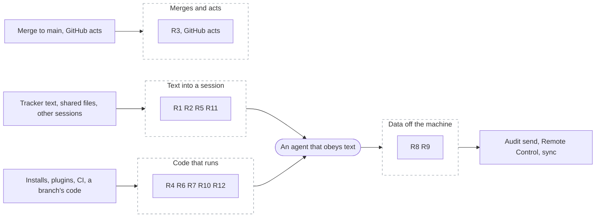
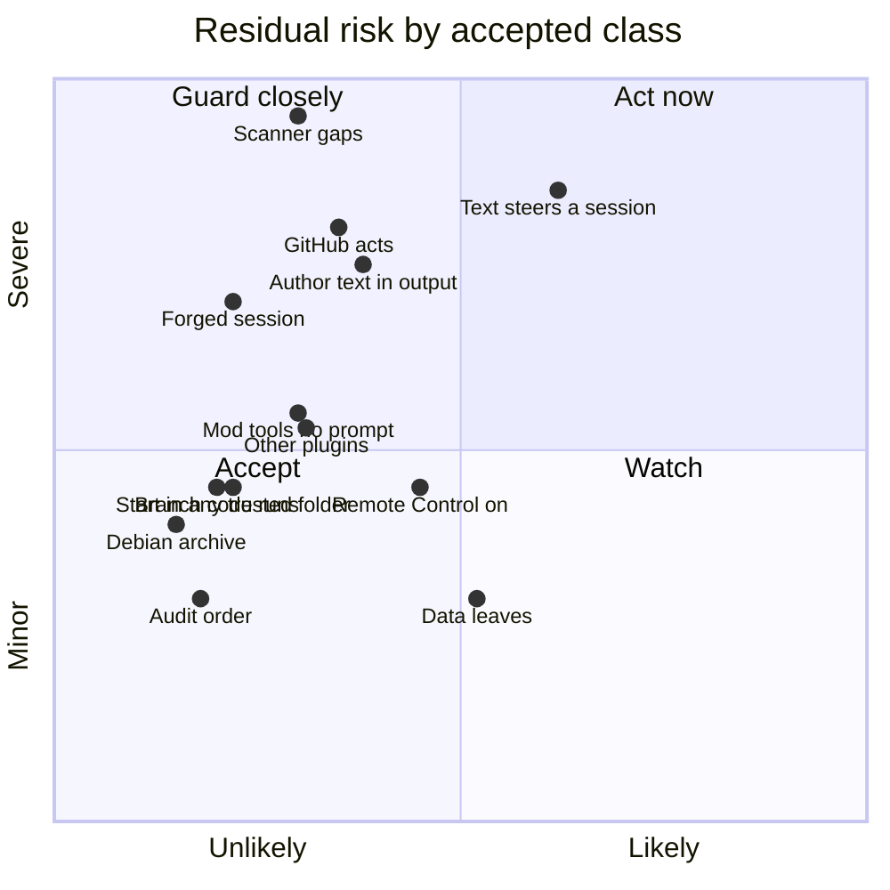

# Threat model

Read the boundaries first. Place each finding on one: where something
comes in from outside, or where an act goes out. What starts and ends on
the machine (your own computer, or a sandbox run on it) is the machine's,
and no finding; what came in from outside stays outside input. Name the
control that holds the boundary against the path, with when it doesn't
hold; if one does, add nothing. Check the residual against the classes.
Bring the owner what the guide's step 5 lists, every `security?` row
included; no class covers a change that weakens a rule or control, adds a
route for outside text into a session or more reach to one that reads it,
adds text to files sessions load, or writes a secret into text sessions
read. The full guide is the pact's review procedure, The threat model
section (`~/.claude/pact/review.md`; public copy:
https://github.com/mephistopheles4/the-pact/blob/main/claude/review.md).

[`SECURITY.md`](../../SECURITY.md) is the summary. Four pages hold the detail
behind the controls: [`checks.md`](checks.md), [`brigade.md`](brigade.md),
[`rendering.md`](rendering.md) and [`hiring-interview.md`](hiring-interview.md);
[`scanners.md`](scanners.md) and [`edge-audit.md`](edge-audit.md) say what the
scanners and the audit send. An edit that weakens a control one of them names is
a removed control.

## Boundaries

### Text into a session

**Crosses:** a stranger's tracker text and outside pull requests that a skill charts or a session works on; a file a stranger shares (box, flightpath, skill, agent, contract, answers block); another session's messages, reports, relays and hand-offs, wrong or forged; heard speech.

**Controls:**

- Harness: the permission mode's prompts and classifier, deny and ask rules, and folder trust. Claude Code's documented behaviour: none of them under `bypassPermissions` or an allow rule, and the classifier is skipped when a mod approves the call. This is the host agent's own rule that file content is data.
- Installed by the pact: deny rules on raw worktree and branch removal and `claude rm`, and on `claude stop`, `kill`, `daemon stop` and `respawn`, each on only while its switch is on; an ask rule on the cleaner, passed under `bypassPermissions`. Speed bumps, not gates.
- R1: each skill says the material is data; groundtrack tells the reader a request-like line, says AI drew the page, and stamps it authored; traces are literals a reader can check.
- R2: renderers escape control and invisible characters, cut strings at 200, 1,000 and 2,000, put no author text in an attribute, fill pages in one pass, and refuse hostile shapes at three measured limits (call depth 1,000, tree rows 20,000, cut-call search 1,000,000). Answers bind to their draft by SHA-256; the hiring page has a content security policy. Eagle-eye walks at most 20,000 steps. The contract skill never writes a hook, a settings file or a permission list, asks before an installing write, and takes an action drafted from a file only on the person's own words. Rules 2c and 6c refuse hidden characters and unlisted keys. The hiring interview has Reset, a hand-back delete and a refusal of a parent inside a git work tree. [Detail](rendering.md), [hiring-interview.md](hiring-interview.md).
- R5: the head chef's sender check (status file, `from-session` and `from` pairing), fixed-form start prompt, sends only to a local address, reports as data, the owner's yes for starts, cleanup and each GitHub act, and no force push, no remote branch delete. A background start refuses a bad name, form, shell, issue number, repository, permission mode or prompt, and relies on folder trust; a Desktop start needs the owner's words. Cleanup runs a cleaner the owner's instructions name, only for a folder it knows, never on a main working tree or a worktree another session is in; a failed run is told and left. At level 3 the lead decides what the owner's user-level file hands it; an install, a post carrying private work, and an edit to this model's scope, its classes or its AGENTS.md line still wait for the owner. [Detail](brigade.md#row-16).
- R11: a skill under test runs in don't-ask mode with hooks off, settings edits and reaches off the machine denied, the environment built from a named list, and backups of the owner's live places. Hygiene, not a boundary (ADR 0006).

**Residual:** Text steers a session; Renderer output carries author text; A forged or misled session can speak for the lead; A steered lead can start a session in any trusted folder; Box text can move an audit edge. The rules they rest on, each a control: only the owner's words in the lead's chat count as the owner's; installs stay the owner's; reports and relays are data.

### Code that runs

**Crosses:** the Brigade mod and other plugins loaded beside it; CI actions and packages; a branch's own code when a session opens on it; the local check's image build.

**Controls:**

- Harness: folder trust and the permission mode hold a branch's folder and the mod's tool calls only as Claude Code documents them; a mod's own call skips the prompt.
- GitHub: secret scanning with push protection, Dependabot security updates and version updates on Actions, and CodeQL default setup on Actions, JavaScript and TypeScript.
- R4: every action pinned to a commit SHA, with zizmor's `ref-version-mismatch`; `persist-credentials: false` and per-job permissions; the validator package pinned, unpacked and never installed; `npm pack` run outside the checkout, and rule 6 refusing `.npmrc` and `.yarnrc.yml`.
- R6: the mod asks the engine for its verdict first; its pane waits for `/brigade` or a head-chef load; the model never names a path, and a path rule runs before and after each write; writes are strict-checked, one at a time, capped; each call's bounds, `gh` argument lists and Open in app routes are fixed. [Detail](brigade.md#row-15).
- R7: plugin state is read through checks and caps and drawn as text; the autonomy level changes only by a slider press or the owner's level command, reads 1 on any other value and logs an alarm, and a 3 counts only after the owner confirms it in the lead's chat.
- R10: rule 6d holds the tracked settings file to the one agent-guard entry; `CONTRIBUTING.md`'s agent guard says to read a branch's `.claude/` and `scripts/` first, or open with hooks off.
- R12: the local check run has no network; its build folder is held to `tests/container/`; the base image is pinned by digest and Claude Code by sha512; athanor refuses an engine not on this machine unless `allowRemoteDocker` is set.

**Residual:** Other plugins share the mod's trust; The mod's tools run with no permission prompt; A tracked hook runs a branch's code; The local test image trusts Debian's archive.

### Merges and acts

**Crosses:** a merge to `main`, which reaches every installer; a GitHub act, such as a post, merge, close or branch delete, that the head chef or the pane makes on the owner's word; a release.

**Controls:**

- GitHub: a ruleset on `main` requires a pull request, an up-to-date branch and the checks `check`, `scan` and `audit`, and blocks deletion and non-fast-forward pushes; it requires no approving review. The plugin validator's `validate` runs on pull requests and is not a required check.
- R3: `scripts/check.mjs` holds frontmatter keys, hidden characters, manifests, baselines (rules 2c, 6c, 7 and 7a), fixed home paths and a version bump; SkillSpector's probe, the scanner pins, and partly read files pinned by content; review of each diff.
- The head chef names the repository and whether it is public before an act, deletes its temporary post file, reads the head again before a merge, deletes a branch only on the owner's words or a same-repository head, and posts no error text. A level-3 merge names the reviewed head; every other merge or close, and a merge that changes this model's scope or classes, waits for the owner's words. [Detail](brigade.md#row-16).

**Residual:** Review is the guard for scanner gaps; GitHub acts on the owner's word are irreversible and public.

### Data off the machine

**Crosses:** the edge audit's send of a box's text to a provider; Remote Control and claude.ai; the pane's `gh` calls under the owner's sign-in; sync and backup of a folder the person names; a path or key in a shipped file, page or post.

**Controls:**

- R8: the audit's dry run first names every receiver, and a standing yes comes only from the user's own instructions; `audit.mjs` never prints or writes the key; the endpoint override takes only loopback. [Detail](edge-audit.md).
- R9: rule 2 refuses a fixed home path in shipped folders, the one print helper masks the account segment, and groundtrack warns on an absolute path, naming the field. [Detail](checks.md#row-17).
- The permission warning before the first launch names background sessions.

**Residual:** Data leaves the machine as the owner accepted; Every background member runs with Remote Control on.

## Scope

**In:** the four boundaries above. **Out:** the machine, the owner's own computer or a sandbox run on it, with every program, process, account, file and memory made there; a local tool's data on a user's own computer is that user's machine. A cloud session's sandbox, a service a project deploys, and that service's users' devices are not the machine; data that service keeps for its users is past a boundary. grimoire runs nothing on a server. The machine's own controls (antivirus, account isolation, disk encryption) hold only the machine. Loss of work with no attacker is not a class; its checks stay, and a change that loosens them is a spec change. Third parties relied on: model providers, GitHub, claude.ai and Remote Control, Debian's package archive, the container engine. The root of trust is the owner's GitHub account.

## Accepted threat classes

- **Text steers a session.** The host agent is the last guard against text read as instruction; grimoire builds no detector for injected wording, so a well-worded injection can steer a session, and rules held by prose a steered session can break.
- **Review is the guard for scanner gaps.** Baseline allowances cover whole files or rules, some files are read in part, nothing is signed, and a skill is dangerous by its nature (ADR 0006).
- **Renderer output carries author text.** An escaped one-line name can still read like a path or a reason; refusal lines are bounded each, not in count; deep nesting stops a renderer with one line.
- **Other plugins share the mod's trust.** A plugin the owner installed can read the mod's plugin state, rewrite the usage record, plant the warning's dismissal, and rewrite or press the autonomy level; a 3 counts only on the owner's confirmation, which it can forge.
- **A forged or misled session can speak for the lead.** A message under the lead's shown name, a relay counted as a decision, or a confirmed level 3 can move the lead, and false log entries and hand-offs can be written; the lead's own calls are not limited.
- **GitHub acts on the owner's word are irreversible and public.** The head is not pinned between review and merge, a broad word covers acts it did not name, deletes are permanent, and history keeps text; at a confirmed level 3 the lead's own picks reach a merge.
- **A steered lead can start a session in any trusted folder.** The start binds a folder to no repository the owner chose, and its reads run before the trust gate, so a refusal shows whether a path exists, is a main checkout, or belongs to a repository.
- **The mod's tools run with no permission prompt,** in plan and don't-ask modes too, each inside its guards and the path rule: `set_roster`, the four tab tools and `stop_background_session`.
- **A tracked hook runs a branch's code when a session opens.** The owner judged the agent guard worth that exposure; it protects the merge, not the reader.
- **The local test image trusts Debian's archive at build time.** git and its packages install unpinned, with network and proxy settings; a moved or replaced package runs inside an image that only runs checks.
- **Data leaves the machine as the owner accepted.** A provider keeps the audit text; pull request rows, the autonomy level and decision files reach Remote Control devices, backup, sync and the account's audit log; an author's home path warns and does not block.
- **Every background member runs with Remote Control on.** Its whole conversation goes to claude.ai and every device signed in, and any signed-in device can type to the member and answer its permission prompts.
- **Box text can move an audit edge.** A box's text can move an edge in the audit's reread order; a score never changes a tier.

## Residual risk

L and I, from 0 to 1, are judgement after today's controls, carried from the old matrix where it scored the path.

## Open issues

- R1: what a steered session does, a misleading sheet first, is not covered by the class.
- R2: the attribute rule is held by review, not by a parse of the page.
- R3: plain-prose instructions no scanner detects; fifteen scanner dependencies resolve fresh each run.
- R4: the CI pins are not content pins, and no tarball hash is checked; git in the image is not hash-pinned.
- R5: cleanup's authorization; the sender check is a consistency check; git config still runs programs in the lead at cleanup; the start's reads run on any well-spelled local folder before the trust gate ([#588](https://github.com/mephistopheles4/grimoire/issues/588)); rerun the version checks when Claude Code changes ([#587](https://github.com/mephistopheles4/grimoire/issues/587)).
- R6: the `claude://` opener inherits the session's environment; the roster's check-and-write race.
- Remote Control: how long a member's transcript stays after it stops, and whether a device keeps a copy, are not checked.
- R8: the script cannot stop the agent itself printing an environment variable.
- R9: a home root joined from a separate string is not seen, and free text is not checked.
- R10: the agent guard protects the merge, not the reader.
- R12: the build runs before the check on an unread branch, with the registry login and proxy passwords; a non-local container engine gets the run's data.
- Plugin-side gaps, not accepted: another plugin planting or rewriting decision files, marks, hand-offs or summaries, planting or hiding refusal lines, reading the report store or a session's Remote Control link, pressing against cleanup's yes, or seeing tool calls through the mod's hook; cleanup's indirect removal paths.
- Not accepted: a session named like a card feeding it; the pill press has no rate limit; a skill's write scope and a contract's second-agent load are held by prose.
- Waiting for the owner's word: a member takes a message under its lead's name as its lead's; a start's note can redirect a member; own-pick starts, posts and level-2 merges at levels 2 and 3, flagged big.
- Data flows no class covers: the lead's own transcript and a Desktop member's on Remote Control devices, the apps' own stores and the phone sync, a removed background session's transcript, the `claude://` opener's environment: ask the owner.
- Package-manager settings files nothing reads (`.yarnrc`, `.pnpmfile.cjs`, `bunfig.toml`, `.env`): ask the owner.
- The plugin validator `validate` is not a required check on `main`: ask the owner.
