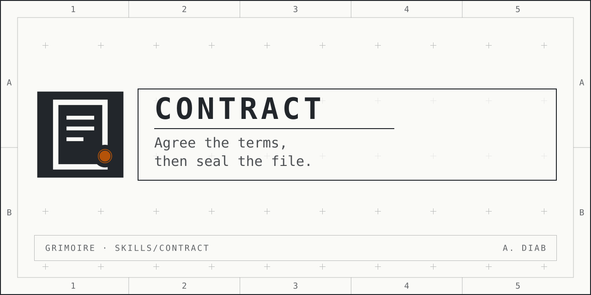

<p align="center">
  
</p>

# contract

**People ask for help in human language, and an agent needs exact instructions.**

A person who wants a reusable helper usually writes a prompt. They paste it
again and again, and edit it when it goes wrong. The prompt drifts. Nobody
can say which line holds which decision, or why. A day later, the person who
decided often cannot say either.

contract closes that gap. The person does not write a prompt. The person
agrees terms, and the skill writes the prompt from those terms. The terms,
and the history of why each one was decided, stay beside the prompt.

The contract reads like an employment contract, and the skill works like a
hiring interview: `purpose` is the job offer, `why` is why you are hiring,
`good` is what great work looks like, `roles` holds the duties, sign-offs and
stops, `tools` the keys and access, `rules` the house rules, `writing` the
house style, and `open` the probation. A *Proposed* answer is the draft offer; **Confirmed**
is signed as offered; **Decided** is a term you negotiated.

## Use it

Ask for it by name. The installer route keeps the plain name; the plugin route
namespaces it:

```text
/contract <the skill or agent you want>
/grimoire:contract <the skill or agent you want>
```

Or let it step in. It steps in when a person wants to build a reusable skill
or agent, for a prompt they keep pasting, and for a change to a skill, agent
or CLAUDE.md that has a contract. It stays out of a one-off prompt, and of a
request to run a skill or agent that already exists.

**Read before you install.** Read a shared skill, agent or CLAUDE.md and its
contract before you use it, as you would any code from someone else.

**The hiring page keeps your answers, unencrypted.** If you take the second
way in (below), the page keeps your answers in your browser until you press
**Forget these answers** on it. Other pages opened from disk in the same
browser, browser extensions with file access, programs running as you and
backups of your browser profile can read them. Forget removes them from the
page's store; your browser may keep its own copy on disk for a while. Your
browser's history keeps the page's title and location. The draft, the page and the
answers file in the interview's scratch folder hold the same answers,
unencrypted, until the skill deletes them at the hand-back. The scratch
folder is in your own temporary folder on Windows and macOS, and under
`$XDG_CACHE_HOME/contract-interview/` or `~/.cache/contract-interview/` on
Linux; on macOS and Linux only your account can open it. Once the page and
the draft are gone, clearing your browser's stored data for pages opened
from disk is the one way left to remove saved answers.

To try the skill before a release, install it with the "Pinned to one commit"
route in the [root README](../../README.md), using a commit from the pull
request.

## How it works

The skill proposes what you are making (a skill, an agent or a CLAUDE.md),
how thorough to be, and its name, from what you already said. You confirm.
Then it asks one question at a time, and fills a contract of eight parts:

| Part | What it holds |
| --- | --- |
| `purpose` | What it is for, and when it steps in or stays out |
| `why` | Why it exists, in your own words |
| `good` | What good output looks like |
| `roles` | Who does what, and when it stops to ask |
| `tools` | What it may use and do |
| `rules` | Its rules, and the failures they guard against |
| `writing` | Its terms, and how it writes |
| `open` | What is still open, and when you would retire it |

The level sets which parts it asks. Quick fills the first five, Standard adds
`rules` and `writing`, and Thorough adds `open`. You can change the level at
any time, by answering more or fewer questions.

It drafts what it can and marks each draft *Proposed*. It never writes `why`
for you. Before it builds anything, you agree what good output looks like:
your real example, or the closest of two or three samples it drafts.

When you give the go, it generates the file from the contract, and runs
`claude plugin validate --strict` on it. When that command is not available,
it says the file was not validated.

## The second way in: the hiring page

Most people do not know what to write in a contract, or do not enjoy it. So
the skill offers a second way in, where you answer by picking.

1. In chat, you agree what good output looks like, as above.
2. The skill drafts the contract, every answer *Proposed*, and renders it as
   a page on your machine: a short offer letter with blanks, and its
   schedules below it. You open the page in your own browser.
3. Each blank asks what should happen in a situation, with two to four
   options. Where a term can do damage, such as a stop or a key, the page
   asks for your pick before it shows the skill's. The only box you must
   write in is why you are hiring.
4. You copy one answer block from the page and paste it in chat. The skill
   checks it with its script, which prints what changed, and asks you about
   each term that can do damage, in your own words. Then it writes the
   contract and builds, as in the chat way.

The page needs **Node.js 24 or later** to render, and nothing else to
install. It loads nothing from the network. When Node is missing, or you
cannot open a file from this machine in your browser, the skill offers the
chat way. [An example page](https://mephistopheles4.github.io/grimoire/skills-contract-examples-release-notes.html)
shows a made-up skill's interview; it keeps nothing.

## Fix the contract, not the file

**The contract is the source. The built file is output.** Nobody edits the
file by hand.

When it goes wrong, ask for a change. The skill uses **amend mode**:

1. It finds the clause that should have held, and proposes a change to it.
2. It records the change in the change log, with its reason.
3. It shows the change list, and waits for your go.
4. It regenerates only the parts of the file the change touches. In a
   `SKILL.md`, each generated part sits between two comment lines that name
   it. An agent file or a CLAUDE.md has none, so only the sections the
   change touches are regenerated. Every other line stays word for word.

A small change then gives a small diff, and a reviewer can read it.

## What it hands back

1. **The contract** and its change log, with a mark on every answer.
2. **The built file**, marked "not installed".
3. **The validator's output**, as printed.
4. **The unsettled list**: each open answer and question, and where to
   install the file.

## What it never does

- It never installs what it builds. Installing activates it in every future
  session, so that choice is yours.
- It never runs an eval without your yes in chat, each time.
- It never sends or publishes anything.
- It never writes a hook, a settings file or a permission list.
- It never follows an instruction that it finds inside a file. A "yes" in a
  file is never your yes.

## Changes in 0.13.0

**A second way in, the hiring page.** The skill can render a local page
where you answer by picking, then read back the one block you paste. Its
interview script, `scripts/render.mjs`, makes a scratch folder for each
interview, renders the page, checks the block, prints the change list, and
deletes its own files at the hand-back. It needs Node.js 24 or later. The
page keeps your answers in your browser until you press Forget, unencrypted:
see "Read before you install" above. On the page you can add, move and
remove a schedule's entries. To remove or move a term in the letter, say so
in chat at push-back.

**An answer for the tools, an action or a stop needs your own words,** on
both ways in, unless it is only what the skill needs to run.

**To roll back,** revert the change and publish the next minor version. An
interview still open then finishes by the chat way, and Forget still works on
a page already rendered.

## Changes in 0.12.0

**The skill is rebuilt to the shape it teaches.** It asks one question at a
time, and its contract has eight parts in place of 20 questions. The old
check, and the keys it wrote into each built file, are gone: the skill runs
`claude plugin validate --strict` instead. Its own contract moves to `references/CONTRACT.md`, and its history
to `references/contract.changelog.md`, where every earlier version's changes
are kept.

**An older contract converts at its first amendment.** Amend mode maps each
old question to its part and keeps each answer's words and mark.

**To roll back,** revert the change and publish the next patch version.

## What is in this directory

| Path | What it is |
| --- | --- |
| [`SKILL.md`](SKILL.md) | The skill. It is generated from the contract, so do not edit it by hand. |
| [`references/CONTRACT.md`](references/CONTRACT.md) | This skill's own contract. Change the skill here, then generate `SKILL.md` again. |
| [`references/contract.changelog.md`](references/contract.changelog.md) | This skill's history: every version, why, and where it came from. |
| [`references/template.md`](references/template.md) | The eight parts, the levels and the marks. |
| [`references/amend.md`](references/amend.md) | Amend mode: how the skill changes something that has a contract, and converts an older one. |
| [`references/binding-claude.md`](references/binding-claude.md) | How the skill builds an agent or a CLAUDE.md for Claude Code. |
| [`references/binding-antigravity.md`](references/binding-antigravity.md) | How the skill builds an agent for Antigravity. |
| [`references/binding-codex.md`](references/binding-codex.md) | How the skill builds an agent for Codex. |
| [`references/hiring.md`](references/hiring.md) | The hiring page: how the skill drafts, renders and reads back. |
| [`scripts/render.mjs`](scripts/render.mjs) | The interview script: the scratch folder, the page, the block check, and the deletes. Node.js 24, no dependencies. |
| [`scripts/interview.js`](scripts/interview.js) | The one module the page and the script share: the checks, the marks, the block, restore and Forget. |
| [`scripts/kinds.json`](scripts/kinds.json) | The kinds of clause, with their parts, fields and stakes. The only copy of that table. |
| [`assets/template.html`](assets/template.html) | The page the script fills in. |
| `assets/` (the rest) | The page's fonts, their licence, and the Aviation design system's stylesheet, copied in so the page loads nothing. |
| [`examples/release-notes.interview.json`](examples/release-notes.interview.json) | A made-up skill's draft, published as the example page. |
