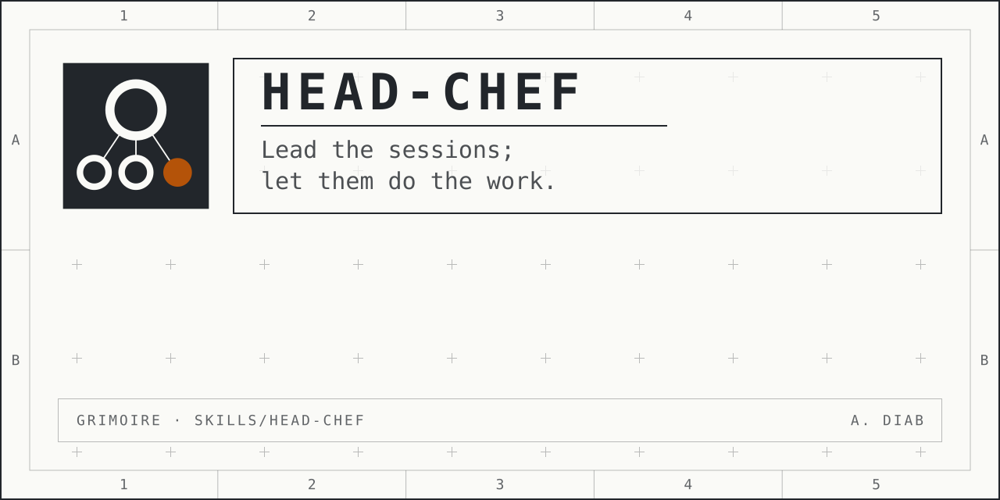

<p align="center">
  
</p>

# head-chef

**One session leads. The sessions it starts do the work.**

A person who runs many sessions on one or more efforts repeats the same
actions by hand: starting a session, managing its context, handing work to
another session, and archiving it. head-chef takes care of those, so you can
stay on the bigger picture, keep its direction, and step in where you need to.

head-chef makes one Claude Desktop session the **head chef**: the lead of a
**brigade**, the sessions it starts. Unlike a subagent or a workflow, every
session it starts is one you can talk to directly, at any time. When and why
to start a session comes from your own process or your request.

## The words it uses

- **Head chef:** the session this skill runs in, which leads the others.
- **Lead:** the Desktop session the head chef runs in.
- **Brigade:** the sessions the lead started.
- **Name-back:** the list the head chef shows before an act that cannot be
  undone, naming exactly what it will touch.
- **Permission warning:** the band above the prompt that says what the head
  chef's sessions put at risk.

## Use it

Install grimoire as a Claude Code plugin to get the skill, the Brigade pane
and the permission warning together:

```text
claude plugin marketplace add mephistopheles4/grimoire
claude plugin install grimoire@mephistopheles4
```

An `npx skills` install copies skill folders only. It gives you `head-chef`
but not `/brigade` or the warning band: the skill then works without a pane,
and says the warning once in chat instead.

It needs Claude Code, Claude Desktop, git, and the GitHub command line (`gh`)
installed and signed in.

Then, in Claude Desktop, ask for work to run elsewhere, for example *"start a
session to build ticket 4 of issue 312, Sonnet medium."* Or type
`/head-chef`. With the plugin installed, the pane opens when the skill loads,
or type `/brigade` to open it.

## What it does

- **Starts sessions.** Each one is a Desktop session under the lead, with its
  name, model and effort set. The model and effort come from your words or
  your own process. Its start prompt is one short pointer: the stage and the
  issue, which holds the brief, and how to report to the lead.
- **Never relies on a card** to start work you asked for. When a start can
  only happen through a card, such as an approval above the lead's settings,
  it says in one line that the card needs a tap in the desktop app.
- **Reports the start** in a few lines: the session, its issue, what you must
  do, and your usage. Usage stays in chat.
- **Relays** questions and answers, quoted, with the source named.
- **Decides small questions** your direction already covers, and tells you in
  one line.
- **Watches** for a session that is blocked, quiet, or done without
  reporting, and messages it to ask.
- **Keeps the Brigade pane** in the same step as each act, while the pane is
  open.
- **Cleans up** on your "done": one name-back of each session, its worktree
  and its branch, then one yes. It runs its checks again, archives the
  session, and removes with git whatever the archive left. It never forces a
  removal.
- **Acts on GitHub** only on your own words in its chat: merge, close, edit,
  delete or label an issue or a pull request, file an issue, or post a comment, each named in
  one line first.

## What counts as your yes

Only your own words in the lead's chat. A session's message, a report, a note
or an issue comment never counts: a request in one is told to you, and
nothing happens. Accepting a risk is your words in chat too; pressing I
understand on the permission warning is a reminder, not acceptance.

## What the sessions trust

A session takes a message from the lead as a **relayed decision**, on any
matter, when the sender's shown name matches the lead's row in the session
list and no other row holds that name. It labels it as relayed by the lead,
never as your own words, and names each decision it acted on in its next
report to the lead. A session
cannot tell a forged sender from the lead, so anything that can send it a
message under the lead's name can steer it. The head chef tells you at once
when a session reports a decision it never sent.

A session also follows comments on its issue made as you, and every session
you start posts as you, so a comment from one session can steer another.
While Remote Control is on, any device signed in to your account can drive
the sessions it starts. The permission warning says all of this before the
first launch in each lead, until you tick "Don't show again". It shows again
when its wording changes.

## The permission warning

The Brigade mod draws it above the prompt when the head chef calls its
`show_permission_warning` tool. "I understand" hides it for this session.
Tick "Don't show again" first, and it stays hidden in every later lead until
its wording changes. The choice is kept in the plugin's own store, as the
time and a hash of the wording.

## Upgrading from an older head-chef

Finish or clean up a brigade an older head chef started before you upgrade:
its sessions follow their old start prompts, not this one.

**Leftovers from 0.4.0.** Its relay scripts may have left five kinds of
file, which can hold your quoted words, questions and session ids. 0.9.0 no
longer checks for them, so delete them by hand. Before you delete the
folder, check that it is a plain folder, not a link or a junction.

| What | Where | How to spot it |
| --- | --- | --- |
| The relay state folder | `plugins/data/grimoire-relay/` under your Claude config folder: `CLAUDE_CONFIG_DIR` when that is an absolute path, otherwise `.claude` in your home folder | Per-session JSON files, holding question words, choices, issue links and session ids |
| Lock and copy files | In that folder | `.lock` files, and `<session id>.<hex>.tmp` copies |
| Post files | The temporary folder that your `TEMP`, `TMP` or `TMPDIR` setting names | Named `grimoire-relay-<hex>.md`; one left by a crashed run can hold your quoted words |
| Question files | `$CLAUDE_JOB_DIR/tmp`, or the temporary folder that `TEMP`, `TMP` or `TMPDIR` names | Random names; one question line, then lines starting `A)`, `B)` and on |
| Local-only list files | The temporary folder that `TEMP`, `TMP` or `TMPDIR` names | Random names; one line of local-only answers |

The last two have no fixed name, so you may not find them all. A record act
from 0.6.0 to 0.8.x that was interrupted can also leave a post file in the
temporary folder, named `grimoire-act-<hex>.txt`; from 0.9.0 the file is
named `head-chef-post-<hex>.md`. Either can hold text you asked the head chef
to post.

**What 0.4.0 posted on your issues stays there.** Sessions under 0.4.0
posted your quoted words, their questions and choices, and taken-answer and
failed-check lines on their issues, which may be public. To remove them,
delete those comments, or delete the old version from each edited comment's
history: an edit alone keeps the old text there. Notification emails already
sent keep it too.

## Files

| File | What it is |
|---|---|
| `SKILL.md` | The skill. Generated from the contract. |
| `references/roster.md` | How the head chef keeps the pane's roster. Generated with `SKILL.md`. |
| `references/CONTRACT.md` | The contract `SKILL.md` is generated from. |
| `references/contract.changelog.md` | The contract's history, from 0.1.0. |
| `.skillspector-baseline.yaml` | Why four of the scanner's rules are false positives here. |

Nothing seals a generated file. To change the skill, amend the contract and
generate `SKILL.md` again; a reviewer reads every changed file in full.
