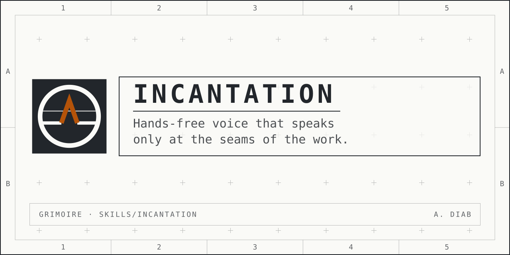
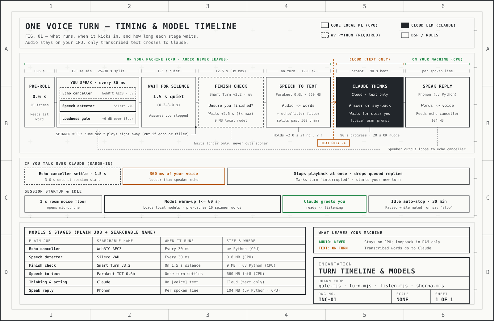

<p align="center">
  
</p>

# incantation

**A familiar at your shoulder. Think out loud together.**

A voice pair-programming partner for Claude Code. `/incantation` turns a session
into one you talk with: it greets you, speaks short plain turns (one fact at a
time), listens at all times, says any request that changes anything back before it
acts, and speaks unasked only when something needs you. Talk over it at any
time and it stops.

By default, hearing and speaking run locally on your CPU inside the listener's
own process (Parakeet hears, Kokoro or Phonon speaks, nothing opens a port), and
only transcribed text reaches Claude. [Voicebox](https://voicebox.sh) stays as a
second local engine on `127.0.0.1:17493`. Incantation is a skill of the
`grimoire` plugin (`grimoire@mephistopheles4`), whose mod carries each heard turn
into chat, nudges you at permission prompts, and draws the mic band. If you
installed the earlier `incantation@mephistopheles4` plugin, uninstall it. Only
your own typed `/incantation` starts the mic.

## How a turn works

<p align="center">
  
</p>

| When | Duration | Model / stage | Runs on | What it does |
|---|---|---|---|---|
| Startup | `1 s` floor, `<= 60 s` warm-up | Room calibration + model warm-up (`ffmpeg` + local models) | Local CPU | Measures room noise floor, loads models, pre-caches 10 spinner words |
| Before you speak | `0.6 s` (`20 frames`) | Pre-roll buffer | Local CPU | Keeps audio right before speech triggers so your first word is not clipped |
| While you speak | Every `30 ms` (`120 ms` min, `25–30 s` split) | Echo canceller (`WebRTC AEC3`, optional `uv`) + Speech detector (`Silero VAD`, `0.6 MB`) + Loudness gate | Local CPU | Strips speaker echo, filters clicks/typing, splits marathon turns cleanly |
| When you pause | `1.5 s` quiet (`0.3–3.0 s`) | Wait for silence + spinner word | Local CPU | Closes the turn and plays a short cue (`"One sec."`) right away |
| If you sound unfinished | `+2.5 s` per hold (`3x` max) | Finish check (`Smart Turn v3.2`, `9 MB`, optional `uv`) | Local CPU | Checks the last `8 s` of audio; waits longer if mid-thought, never cuts sooner |
| Once turn settles | Once per turn (`+2.0 s` joiner if no `. ? !`) | Speech to text (`Parakeet TDT 0.6b v2`, `660 MB`) | Local CPU | Turns audio into words and drops filler/echo fragments |
| Thinking & acting | `90 s` progress beat, `20 s` OK nudge | Claude thinks & acts (via grimoire mod) | Cloud (text only) | Answers questions aloud, or gives a one-sentence say-back and waits for a clear yes (an easily undone act goes on) |
| Replying aloud | Per line (`3` max queued) | Speak reply (`Kokoro 1.0`, `393 MB` or `Phonon`, `104 MB`, `uv`) + `ffplay` | Local CPU | Speaks one short fact and loops speaker audio back to the echo canceller |
| If you talk over Claude | `360 ms` voice (after `1.5 s` grace) | Barge-in detector | Local CPU | Stops playback at once, drops queued replies, opens your new turn |
| Long silence | `30 min` quiet | Idle auto-stop | Local CPU | Closes the mic automatically (paused while the mic is muted) |

`Voicebox` swaps `Parakeet` + `Kokoro`/`Phonon` for a local HTTP server on
`127.0.0.1:17493`.

## What a session feels like

```text
You:    What's failing on this branch?
[One sec.]
Claude: Two unit tests in the gate module failed on the timeout check. Want the details?
You:    No, fix the timeout check and run the suite again.
[Looking into it.]
Claude: So you want me to fix the timeout check in the gate tests and run the suite again. Shall I?
You:    Go ahead.
Claude runs it, then says: Fixed the check and all twelve tests passed.
You:    File an issue to tidy the gate's timeouts later.
Claude: I'll file that as a new issue now.
Claude files it, then says: Filed. Say if you want it closed.
```

Each spoken line also shows in chat as a block quote, so you can tell at a
glance what was said aloud. Your own relayed turns already show as your
messages and are not repeated.

- **One fact per turn.** Spoken replies stay short and plain, with no markdown,
  file paths, or IDs read aloud; full details go into chat.
- **Say-back and clear yes.** Any request that edits files, runs side-effecting
  commands, merges, pushes, or installs is said back in one sentence (naming any
  cost) and acts only on a clear yes (`"yes"`, `"go ahead"`, `"do it"`, `"yeah"`,
  `"yep"`, with no pull-back words).
- **Easily undone acts go on.** Filing an issue in your own private tracker,
  messaging another of your sessions, or editing a scratch file or a roster card
  is said back ("I'll file that now") and done in the same turn, with no wait
  for a yes. Say "no" or "wait" while it is being said back to stop it; a quick
  act like filing an issue is usually done by then, so ask for it put back. It
  waits for a yes anyway, for example when the record is public, when it costs
  anything, while the voice is muted, or when a rule of yours keeps it for you.
- **Talk over it any time.** The mic stays open while Claude speaks. Talking over
  a reply stops playback immediately and drops any lines queued behind it.
- **Instant feedback & nudges.** A heard turn gets a short spinner word right
  away; long work speaks a progress line every `90 s` (or `"Still working on it."`
  during one long tool call), and a waiting permission prompt nudges
  `"I need your OK on screen."` at most once every `20 s`. Voice never answers
  permission prompts on screen.

## Commands

| Command or phrase | What it does |
|---|---|
| `/incantation` | Checks setup, warms the local models, greets you, and listens continuously |
| `/incantation install` | Downloads your chosen voice runtime (`kokoro` or `phonon`), picks mic & voice, runs guard |
| `/incantation observe` | Runs live while logging unspoken speak-gate candidates for tuning instead of speaking unasked |
| `/incantation mute` / `unmute` | Mutes or unmutes the mic (or say `"mute"` / `"unmute"` alone aloud) |
| `/incantation mute-voice` / `unmute-voice` | Silences spoken audio while keeping transcript turns and chat replies active |
| `"stop"`, `"that's all"`, `"goodbye"`, `"we're done"`, or typing | Ends the listener and prints `Stopped listening.` |

## Quick start

1. **Prerequisites.** Install **Node 24 or later** and **ffmpeg** (with
   `ffplay` in the same folder, on your PATH). Install
   [`uv`](https://docs.astral.sh/uv/) if you want echo cancellation (`WebRTC AEC3`),
   end-of-turn hold (`Smart Turn`), and the `Phonon` voice. Grant your terminal
   or desktop app OS microphone permission. (If using Voicebox instead of the
   local runtime, install Voicebox 0.5.0+ and start it on `127.0.0.1:17493`.)
2. **Install.** Install the `grimoire@mephistopheles4` plugin (required for the
   mod that relays `[voice]` messages into chat and draws the mic band), then
   type `/incantation install` in a session. Choose `kokoro` (fast default) or
   `phonon` (requires `uv`), confirm the download plan, pick your mic number and
   voice ID, and optionally enable the terminal status line.
3. **Start.** Type `/incantation` in any Claude Code session (including a
   brigade lead).

> **Tell people within the mic's reach that it is always listening.** While
> Incantation runs, the mic stays open continuously. Audio stays on your machine,
> but everything transcribed reaches your model provider as chat (and `claude.ai`
> / signed-in devices if Remote Control is on). A muted mic sends nothing.

## Reference & privacy

<details>
<summary><strong>Platforms &amp; OS differences</strong></summary>

| Platform | What you get | Status |
|---|---|---|
| Windows 11 | the whole runtime, with `uv` for the Python layer | Tested with a real mic and a headset: the owner's trial. |
| Windows 11 without `uv` | the core: hearing, speaking, the speech detector, the steady player, the loopback reference and the text echo guard; no echo canceller (so use a headset), no end-of-turn hold, no Phonon voice | Same trial, core only. |
| Linux x64 and Linux on ARM (64-bit) | the whole runtime, with `uv` for the Python layer, which needs glibc 2.28 or later (the onnxruntime and livekit wheels are `manylinux_2_28`) | Installed, verified and each part started once by the `incantation-platforms` workflow; no real-mic run. |
| macOS 14 or later, Apple Silicon | the whole runtime, with `uv` for the Python layer | The same workflow, and a Phonon run on an Apple Silicon Mac; no real-mic run. |
| macOS 13 or later, Intel | the whole runtime, with `uv` for the Python layer. Intel Macs run an older onnxruntime, 1.23.2, because later releases publish no Intel Mac wheel; elsewhere it is 1.32.0. 1.23.2 gets no upstream security fixes, and is safe here only because every model it loads is pinned by hash | The same workflow; no real-mic run. |
| macOS 13 on Apple Silicon, macOS 12 on Intel | the core only: onnxruntime's wheel needs macOS 14 on Apple Silicon and macOS 13 on Intel, and `setup.mjs runtime plan` says so | |
| Windows on ARM | no pinned addon: `sherpa-onnx-node` 1.13.8 publishes no Windows on ARM build, and the plan says so; choose Voicebox | |
| Any other platform | no pinned addon: the plan names the platform; choose Voicebox | |

The runtime is CPU only, on every machine. The code is the same everywhere;
these places differ by platform:

| Place | Windows | macOS and Linux |
|---|---|---|
| Capture input and device list | `dshow` | `avfoundation`, `pulse` or `alsa` |
| Finding ffmpeg | fully qualified drive folders on PATH | absolute PATH entries, owned by root or you, writable by no one else |
| The `~/.grimoire/incantation` folder's privacy | your profile folder's default access | 0700 folders and 0600 files, refused when looser |
| The OS mic permission | Settings, Privacy, Microphone, "Let desktop apps access your microphone" | macOS: give the terminal or app that runs Claude Code Microphone access; Linux: none beyond the sound server |

- **PATH security for `ffmpeg` and `uv`.** On macOS and Linux, both must sit in
  a folder owned by root or by you that no other account can write; a shared
  Homebrew prefix owned by another account is refused. Neither is ever resolved
  from the working folder.
- **OS mic permission off.** With permission off, the mic gives only silence and
  the listener stops after `3 s` with `listener error mic`.
- **A Bluetooth headset on macOS.** The headset's own mic works as the input,
  and replies play in the headset. While its mic is open, macOS puts the headset
  in call-quality audio, so replies sound thinner than music does. If you want
  full-quality playback in the headset, pick the Mac's own mic as the input
  instead.
- **Voicebox guard.** If you choose Voicebox 0.5.0+ (on Linux, build from source
  as its README says), start it and keep it on `127.0.0.1` only. At each start,
  Incantation's guard refuses to go on when Voicebox answers on any of the
  machine's other addresses at that moment; a network that comes up later is not
  checked until the next start.

</details>

<details>
<summary><strong>Runtime downloads, licences &amp; verification</strong></summary>

Incantation declares no dependency in the repository. `/incantation install`
runs `setup.mjs runtime plan <engine>` (`kokoro` or `phonon`) to list every
part, whether it is already installed, its download size, whether `uv` was
found, total size, peak disk use (download plus unpacked), time at 10 MB/s, and
every host it will contact, and downloads only on your clear yes.

The engine choice skips the other voice engine's files so you download one voice
engine and not both (with no engine named, the plan covers every part). `setup.mjs
runtime install <engine>` runs as a background command printing one line per
file and one result per part (`ok`, `skipped <why>`, `failed <file>`), and
refuses to start when free space on your home drive is short. `setup.mjs runtime
verify` re-hashes every installed file; at each start the guard checks only that
each file is present at its pinned size. With a Phonon voice (`Everly`) chosen,
the guard asks for Phonon in place of Kokoro, so Kokoro files need not be on
disk; Phonon requires `uv`, and the install fails without it (choose `kokoro`
then). The runtime lives under `~/.grimoire/incantation/runtime/` and nowhere
else.

| Part | About | Licence |
|---|---|---|
| The addon: `sherpa-onnx-node` 1.13.8 and its platform package, CPU build | 30 MB order | Apache-2.0 |
| Hearing: Parakeet TDT 0.6b v2, int8 | 660 MB | CC-BY-4.0, see below |
| Speaking: Kokoro 1.0 multi-lang, fp32, with its lexicon | 393 MB | Apache-2.0 |
| Speaking: `espeak-ng-data/`, and the espeak-ng code the addon carries | with Kokoro | GPL-3.0-or-later |
| The speech detector: Silero VAD | 0.6 MB | MIT |
| The Python layer, one venv from `uv` (CPython 3.12): `livekit`, `onnxruntime`, `numpy`, `ptts` and their dependencies | 190 MB | Apache-2.0, MIT, BSD |
| End of turn: Smart Turn v3.2 (CPU) | 9 MB | BSD-2-Clause |
| The Phonon voice, Everly, loaded by `ptts` | 104 MB | Apache-2.0 |

**Attribution.** The hearing model is NVIDIA's Parakeet TDT 0.6b v2, licensed
[CC-BY-4.0](https://creativecommons.org/licenses/by/4.0/), here as the int8 ONNX
conversion the sherpa-onnx project publishes. It is not changed beyond that.

**Where it comes from.** Downloads come from `huggingface.co` and its CDN,
`registry.npmjs.org`, `github.com` and its release hosts
(`release-assets.githubusercontent.com`, `objects.githubusercontent.com`), and,
for the Python layer, `pypi.org` and `files.pythonhosted.org`; `uv` also fetches
its own CPython from Astral's mirror (`releases.astral.sh`) or GitHub and checks
it. Sources and redirect hosts are fixed in code and no proxy variable is read.
Every file has a size and sha256 in `scripts/runtime/pins.mjs` and is checked
before it is kept, loaded, or run; archives are checked whole before opening
and unpacked with no links or escapes; Python packages install by hash only with
no build step. Two pins are trust on first use, taken from the files the owner
ran rather than a published hash: Silero VAD and the Hugging Face files not in
LFS. The downloader sends no cookie, token, or Authorization header. A program on
your account that changes a file after install is the machine's own business, as
with ffmpeg. The ONNX runtime inside the addon sends Microsoft usage telemetry on
Windows (TraceLogging); nothing here turns it off.

**Migration from earlier drafts.** Earlier drafts kept files in
`~/.incantation/`. The first run of the guard, setup, or listener moves that
folder to `~/.grimoire/incantation/`, beside eagle-eye's. A link in its place is
never moved, and neither is a folder when the new one already exists.

</details>

<details>
<summary><strong>Player, echo layers, long turns &amp; say-back rules</strong></summary>

- **Player for replies (`ffplay` and fallbacks).** Nothing is registered in
  Claude Code. The listener synthesizes each reply as audio (locally, or via
  Voicebox's `/generate/stream` without playing — Voicebox's own speaking and
  MCP tools are not used) and plays it itself so it knows when playback starts
  and ends and can kill it on barge-in. With the local engine, the player is one
  `ffplay` started once the mic is open and kept for the session, fed silence
  between lines so speaker delay stays constant for AEC3. `ffplay` is resolved
  only beside the pinned `ffmpeg`, never by searching PATH. Without `ffplay`,
  the listener falls back to `afplay` (macOS), `paplay`/`aplay` (Linux), or
  Windows PowerShell's sound player, writing one private temporary file for the
  duration of the reply and deleting it when done. With none available, the
  first line fails with `say-no-player`: install an ffmpeg build that includes
  `ffplay` and run `/incantation install` again. Players run with no shell and
  receive audio only. The session hands each line to the listener in a small
  file under `~/.grimoire/incantation/observe/`, read once and deleted, never via
  a command line.
- **If your mic is gone.** The listener finds your saved mic by keyed id digest,
  then keyed name digest. If neither is present, it opens the first input that
  is not a loopback device (skipping names looking like a loopback or
  `"monitor of"`, tested on Windows only) and names it in the greeting. With only
  loopback devices, it stops with `listener error device`.
- **Hearing through the mod.** The listener holds one `wait`, and grimoire's mod
  holds it for the session: each heard turn arrives as a `[voice]` message,
  between your turns as a user-role prompt, or while working on the next tool
  result ending `(heard while you worked)`. The session never runs `listen.mjs
  wait` itself. Without the mod, no waiter connects within `60 s` of `ready` and
  the listener stops with `listener error relay`. The mod acts only in the
  session whose own typed `/incantation` started the listener; elsewhere it
  spawns nothing. A second session gets `listener error busy`.
- **Use a headset & echo layers.** A mic near speakers picks up the session's
  voice, and sound from other programs (browsers, calls, media) can still be
  heard as speech. Each echo layer runs when installed and is skipped when not:
  WebRTC AEC3 (from `uv`) subtracting speaker playback from the mic; a Windows
  loopback reference of everything the default speaker plays; the steady
  `ffplay` stream; Silero VAD (`0.6 MB`) so typing or coughs make no turn;
  Smart Turn (`9 MB`) holding unfinished-sounding turns up to `2.5 s` more at
  most `3` times (never ending one sooner); and a text guard dropping turns made
  of words the session just spoke (unless it is a stop word).
- **Barge-in & held lines.** Talking over a reply kills the player, drops
  queued replies behind it, and marks the next delivery `interrupted` (how fast
  audio stops on your hardware is not measured). If a new turn arrives before a
  pending `say` plays, the listener answers `say-held` and drops the stale line
  so the session reads your new words first.
- **Noise gate.** Left intentionally loose so your OS/headset/NVIDIA Broadcast
  canceller handles background noise: a frame counts as voice at `6 dB` over the
  calibrated room floor and at least `-55 dBFS`, and a turn requires `120 ms` of
  voice so a clipped `"yes"` still registers. Filler-only turns (`"you"`, `"um"`,
  etc.) are dropped. Raise `voiceDb`, `minVoiceDbfs`, and `minVoiceMs` in
  `skills/incantation/scripts/gate.mjs` if your room needs it.
- **Long turns.** A turn closes after `1.5 s` of quiet (`endOfSpeechMs` in
  settings, `300` to `3000` ms). Incomplete-sentence turns wait up to `2.0 s` in
  the joiner to merge with the next turn; turns past `25 s` (`30 s` hard cap)
  split at a lull and stitch together; heard text over `500` characters splits
  into multiple `Heard:` lines before reaching the session.
- **Clear yes & pull-back rules.** A spoken clear yes is the first turn after
  the say-back, or over it (marked `(after reply)`, matching `plays`),
  opening with `"yes"`, `"go ahead"`, `"do it"`, `"yeah"`, `"yep"`, or the like,
  and containing none of `"no"`, `"not"`, `"don't"`, `"wait"`, `"stop"`,
  `"instead"`, or `"actually"` (`"but"` is allowed). A narrowing reply (`"yes,
  only on this branch"`) or bare `"okay"` / `"sure"` / `"right"` / `"mhm"` is not
  a clear yes: the session re-confirms. A clear yes stands in for typing at
  checkpoints (including head-chef gates and runtime installs), never for
  on-screen permission prompts.

</details>

<details>
<summary><strong>Mic band &amp; terminal status line</strong></summary>

**The mic band (Claude Desktop, VS Code, mobile app, terminal).** With the
grimoire plugin installed, a row above the prompt shows the listener's state
(`mic: listening`, `hearing`, `thinking`, `working`, `speaking`, or `muted`), a
live waveform of mic input, and two buttons: **Mute / Unmute** (mic) and
**Mute voice / Unmute voice** (spoken replies). In the terminal, the wave is
two rows of blocks up to 2000 columns wide; in Desktop, VS Code, and mobile, it
is an orb with ripples drawn 4 times a second (100 ms lookahead). The band reads
`~/.grimoire/incantation/run/levels` (stamp, state word, and 24 digits `0–8`
representing the loudest frame per quarter second — no audio, no text) and
`run/voice` (`muted` or `on`), and writes `mute`, `unmute`, `mute-voice`, or
`unmute-voice` to `run/command` on click, which the listener reads once and
deletes. Anyone with access to the run folder can click for you (as they could
via the channel token in the same folder).

**Terminal status line.** Claude Desktop does not draw a status line; a terminal
does. `/incantation install` offers a status line command using
`skills/incantation/scripts/statusline.mjs` (prints `mic: <state>` plus
`voice: muted` when voice is muted, and nothing when no listener runs). To add
it manually to your Claude Code user settings file:

```json
{ "statusLine": { "type": "command", "command": "node <skill base>/scripts/statusline.mjs", "refreshInterval": 1 } }
```

If you already have a status line, append the script's output to yours. Plugin
updates move `<skill base>`, so repeat the path after an update.

</details>

<details>
<summary><strong>Optional allow rules</strong></summary>

You may add allow rules so turns do not stop on a tool prompt. Add them
yourself; Incantation adds none:

- Exactly `node <skill base>/scripts/listen.mjs working`,
  `node <skill base>/scripts/listen.mjs idle`, and
  `node <skill base>/scripts/listen.mjs say` followed by 8 hex digits, plus
  `Write(~/.grimoire/incantation/observe/say-*.txt)`.
- In observe-only mode, also `node <skill base>/scripts/observe.mjs add`
  followed by 8 hex digits, plus
  `Write(~/.grimoire/incantation/observe/inbox-*.json)`.

Never allow a wider path in that folder: a session could otherwise change your
settings or eval set without prompting you. Never add an allow rule for
`listen.mjs start` or `stop`, or for `setup.mjs`.

</details>

<details>
<summary><strong>Who hears, privacy &amp; data kept</strong></summary>

- **Always-open mic & transcript storage.** Everything spoken near the open mic
  reaches the model provider as a user-role prompt (or tool-result context while
  working), so every prompt hook, Desktop transcript store, phone sync, and
  Remote Control client sees it as if typed, and a clear yes after a say-back
  confirms acts as yours. `listen.mjs` writes no audio and no heard text; the
  mod writes no heard text anywhere; Claude Code keeps heard lines in the
  session transcript. A fallback mic is named in chat when opened.
- **Run files & command line.** `listen.mjs` writes only the state word to
  `~/.grimoire/incantation/run/status`, `muted`/`on` to `run/voice`, and
  `run/nudge.stamp` (kept after stop for the 20 s permission nudge cooldown). It
  passes the mic device ID to `ffmpeg` on its command line, so anything reading
  local process command lines sees it.
- **Settings file (`~/.grimoire/incantation/settings.json`).** Written by
  `setup.mjs`. A session may read it to troubleshoot: it holds no secret, but
  holds the full path to `ffmpeg` (which can include your account name), a plain
  hash of the device list (which could confirm a guessed list), and keyed
  HMAC-SHA-256 digests of your chosen mic's ID and name using a random key in
  `~/.grimoire/incantation/key` — so do not have a session read `key` or
  `settings.json` without need. Microphone and voice names also appear in chat
  during `/incantation install`, reaching the model provider. Settings with no
  `engine` key default to `voicebox`; fresh installs write `sherpa`.
- **Loopback & Python worker isolation.** On Windows, while the listener runs
  (even muted), speaker output — including calls — is read into RAM for AEC3:
  at most `100 ms` is kept, and none is written or sent. Python workers read
  audio from pipes only, run from the runtime's own interpreter with no shell,
  start in the state folder rather than your repo, and open no network
  connections.
- **Voicebox & observe logs.** If using Voicebox, Voicebox may keep reply text
  and audio in its History and dictation transcripts in plain files in your
  profile folder (clear them from Voicebox's History and Captures tabs); the
  local runtime keeps nothing of the kind. In `/incantation observe`, candidate
  files under `~/.grimoire/incantation/observe/` are pruned after 30 days
  (unlogged inbox files after 1 day); frozen samples stay until deleted.

</details>

<details>
<summary><strong>Stopping, removing &amp; tuning</strong></summary>

- **Stopping & uninstalling.** Run `node <skill base>/scripts/listen.mjs stop`
  first, then delete `~/.grimoire/incantation/` (holds the runtime, models, and
  HMAC key). To also clear `uv`'s own cache and CPython, run `uv cache clean`
  and `uv python uninstall`. Incantation changes none of Voicebox's settings.
- **Tuning.** Speak-gate thresholds, urgency weights, pause threshold, and
  backchannel lists live in `skills/incantation/references/tuning.md` (edit and
  start a new session). Listener timing constants live at the top of
  `skills/incantation/scripts/gate.mjs`.

</details>
